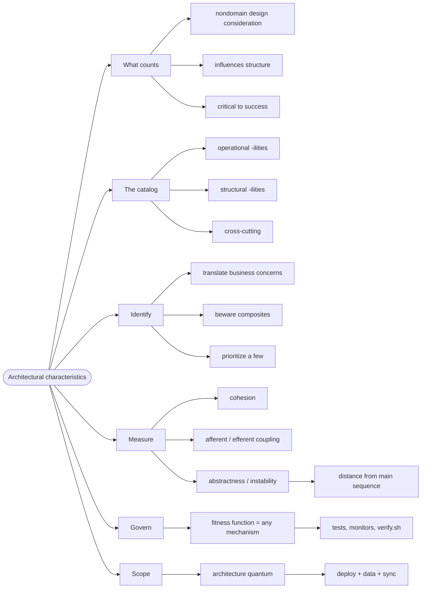

# Architectural Characteristics — Naming What Must Be True

> Source: *Fundamentals of Software Architecture* (Richards & Ford) — ch 4
> «Architectural Characteristics Defined», ch 5 «Identifying Architectural
> Characteristics», ch 6 «Measuring and Governing Architecture
> Characteristics», ch 7 «The Scope of Architectural Characteristics».

Before you choose a style, you must name what the system has to be good at.
Those qualities are called **architectural characteristics** — informally
the "-ilities". If you can't name them, you can't choose between designs,
and you can't tell whether a change made things better.

## The requirement nobody wrote down

A team builds a tournament site. The requirements say: "players can
register, view brackets, and see results." Every feature ships. Then the
first real tournament opens: two thousand players register in a minute and
the site falls over.

Nothing in the requirements was violated. What was missing was an
**implicit characteristic** — *scalability* — that nobody had named, so
nobody had designed for it. This page is the discipline of naming those
before they bite.

## 1. What counts as a characteristic

The book's three-part test, verbatim: to count, a requirement must be

> a **nondomain design consideration**, influence some **structural
> aspect** of the design, *and* be **critical or important to the
> application's success**.

The catalog, condensed:

| Family | Examples |
| --- | --- |
| **Operational** | availability, continuity, performance, recoverability, reliability, robustness, scalability |
| **Structural** | configurability, extensibility, installability, reuse, localization, maintainability, portability, upgradeability |
| **Cross-cutting** | accessibility, archivability, authentication, authorization, legal, privacy |

Characteristics are **not binary**. Each is a dial, and turning one up
usually turns another down — that is the First Law again.

## 2. Translate business concerns into characteristics

Stakeholders don't say "we need availability". They say "we're losing
customers". The architect's job is the translation — the book's table:

| Domain concern | Architectural characteristics |
| --- | --- |
| Mergers and acquisitions | interoperability, scalability, adaptability, extensibility |
| Time to market | agility, testability, deployability |
| User satisfaction | performance, availability, fault tolerance, testability, deployability, agility, security |
| Competitive advantage | agility, testability, deployability, scalability, availability, fault tolerance |
| Time and budget | simplicity, feasibility |

One trap the book names: **false equivalence**.

*Agility* is a **composite** characteristic — it has no single measurable definition; it is made of other measurable things. Don't treat a composite as if it were one dial.

## 3. Prioritize ruthlessly

An architecture that supports everything supports nothing. Pick the few
that matter and let them drive the style choice.

For each candidate, ask the design question from
[architectural-thinking](../architectural-thinking/index.md): does it need
**structural** support (architecture), or does a local pattern suffice
(design)?

## 4. Measure, then govern

You cannot keep a characteristic you don't measure. The book splits the job:

**Measuring** — metrics that make structure visible:

| Metric | Meaning |
| --- | --- |
| **Cohesion** | related code stays together |
| **Afferent coupling** | how many components depend on *me* |
| **Efferent coupling** | how many components *I* depend on |
| **Abstractness** | abstract artifacts ÷ total artifacts |
| **Instability** | efferent ÷ (efferent + afferent) |
| **Distance from the main sequence** | `D = \|A + I − 1\|` — 0 is balanced |

Metrics **steer**; they don't decide. Too many abstractions fails as surely
as too few.

**Governing** — a **fitness function**, defined verbatim as

> **any mechanism that provides an objective integrity assessment of some
> architecture characteristic or combination of architecture characteristics**.

The definition's key phrase is *any mechanism*. A fitness function is not a
product you install; it is a perspective on tools you already have:

- a test that fails when the domain layer imports infrastructure;
- a performance suite that fails on regression;
- a monitor that alerts when error rate crosses a line;
- this repo's `verify.sh`, which fails when generated nav drifts from the
  manifest.

**Why governance matters:** modularity is important but never urgent, so it
decays under deadline pressure. A fitness function is how you make an
important-but-not-urgent characteristic fail loudly.

## 5. Scope: where a characteristic lives

Characteristics have a **scope** — they apply to the whole system, or only to part of it.

The book's unit is the **architecture quantum**: the smallest set of components that must be deployed together, with their data, synchronously coupled.

- A monolith usually has **one** quantum.
- Microservices aim for **many small** ones.
- A bounded context with its own data store is usually a quantum.

This matters because you rarely need "the system is scalable" — you need
"*this* part scales", and the quantum tells you where the boundary is.

## Revise

## Cross-links

- The laws that make characteristics trade against each other:
  [architectural-thinking](../architectural-thinking/index.md).
- Modularity and components in depth:
  [modularity-and-components](../modularity-and-components/index.md).
- Fitness functions as recorded decisions:
  [decisions-and-risk](../decisions-and-risk/index.md).
- Choosing a style from these characteristics:
  [architecture-styles](../architecture-styles/index.md).
