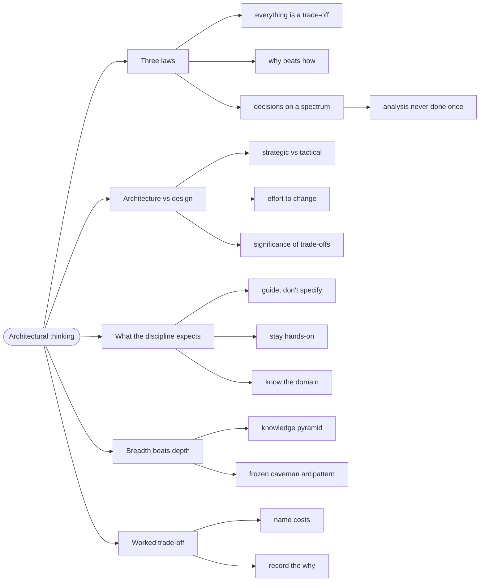

# Architectural Thinking — Trade-offs, Not Vibes

> Source: *Fundamentals of Software Architecture* (Richards & Ford) — ch 1
> (Introduction), ch 2 (Architectural Thinking), ch 27 (The Laws of
> Software Architecture, Revisited).

**Architecture** is the set of decisions that are expensive to change. This
page is about the thinking that produces those decisions — and about the
impostor version of it, which produces none.

## The fix that no comparison could produce

This repo runs on-prem Kubernetes with Traefik ingresses behind Argo CD.
Argo CD reported the app `Progressing` forever — never `Healthy` — even
with every pod Running. The cause: on-prem Traefik never sets
`status.loadBalancer`, so Argo CD's built-in Ingress health check waits
for a field that will never arrive.

```text
❌ Framework comparison: "which Ingress controller is most mature?"
   → Traefik scores well. Problem survives. Comparison has no answer.

✅ Constraint analysis: "our controller cannot populate the field that
   this health check requires"
   → Add an Argo CD health customization. Problem solved.
```

No amount of tool comparison finds that fix, because it isn't a property of
a tool — it's a property of *this deployment's* constraint. That is the
whole point of architectural thinking: **it is grounded in your constraints,
not in a market ranking.**

## 1. The three laws are tests, not slogans

The book's three laws are falsifiable — each one gives you a question you
can put to any proposal, including your own:

| Law | The test you run |
| --- | --- |
| **Everything is a trade-off** | "Show me the alternatives and what each costs." A claim of a cost-free choice means the cost hasn't been found yet. |
| **Why beats how** | "Where is the context recorded?" Anyone can read *how*; the *why* is the asset. |
| **Decisions live on a spectrum** | "Which options have significant trade-offs?" If every option is cheap to reverse, it isn't architecture. |

Two corollaries the book insists on:

- **If you can't find the trade-off, you haven't looked hard enough.**
- **Analysis is never done once** — the landscape moves, so the decision
  must be revisited.

## 2. Architecture vs design: three questions

**Architecture** is structure — the floors and roof. **Design** is
appearance and detail — the carpet. Most real decisions sit *between* the
two, and the book gives three questions to locate any one of them:

| Question | Pushes toward architecture | Pushes toward design |
| --- | --- | --- |
| **Strategic or tactical?** | weeks of planning, many stakeholders | minutes, alone |
| **Effort to change?** | monolith → microservices | rearranging fields on a screen |
| **How significant are the trade-offs?** | scalability bought with complexity, cost, and weak consistency | splitting one class into two |

Fowler's one-line version, quoted in the book: architecture is
**"the stuff that's hard to change."**

## 3. What the discipline actually expects

- **Guide, don't specify.** Point at a class of solutions, not a brand:

```text
❌ "Use React."
✅ "Use a reactive framework — React, Vue, Elm, Angular are all fine."
```

- **Stay hands-on.** The book suggests roughly half the time in code. An
  architect who never touches code loses the grounded truth that produced
  the Traefik fix above.
- **Know the domain** — domain knowledge beats framework trivia.
- **Continually analyze** — the architecture is never finished.
- **Keep current, without chasing every trend.**

## 4. Breadth beats depth — and the two ways to fail

**Technical depth** is knowing a few things very well; it is a developer's
asset and it decays if unmaintained. **Technical breadth** is knowing that
many things exist and roughly what each is for; it is an architect's asset.
The book's knowledge pyramid: *stuff you know* (small, expensive to keep),
*stuff you know you don't know* (the architect's working set), and *stuff
you don't know you don't know* (the biggest part, and the one worth
shrinking).

Two classic failures follow from ignoring this:

- **Trying to stay expert in everything** → mastery of nothing.
- **Stale expertise** — the **Frozen Caveman Antipattern**: an architect
  burned once by a rare event ("but what if we lose Italy?") who re-raises
  that one concern for every system, years after it stopped being a real
  risk.

## 5. A worked trade-off: shared library or shared service?

The book's own example, and the template for how to write one down:

| | Shared library | Shared service |
| --- | --- | --- |
| **Coupling** | build-time — compiled into each consumer | runtime — network calls |
| **Consistency** | versions can drift per consumer | one source of truth |
| **Availability** | no extra hop | adds a failure point |
| **Change** | redeploy every consumer | redeploy one service |

There is no right answer. The decision depends on **change frequency**,
**team topology**, and **availability needs**. The discipline is: name the
trade-offs, pick the least-worst fit, and record the *why* so it survives
you.

## Revise

The flowchart is the review map — walk its nodes to check coverage.



## Cross-links

- The characteristics you trade between: [architectural-characteristics](../architectural-characteristics/index.md).
- Where the trade-offs get recorded: [decisions-and-risk](../decisions-and-risk/index.md).
- Picking a style with these laws: [architecture-styles](../architecture-styles/index.md).
- The domain knowledge an architect needs: [domain-driven-design](../domain-driven-design/index.md).
