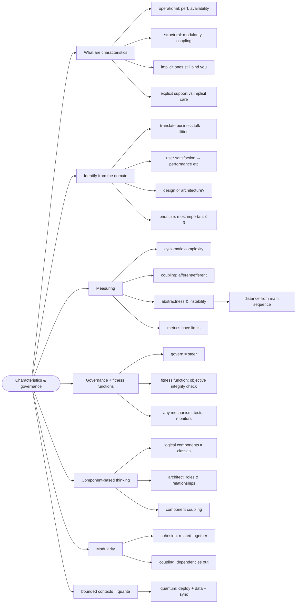

# Architecture Characteristics and Governance — Naming What Matters

> Source: *Fundamentals of Software Architecture* (Richards & Ford) —
> ch 3 (Modularity), ch 4–6 (Characteristics: Defined, Identifying,
> Measuring & Governing), ch 7 (Scope & Quanta), ch 8 (Component-Based
> Thinking).

Before choosing a style, name what the system must be good at — the
**-ilities** — then measure and *govern* them. Implicit requirements are
still requirements.

## What counts as an architecture characteristic

- **Implicit** characteristics (availability, stability, security) appear
  in no requirements document yet decide whether the site works. Explicit
  ones (target response time, scalability) are specified.
- They aren't binary checkboxes: each is a spectrum with real trade-offs
  against the others (see [architecture-thinking](../architecture-thinking/index.md)).

## Identifying: translate, then prioritize

- Stakeholders say "mergers, time-to-market, user satisfaction";
  architects say "interoperability, time-to-release, performance". The
  architect's job is **the translation**, not the vocabulary.
- Ask of each candidate: **architecture or design?** (structural support
  needed → architecture; Template Method suffices → design).
- Prioritize: an architecture supporting everything supports nothing.
  Pick the few that matter most and let those drive style selection.

## Measuring modularity

| Metric | Meaning |
| --- | --- |
| **Cohesion** | related code stays together (a module does one thing) |
| **Afferent coupling** | how many components depend on *me* |
| **Efferent coupling** | how many components *I* depend on |
| **Abstractness** | abstract artifacts ÷ concrete artifacts |
| **Instability** | efferent ÷ (efferent + afferent) |
| **Distance from main sequence** | `D = |A + I − 1|` — 0 is the ideal abstractness/instability balance |

Metrics steer; they don't decide. Too many abstractions is as real a
failure as none.

## Governance: fitness functions

- **Governance** = steering the development process so the important
  characteristics survive schedule pressure. Modularity is important but
  never urgent — hence it decays without a mechanism.
- An **architectural fitness function**: *any mechanism providing an
  objective integrity assessment of some architecture characteristic*.
  Not a framework — a perspective on existing tools: a dependency test
  that fails when the domain layer imports infrastructure; a performance
  regression suite; a monitoring alert on error rate.

## Component-based thinking

- A **logical component** = a container of related responsibilities
  ("Reference Manager": GetData, SetData, ReloadCache...). Components are
  the level an architect *sees*; classes are the developer's level.
- The architect identifies components and their **roles and
  relationships**; developers own their internal design. (This is the
  "guide, don't specify" rule from [architecture-thinking](../architecture-thinking/index.md).)
- **Component coupling** matters even without direct communication —
  shared assumptions couple too.

## Bounded contexts as quanta

- The **architecture quantum**: the smallest set of components that must
  deploy together with their data, synchronously coupled. A bounded
  context with its own store is usually a quantum.
- Quanta connect this page to DDD and to the style catalog: monoliths
  have one big quantum; microservices aim for many small ones.

## Cross-links

- DDD's bounded contexts (the domain view): [domain-driven-design](../domain-driven-design/index.md).
- Where these constraints bite — style selection: [architecture-styles](../architecture-styles/index.md).
- Fitness functions automate decisions: [architecture-decisions-and-soft-skills](../architecture-decisions-and-soft-skills/index.md).
- Trade-off discipline: [architecture-thinking](../architecture-thinking/index.md).
- Measuring instead of guessing, at code level: [functions-and-composition](../functions-and-composition/index.md).
