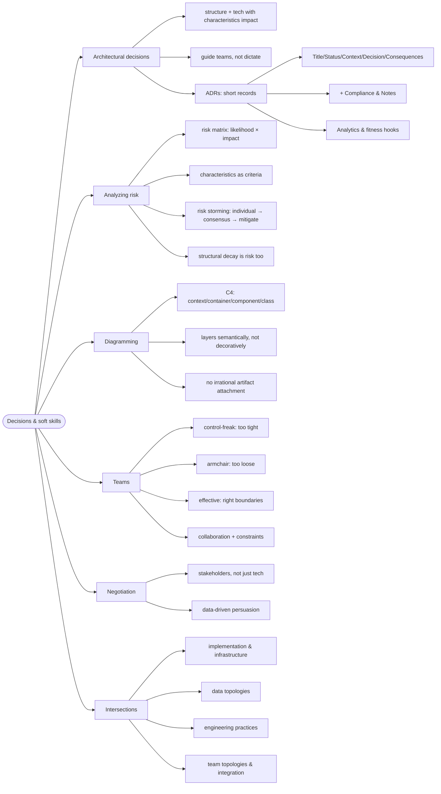

# Architecture Decisions and Soft Skills — The Human Layer

> Source: *Fundamentals of Software Architecture* (Richards & Ford) —
> ch 20–26: Architectural Patterns, Decisions (ADRs), Analyzing Risk,
> Diagramming, Making Teams Effective, Negotiation, Intersections.

Technical brilliance fails without communication. Decisions need records,
risk needs a shared language, and teams need the right kind of architect —
not too tight, not too loose.

## Making decisions: ADRs

- Architectural decisions shape **structure** or technology choices that
  impact characteristics; good ones **guide** teams to the right
  technical choices rather than dictating every detail.
- **Architecture Decision Records**: one- to two-page text/markdown per
  decision — **Title, Status, Context, Decision, Consequences** (+ the
  authors' additions: **Compliance** — how it's enforced, possibly via
  fitness functions — and **Notes**). ADRs fix the Second Law's problem:
  the *why* survives team turnover.

## Analyzing risk

- Risk = operational (availability, data integrity) **and** structural
  (coupling, decay). Use a **risk matrix** (likelihood × impact) with
  characteristics as assessment criteria.
- **Risk storming**: (1) individuals assess alone — no anchoring;
  (2) consensus on the hot spots; (3) mitigation plans. Repeat when the
  architecture changes.

## Diagramming

- **C4** (Simon Brown): zoom levels **Context → Container → Component →
  Class**. Use layers **semantically** (each layer = real meaning), not
  decoratively (boxes grouped for looks). Don't let one tool become an
  irrational artifact attachment; pick the diagram the audience needs.

## Teams: three architect personalities

| Personality | Boundaries | Result |
| --- | --- | --- |
| **Control freak** | too tight — writes the pseudocode, bans libraries | steals the craft; devs disengage |
| **Armchair** | too loose — absent, diagrams too high-level | team does the architect's work, confusion |
| **Effective** | right-sized constraints | guidance + availability + roadblocks removed |

## Negotiation

- Architecture work is persuasion across audiences: developers, managers,
  other architects. Bring **data and trade-off analysis**, not evangelism
  — the objective arbiter of trade-offs is the one who gets trusted
  (First Law in action).

## Intersections: architecture must align with…

- **Implementation** — do components match the intended structure?
- **Infrastructure** — deployment vs operational characteristics.
- **Data topologies** — monolithic vs domain-databases vs database-per-
  service must match the style.
- **Engineering practices** — TDD/deployment pipeline vs the style.
- **Team topologies** — org structure vs intended architecture.
- **Systems integration** — what you must talk to; ignoring this is how
  reliability dies.

## Cross-links

- ADRs record the trade-offs of the First Law: [architecture-thinking](../architecture-thinking/index.md).
- Fitness functions enforce ADR compliance: [architecture-characteristics-and-governance](../architecture-characteristics-and-governance/index.md).
- The styles these decisions choose between: [architecture-styles](../architecture-styles/index.md).
- Data topologies ↔ aggregates: [domain-modeling-with-types](../domain-modeling-with-types/index.md).
- Team boundaries ↔ bounded contexts: [domain-driven-design](../domain-driven-design/index.md).
