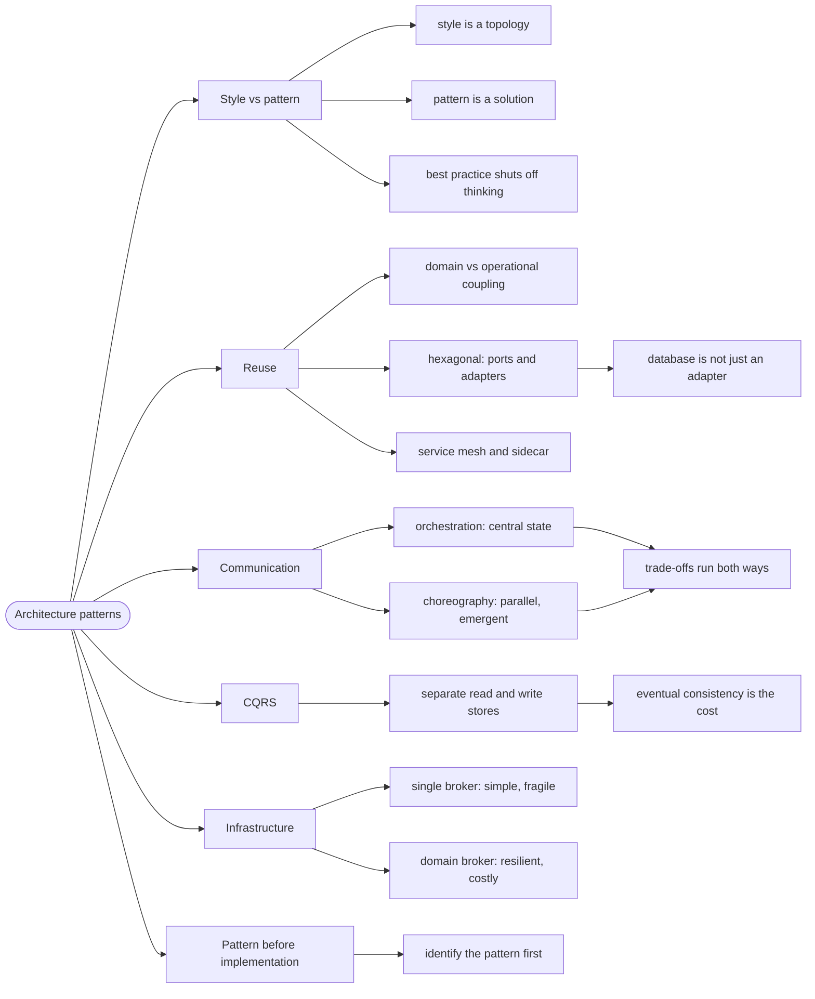

# Architecture Patterns — Named Solutions, Not Styles

> Source: *Fundamentals of Software Architecture* (Richards & Ford) — ch 20
> «Architectural Patterns».

A **style** is a whole topology — layered, microservices, event-driven.

A **pattern** is a smaller, contextualized solution to a recurring problem that can appear inside any style. Confusing the two is how teams end up arguing about patterns as if they were architectures.

## The "best practice" that shut down thinking

The book's warning is blunt: calling something a **best practice** implies
the architect has a *duty* to use it whenever the situation arises. That
word ends the conversation — "we call it the *best* practice, allowing
architects to shut off their brains".

Patterns are not best practices. Each one below has a cost, and the cost is
the part worth remembering.

## 1. Reuse: separating domain from operational concerns

Two kinds of coupling are routinely confused:

- **Domain coupling** — services share business concepts.
- **Operational coupling** — services share monitoring, logging,
  authentication, circuit breakers.

Microservices want low domain coupling and high operational consistency —
and those pull in opposite directions. Two patterns resolve the tension.

**Hexagonal (Ports and Adapters)** puts the domain in the centre, with
ports and adapters around it. The book flags a trap: it treats the database
as *just another adapter*, which predates the insight that **database
schemas are business logic**. Using the name as shorthand for "separate
domain from operational concerns" is fine; taking the data isolation
literally violates a microservices principle.

**Service Mesh / Sidecar** is the modern implementation — a sidecar per
service handles the operational concern, consistently:

| Advantages | Disadvantages |
| --- | --- |
| consistent isolated coupling | a sidecar per platform |
| consistent infrastructure coordination | the sidecar can grow large |
| ownership per team or centralized | implementation drift between teams |

## 2. Communication: orchestration vs choreography

Both implement the same workflow; they differ in who owns it.

| | **Orchestration** | **Choreography** |
| --- | --- | --- |
| **Coordinator** | a central orchestrator | none |
| **State** | queryable, in one place | distributed, emergent |
| **Error handling** | centralized, easier | each service must know the workflow |
| **Recoverability** | retries from one place | harder |
| **Throughput** | orchestrator is a bottleneck | more parallelism |
| **Fault tolerance** | orchestrator is a single point of failure | no single point |
| **Coupling** | tighter | looser |

The book's framing is the Second Law in action: **you can't do trade-off
analysis once and be done.** Both are correct; which one is correct *here*
depends on whether you need a queryable workflow state or maximum
parallelism.

## 3. CQRS: split reads from writes

**CQRS** (Command-Query Responsibility Segregation) splits one datastore
into two: writes go to one store, which synchronizes to a read store.

```text
❌ client/server:  client → app → one database (reads and writes mixed)

✅ CQRS:           client → app → write store
                             ↘ sync → read store → client
```

Use it when read and write volumes differ sharply, or when reads and writes
need different models or different security. The cost is the synchronization
lag between the two stores — reads are eventually consistent.

## 4. Infrastructure: one broker or one per domain

| | **Single Broker** | **Domain-Broker** |
| --- | --- | --- |
| **Discovery** | centralized, easy | harder |
| **Infrastructure** | least possible | more, and more expensive |
| **Fault tolerance** | one broker down stops everything | isolated |
| **Scalability** | broker becomes a bottleneck | scales with domains |
| **Fit** | simple systems | domain-partitioned systems |

The trade is the same shape as everything else in this book: **centralize
for simplicity, distribute for resilience.**

## 5. Patterns vs implementations

The book's most practical warning: many tools, frameworks, and libraries
*encapsulate* one or more patterns, with varying fidelity and intermingled
with others.

So the order of work is:

1. **Identify the pattern** the problem needs.
2. **Then** choose the implementation.

Doing it in the other direction — picking the tool first — is how you end up
with a service mesh solving a coupling problem you didn't have.

## Revise



## Cross-links

- The styles these patterns live inside:
  [architecture-styles](../architecture-styles/index.md).
- Recording which pattern and why: [decisions-and-risk](../decisions-and-risk/index.md).
- Domain boundaries that make domain-broker sensible:
  [domain-driven-design](../domain-driven-design/index.md).
- Coupling and cohesion: [modularity-and-components](../modularity-and-components/index.md).
