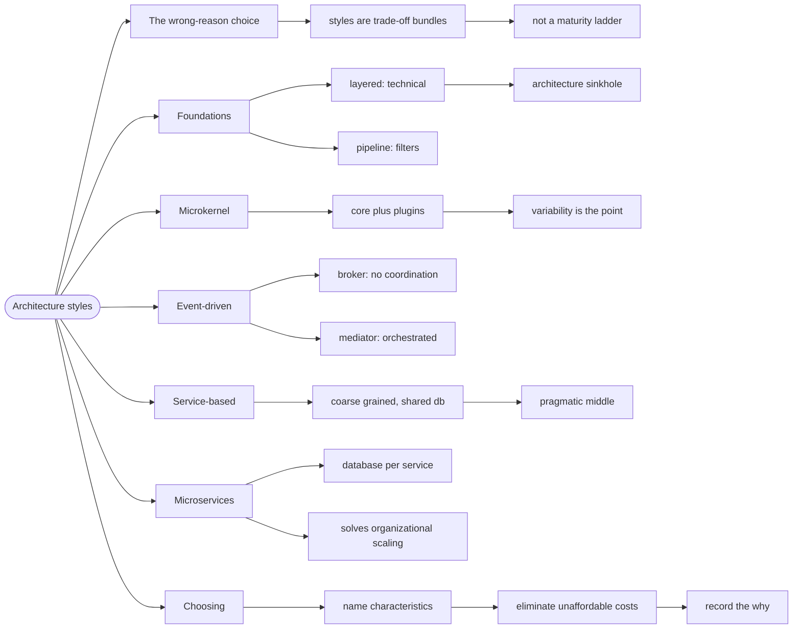

# Architecture Styles — Choosing a Shape

> Source: *Fundamentals of Software Architecture* (Richards & Ford) — ch 9
> «Foundations», ch 10 «Layered», ch 11 «The Modular Monolith», ch 12
> «Pipeline», ch 13 «Microkernel», ch 14 «Service-Based», ch 15
> «Event-Driven», ch 16 «Space-Based», ch 18 «Microservices», ch 19
> «Choosing the Appropriate Architecture Style».

An **architecture style** is a named, reusable structural pattern — layered,
pipeline, microkernel, event-driven, microservices. Each one is a bundle of
decisions with known trade-offs. Choosing a style is choosing which
trade-offs to accept.

## The style chosen for the wrong reason

A team reads that microservices are what serious companies use, so they
build fifteen services for a product with three users. Now every feature
needs a distributed transaction, a network hop, and a deploy pipeline —
costs paid against benefits nobody needed.

The book's framing is the antidote: styles are not a maturity ladder. They
are **trade-off bundles**, and the correct one is the one whose *costs you
can afford* and whose *benefits you actually need*.

## 1. The two foundational styles

Nearly every style is built from two primitives:

| Style | Partitioning | Topology |
| --- | --- | --- |
| **Layered** | technical (presentation, business, persistence) | closed layers — a request passes through each |
| **Pipeline** | technical (filters) | one-way, unidirectional flow |

**Layered** is the default in most frameworks, and the book is blunt about
its cost: it produces the **"architecture sinkhole"** — requests that pass
through every layer doing nothing but forwarding. Its fitness function:
*what percentage of requests are sinkholes?*

**Pipeline** (pipes and filters) is right when a process is a sequence of
independent transformations — ETL, compilers, request middleware. Its
strength is composability; its weakness is that it is terrible at
interactive, branching workflows.

## 2. Microkernel: core plus plugins

A **microkernel** splits a system into a small *core system* and independent *plugins*.

- **Core**: the minimum to run — registry, contract, lifecycle.
- **Plugins**: variable behaviour, added and removed independently.

Choose it when the *variability* is the point: an IDE, a rules engine, a
product with per-tenant customizations. The trade: the core must be designed
up front, and plugin contracts are hard to change later.

## 3. Event-driven: broker and mediator

| | **Broker** | **Mediator** |
| --- | --- | --- |
| **Coordination** | none — events go to a topic | a central mediator orchestrates |
| **Coupling** | very low | moderate |
| **Workflow visibility** | none (emergent) | explicit |
| **Failure handling** | hard to reason about | centralized |
| **Best for** | high scalability, loose coupling | complex multi-step workflows |

The broker's cost is exactly what makes it attractive: with no orchestrator,
**nobody knows the end-to-end workflow**. That is fine for fire-and-forget
events and painful for anything that must complete reliably.

## 4. Service-based: the pragmatic middle

A **service-based** architecture is a coarse-grained distributed system —
typically a handful of services (4–12) sharing a database, with
domain-partitioned services.

It gives you most of the deployability of microservices without the
distributed-data problem, which is why the book calls it the most pragmatic
distributed style. If you are unsure whether you need microservices, you
almost certainly want this.

## 5. Microservices: the expensive one

| Characteristic | Microservices |
| --- | --- |
| **Partitioning** | fine-grained, domain |
| **Data** | database per service — no shared schema |
| **Coupling** | very low, but *distributed* |
| **Deployment** | independent |
| **Cost** | distributed transactions, network failure, operational overhead |

The book's warning: microservices solve **organizational** scaling problems
(many teams shipping independently). If you do not have that problem, you are
paying the costs for a benefit you cannot use.

## 6. How to choose

The method, in order:

1. **Name the characteristics** you need (see
   [architectural-characteristics](../architectural-characteristics/index.md)).
2. **Eliminate** styles whose costs you cannot afford — this is usually the
   decisive step, and it is subtraction, not ranking.
3. **Check the fit** on the remaining candidates against your top two or
   three characteristics.
4. **Record the decision and its why** (see
   [decisions-and-risk](../decisions-and-risk/index.md)).

| If your priority is… | Consider |
| --- | --- |
| simplicity, small team | layered or modular monolith |
| independent deployability, many teams | service-based, then microservices |
| extensibility / per-tenant variation | microkernel |
| throughput and loose coupling | event-driven (broker) |
| complex orchestrated workflow | event-driven (mediator) |
| volatile load | space-based / elastic |

**The modular monolith deserves a mention** the book makes implicitly: if
your domain is well partitioned (see
[modularity-and-components](../modularity-and-components/index.md)), a
monolith gives you most of the modularity benefits with none of the
distributed costs. You can extract a service later — the partitioning is the
hard part, and it is the same work either way.

## Revise

## Cross-links

- The characteristics you choose between:
  [architectural-characteristics](../architectural-characteristics/index.md).
- Partitioning before distribution:
  [modularity-and-components](../modularity-and-components/index.md).
- Recording the decision: [decisions-and-risk](../decisions-and-risk/index.md).
- The laws behind the trade-offs:
  [architectural-thinking](../architectural-thinking/index.md).
