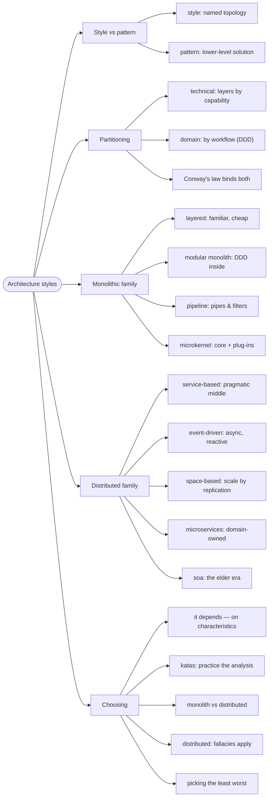

# Architecture Styles — The Catalog of Shapes

> Source: *Fundamentals of Software Architecture* (Richards & Ford) —
> ch 9 (Foundations) through ch 19 (Choosing the Appropriate Style).

A style defines **topology** (component shapes, communication, data) and
fall within two families: **monolith** (one deployment unit) and
**distributed** (many units, network calls). Every style is a trade-off
bundle — none is "best".

## Foundations: styles, partitioning, Conway

- **Style** = topology + deployment + communication + data shapes.
  **Pattern** = a smaller, reusable solution inside a style.
- **Technical partitioning** (presentation/business/persistence layers):
  familiar, cheap to staff — but every workflow cuts across all layers.
  **Domain partitioning** (components by workflow, from DDD): workflows
  change in one place.
- **Conway's Law**: designs copy the organization's communication
  structure. Want domain-partitioned software? Arrange teams that way
  (**Inverse Conway Maneuver** / team topologies).

## The monolithic family

| Style | Idea | Best when |
| --- | --- | --- |
| **Layered** | technical layers, top-down calls | simplicity/familiarity dominate; beware "accidental architecture" |
| **Modular monolith** | domain-partitioned, single deploy | DDD fits, no distributed costs; the modern default candidate |
| **Pipeline** | filters connected by pipes | streams, ETL, batch — each filter transforms independently (producers/consumers over topics, à la Kafka); including DMMF's workflow pipelines |
| **Microkernel** | core system + plug-ins | product apps with per-customer customization |

## The distributed family

- **Service-based**: a few coarse services (UI + domain + DB each),
  pragmatic and cost-effective — microservices' calmer sibling.
- **Event-driven**: decoupled processors reacting to events. Choreography
  (broadcast) vs **mediator topology** (an orchestrator controls the
  workflow); highly scalable, but eventual consistency and workflow
  debugging are the price.
- **Space-based**: replicate processing units + in-memory data grids to
  shed the database bottleneck under bursty load.
- **Microservices**: one service per bounded context, **database per
  service**, independent deploys. Buys scalability/agility/fault
  tolerance, pays in operational complexity and data consistency.
- **Orchestration-driven SOA**: the ESB-centric predecessor — a lesson in
  how eras age.

## Choosing: it depends, on what?

- Never binary — score styles against the prioritized characteristics
  from [architecture-characteristics-and-governance](../architecture-characteristics-and-governance/index.md)
  and the domain's needs; pick the **least worst** fit.
- Practice with **architecture katas** (Silicon Sandwiches is the book's
  running case).
- Monolith vs distributed is the first fork: distributed styles share
  known challenges — network reliability, latency, bandwidth, security,
  consistency. Don't pay that tax without a reason.

## Cross-links

- The laws that forbid "best" answers: [architecture-thinking](../architecture-thinking/index.md).
- DDD → domain partitioning → modular monolith / microservices:
  [domain-driven-design](../domain-driven-design/index.md).
- Pipelines as code: [workflows-and-error-handling](../workflows-and-error-handling/index.md).
- Quanta and fitness functions that police the style: [architecture-characteristics-and-governance](../architecture-characteristics-and-governance/index.md).
- Recording the choice as an ADR: [architecture-decisions-and-soft-skills](../architecture-decisions-and-soft-skills/index.md).
