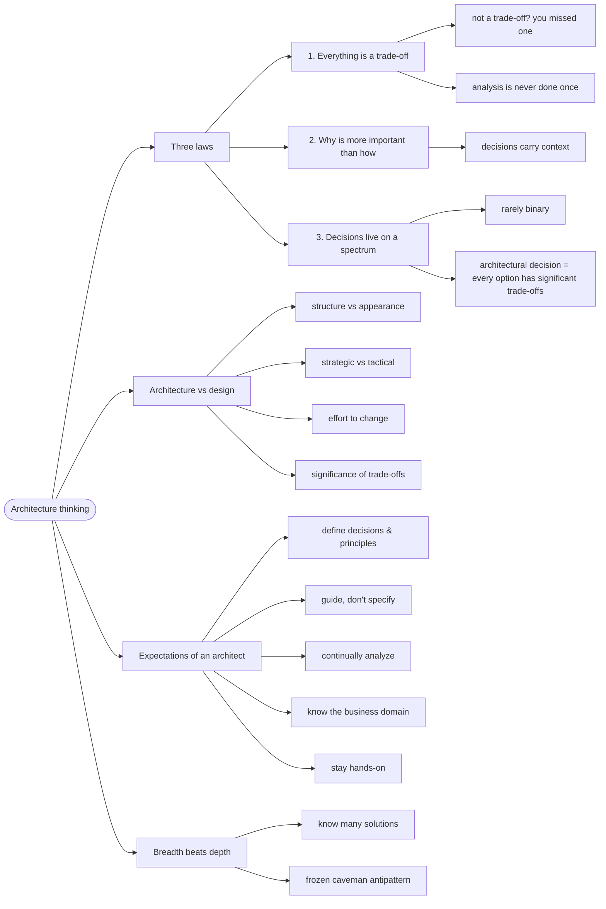

# Architecture Thinking — The Architect's Eye

> Source: *Fundamentals of Software Architecture* (Richards & Ford) —
> ch 1 (Introduction), ch 2 (Architectural Thinking), ch 27 (Laws of
> Software Architecture, Revisited).

Architecture is a role, not a promotion. An architect analyzes trade-offs,
guides (never specifies) technology choices, and owns the *why* behind
decisions. Most of the job is judgment under uncertainty.

## The decision that no comparison could make

This repo runs on-prem Kubernetes with Traefik ingresses behind Argo CD.
Argo CD kept reporting the app `Progressing` — never `Healthy` — even with
all pods Running. The reason: on-prem Traefik never sets
`status.loadBalancer`, so Argo CD's built-in Ingress health check waits
forever.

The fix (an Argo CD health customization in the cluster config) is a
**real architectural decision**: it was invisible to any framework
comparison, because it's grounded in *this deployment's* constraint —
on-prem Traefik + Argo CD co-existing. No amount of "pick the most mature
tool" produces it. What records it is not the code but the *why* — the
trade-off analysis written next to it, so a future maintainer doesn't rip
out the "weird" customization and wait for the built-in check that can
never succeed.

That is what the book means by *why is more important than how* — and why
"fake hypotheticals without grounded truth" (talk without a decision,
trade-off, or constraint attached) is the anti-skill this page guards
against.

## 1. The three laws — a discipline, not a mood

The book's three laws are falsifiable working habits, not vibes. Each one
gives you a test you can run on any proposal, including your own:

- **Everything in software architecture is a trade-off.** Test: show me
  the alternatives and the cost of each. If someone claims a cost-free
  choice, they haven't identified the cost *yet*.
- ***Why* is more important than *how*.** Test: the decision exists with
  its context recorded (this repo's `AGENTS.md` and runbook entries do
  exactly this). Anyone can read *how*; the *why* is the hard-won part.
- **Most decisions aren't binary — they live on a spectrum.** Test: *an
  architectural decision is one where every option has significant
  trade-offs.*

```text
❌ "Should we use microservices or a modular monolith?"   (binary framing)
✅ "Which characteristics matter most here, and what does
    each option cost us on those?"                        (trade-off framing)
```

And trade-off analysis is **never done once** — the landscape changes, so
the decision must be revisited.

## 2. Architecture vs design: three questions

**Architecture** is structure (the house: floors, roof); **design** is
appearance and detail (carpet, wall color). Most decisions sit *between*
the two — three questions locate any decision on that spectrum (FSA ch 2):

- **Strategic or tactical?** Weeks of planning and many stakeholders →
  architectural. Minutes, alone → design.
- **Effort to change?** Fowler: architecture is "the stuff that's hard to
  change." Monolith → microservices: architecture. Rearranging fields on a
  screen: design.
- **How significant are the trade-offs?** Microservices buy scalability
  and fault tolerance at the price of complexity, cost, and poor data
  consistency — significant → architectural. Splitting a class file: minor
  trade-offs → design.

## 3. What the discipline expects

- **Guide, don't specify** — decisions and principles point at a *class*
  of solutions, not a brand:
  ```text
  ❌ "Use React."
  ✅ "Use a reactive framework — React, Vue, Elm, Angular are all fine."
  ```
- **Continually analyze** the architecture — it's never finished.
- **Keep current** with trends — without chasing each one.
- **Ensure compliance** with the decisions made.
- **Know the business domain** — domain knowledge beats framework trivia.
- **Stay hands-on**: balance coding with leading (~50% is the book's
  suggestion). The architect who doesn't touch code loses the grounded
  truth this page opened with.
- **Interpersonal skills**: negotiation, documentation, guidance — the
  book calls them, ironically, the hardest part.

## 4. Breadth beats depth — and the two ways to fail

**Technical depth** is knowing a few things very well (a developer's
asset). **Technical breadth** is knowing many things exist and roughly
what they're for (an architect's asset). The knowledge pyramid: *stuff
you know* (small, expensive to maintain), *stuff you know you don't know*
(the architect's working set), *stuff you don't know you don't know* (the
goal: move things up out of it). The book's advice: sacrifice some depth
to widen the middle band — it's more valuable to know *five solutions
exist* for a problem than to have singular expertise in one.

Two classic failures come from ignoring this:

- Trying to keep expert-level depth in everything → mastery of nothing.
- **Stale expertise** — the *Frozen Caveman Antipattern* (FSA ch 2): an
  architect burned once ("but what if we lose Italy?") who re-raises that
  one pet concern for every architecture, years after it stopped being a
  realistic risk.

## 5. A worked trade-off: shared library vs shared service

FSA ch 27's worked example — the three laws applied to one real decision:

| | Shared library | Shared service |
| --- | --- | --- |
| Coupling | build-time (compiled in) | runtime (network calls) |
| Consistency | versions drift per consumer | single source of truth |
| Availability | no extra hop | adds a failure point |
| Change | redeploy every consumer | redeploy one service |

No "right answer" exists — the pick depends on change frequency, team
topology, and availability needs. The discipline is: name the trade-offs,
pick the least-worst fit, write down the *why*.

## Revise

The flowchart below is the **review map** of this page — each node a chunk
you just walked. Don't try to learn from it; use it to check coverage.



## Cross-links

- The First Law in action when picking styles: [architecture-styles](../architecture-styles/index.md).
- Trade-offs inside a codebase (abstraction vs efficiency): [functions-and-composition](../functions-and-composition/index.md).
- Architecture decisions get recorded as ADRs: [architecture-decisions-and-soft-skills](../architecture-decisions-and-soft-skills/index.md).
- Domain knowledge also drives the model: [domain-driven-design](../domain-driven-design/index.md).
