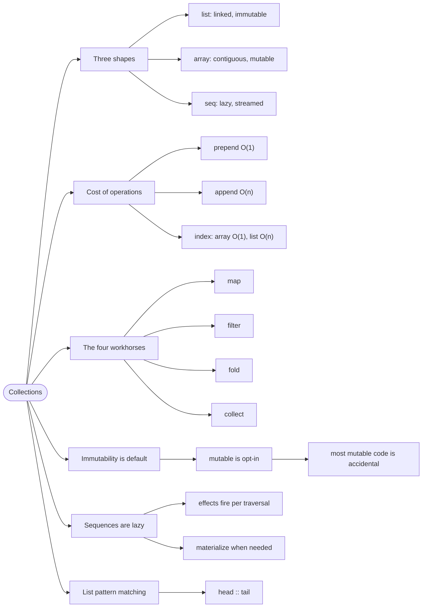

# Collections — Lists, Arrays, Sequences

> Source: *Stylish F# 6* (Eason) — ch 4 «Working Effectively with
> Collection Functions», ch 5 «Immutability and Mutation», ch 12
> «Performance».

F# gives you three everyday collections, and choosing the wrong one is a performance and correctness decision, not a matter of taste.

**Lists** are immutable linked lists, **arrays** are fixed-size mutable blocks, and **sequences** are lazily evaluated views.

## The `List.append` in the loop

```fsharp
// ❌ quadratic by accident — append copies the whole left list every time
let mutable acc = []
for item in items do
    acc <- acc @ [ item ]        // O(n) per step, O(n²) total
```

It works on 100 items and hangs on 100,000. The bug is not in the logic; it
is in the collection operation. Reversing the mental model — *prepend, then
reverse once* — makes it linear:

```fsharp
// ✅ prepend is O(1); reverse once at the end
let acc =
    items
    |> List.fold (fun state item -> item :: state) []
    |> List.rev
```

That is the whole lesson of this page: **each collection has a shape, and
operations that fight the shape are expensive.**

## 1. The three shapes

| | `list` | `array` | `seq` |
| --- | --- | --- | --- |
| **Structure** | linked list, immutable | contiguous block, mutable | lazy, possibly infinite |
| **Prepend** | O(1) | O(n) | — |
| **Index access** | O(n) | O(1) | O(n) |
| **Memory** | higher per element | lowest | lowest (streamed) |
| **Use when** | you build it and traverse it | you need index or speed | the source is huge or I/O |

Rules of thumb:

- **Default to `list`** for domain data — it is immutable and pattern
  matches beautifully (`head :: tail`).
- **Use `array`** when you need indexed access or you are crossing a .NET
  boundary.
- **Use `seq`** for large or streamed sources, or when you only need one
  pass.

## 2. The four functions that do most of the work

| Function | Does | Example |
| --- | --- | --- |
| `map` | transform every element | `players \|> List.map (fun p -> p.Name)` |
| `filter` | keep some elements | `players \|> List.filter (fun p -> p.IsActive)` |
| `fold` | collapse to one value | `orders \|> List.fold (fun s o -> s + o.Amount) 0m` |
| `collect` | map, then flatten | `orders \|> List.collect (fun o -> o.Lines)` |

Note `fold`'s argument order: **state first, element second**. That shape is
what makes it composable with partial application.

`List.sumBy` and `List.countBy` are `fold` with the noise removed — prefer
them when they fit:

```fsharp
let total = orders |> List.sumBy (fun o -> o.Amount)
let byStatus = orders |> List.countBy (fun o -> o.Status)
```

## 3. Immutability is the default, and that is the point

F# values are immutable unless you write `mutable`. SF6 ch 5 shows why that
default pays — a linear search, written the imperative way:

```fsharp
// ❌ SF6 Listing 5-4 — mutable cursor, accumulator, and flag
let mutable result = None
let mutable rest = items
let mutable found = false
while not found && not rest.IsEmpty do
    if predicate rest.Head then
        result <- Some rest.Head
        found <- true
    rest <- rest.Tail
result
```

Four mutable things, a loop, and an off-by-one risk — to express "find the
first match". The library version:

```fsharp
// ✅ SF6 Listing 5-5 — one line, no mutable state
let tryFindFunctional (predicate: 'T -> bool) (items: 'T list) =
    items |> List.tryFind predicate
```

The lesson is not "never use `mutable`". It is that **most mutable code is
accidental** — it re-implements a library function, badly.

When mutation *is* right: tight numeric loops, or building a large array
where copying would dominate. SF6's guidance is to confine it to a small
scope and never let a mutable value escape.

## 4. Sequences are lazy — and that surprises people

```fsharp
// ❌ this does nothing yet — seq is lazy
let doubled = items |> Seq.map (fun x -> printfn "processing %d" x; x * 2)

// ✅ the work happens here, on traversal
for d in doubled do printfn "%d" d
```

Two consequences:

- **Side effects in a `Seq` pipeline fire on each traversal**, not once.
  Traverse twice, print twice.
- **A `Seq` over a database is a query executed at traversal time** — which
  is either exactly what you want (streaming) or a nasty surprise (N+1).

If you need the values computed once, materialize with `List.ofSeq` or
`Array.ofSeq`.

## 5. Pattern matching on lists

The linked-list shape is why this works:

```fsharp
// ✅ head :: tail is O(1) and total
let rec sum items =
    match items with
    | [] -> 0
    | head :: tail -> head + sum tail
```

The compiler warns if you forget `[]`. Prefer library functions for
everyday work, but reach for this shape when you need to look at the first
few elements and the rest.

## Revise



## Cross-links

- Composing these into pipelines:
  [functions-and-composition](../functions-and-composition/index.md).
- Immutability as a design principle:
  [immutability-and-state](../immutability-and-state/index.md).
- Streaming in a workflow:
  [workflows-as-pipelines](../workflows-as-pipelines/index.md).
