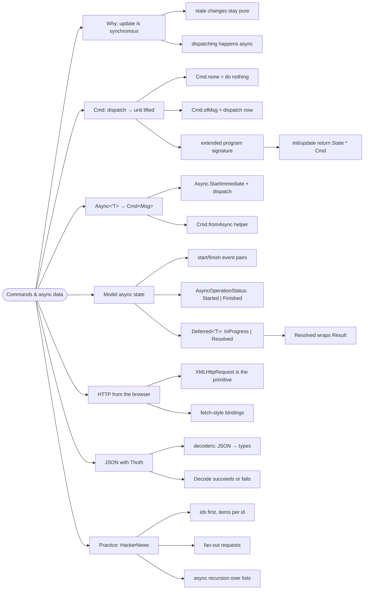

# Commands and Async Data — Side Effects in the Loop

> Source: *The Elmish Book* (Zaid Ajaj) — part 3 (Commands in Elmish):
> commands, definition, async-updates, async-to-cmd, async-state,
> deferred-module-utilities, http, xhr-elmish, working-with-json,
> using-json, elmish-hackernews.

`update` is synchronous — so how does an app call an HTTP endpoint? With
**commands**: values that can dispatch messages later. The pattern is
always start-event → side effect → finish-event.



## Why commands exist

`update : Msg -> State -> State * Cmd<Msg>` — the **state transition stays
synchronous** (easy to reason about and test); only the *dispatching* of
follow-up events happens asynchronously. Concurrent async state updates
are where the "interesting" bugs live; TEA refuses to go there.

A command is essentially a function that takes `dispatch` and returns
`unit` — it decides **when** (now, later, never) to fire a message. The
view keeps dispatching user events exactly as before
(`prop.onClick (fun _ -> dispatch Increment)`); what's new is that
`update` can *also* trigger follow-up events through commands:

```fsharp
val command : (Msg -> unit) -> unit      // the essence
let none : Cmd<Msg> = Cmd.ofSub (fun _ -> ())   // do nothing
```

Using commands changes the program triplet: `init : unit -> State *
Cmd<Msg>` and likewise for `update` — bootstrapping and every transition
can kick off work.

## From `Async<'T>` to `Cmd<Msg>`

```fsharp
let incrementDelayed : Cmd<Msg> =
    Cmd.ofAsync afterDelay Increment               // conceptually:
//   async { do! Async.Sleep 1000; dispatch Increment }
```

- Write the effect once as `Async<'T>`; `Cmd.fromAsync` / `Cmd.ofAsync`
  turn it into a command that dispatches the finished event with the
  result. Failures dispatch the error branch — no hidden try/except.

## Modeling asynchronous state

Every async operation becomes a **start/finish event pair**. Instead of
per-operation message pairs (which multiply), wrap the status:

```fsharp
type AsyncOperationStatus<'t> = Started | Finished of 't
type Msg = LoadData of AsyncOperationStatus<Result<Data, string>>

type Deferred<'T> =
    | NotStarted | InProgress
    | Resolved of Result<'T, string>      // Resolved carries success OR failure
```

- The UI matches on `Deferred` to render exactly the four states:
  placeholder / spinner / data / error — no booleans like `isLoading` and
  `hasError` fighting each other.
- Helper utilities (`Deferred.exists`, mappings) keep render code tidy.

## HTTP and JSON

- The browser primitive is `XMLHttpRequest` (despite the name, it carries
  JSON fine); bindings expose it to F#. Higher-level: `fetch` bindings.
- The book builds it from scratch first (XHR → async XHR) so the pattern
  is visible, then uses it in anger.
- **Thoth.Json** decoders turn JSON into your types — parse, don't
  validate: JSON that doesn't fit becomes an `Error` you can render, not a
  runtime crash.

## Practice: HackerNews clone

The public HackerNews API returns **ids first**: the `topstories` endpoint
yields 500 story ids, and each item needs its own request. Stories come in
categories (`Top`, `Best`, `New`, ...), selected via **filter tabs**, and
each story may carry comments — more per-item loads. The chapter wires up:
load ids → fan out per-story requests → async-recursive updates → render.
It is the full command + Deferred + decoder toolkit in one realistic app,
plus exercises to extend it.

## Cross-links

- `Result`/`bind` — the same two-track shape: [workflows-and-error-handling](../workflows-and-error-handling/index.md).
- Where the data comes from (DDD workflows server-side): [domain-driven-design](../domain-driven-design/index.md).
- Passing loaded data between pages: [scaling-and-routing](../scaling-and-routing/index.md).
- Bundling/webpack serving the app: [dev-workflow](../dev-workflow/index.md).
- Data at the edges as an architecture concern: [architecture-styles](../architecture-styles/index.md).
