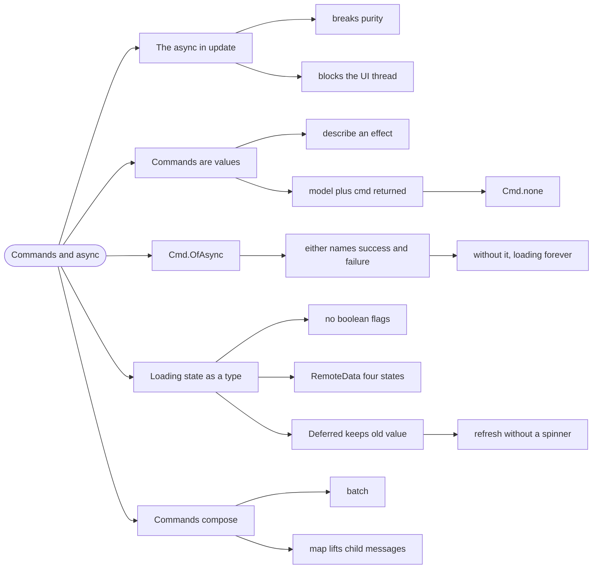

# Commands and Async — Effects Without Breaking Purity

> Source: *The Elmish Book* — `commands/definition.md`,
> `commands/async-to-cmd.md`, `commands/async-state.md`.

`update` is pure, so it cannot call a server. **Commands** are how Elmish
keeps the loop pure while still performing side effects: `update` returns a
*description* of the effect, and the runtime performs it.

## The `async` call in the update

```fsharp
// ❌ update is supposed to be pure — this makes it untestable and racy
let update msg model =
    match msg with
    | Load -> 
        let data = Http.getSync "/api/games"   // blocks the UI thread
        { model with Games = data }
```

Two problems at once: the function is no longer pure (so it cannot be
tested without a server), and the call blocks the UI. Elmish's whole
guarantee — one pure function per message — is broken.

## 1. Commands are values

A **command** is a value that describes a side effect. Its type, from the
book's definition:

```fsharp
// val command : (Msg -> unit) -> unit
```

A command is a function that receives `dispatch` and eventually calls it
with a message. `update` returns `Model * Cmd<Msg>` — the new model, plus a
description of what should happen next.

```fsharp
// ✅ update stays pure; the effect is a value it returns
let update msg model =
    match msg with
    | Load ->
        { model with Status = Loading }, Cmd.OfAsync.either fetchGames () GotGames Failed
    | GotGames games ->
        { model with Games = games; Status = Loaded }, Cmd.none
```

`Cmd.none` is the empty command — no effect. Every branch returns a command,
so the shape is uniform.

## 2. `Cmd.OfAsync` wraps an async

The common case is an `Async<'T>` that produces a message:

```fsharp
// ✅ run an async, dispatch the result or the error
Cmd.OfAsync.either
    (fun () -> api.GetGames())     // the async
    ()                             // its argument
    (fun games -> GotGames games)  // success message
    (fun ex -> LoadFailed ex.Message)  // failure message
```

The book also shows the manual version, `Cmd.ofAsync`, when you want
`Result` instead of two callbacks.

**`either` is usually what you want**: it forces you to name the failure
path, which is exactly the discipline
[errors-and-result](../errors-and-result/index.md) asks for. Without it,
a failed request leaves the UI in `Loading` forever.

## 3. Model the loading state as a type

The naive model uses flags:

```fsharp
// ❌ three booleans, eight combinations, most of them nonsense
type Model =
    { Games: Game list
      IsLoading: bool
      HasError: bool
      ErrorMessage: string }
```

This is the illegal-state problem from
[modeling-with-types](../modeling-with-types/index.md), in the UI. The book
solves it with a type — either the built-in pattern:

```fsharp
// ✅ the book's shape: a status plus the last value
type AsyncOperationStatus<'T> =
    | Started
    | Finished of 'T

type Model =
    { Status: AsyncOperationStatus<Game list> }
```

or the four-state form this repo uses:

```fsharp
// ✅ NotAsked | Loading | Loaded | Failed — every state legal, none ambiguous
type RemoteData<'T> =
    | NotAsked
    | Loading
    | Loaded of 'T
    | Failed of string
```

With either shape, the view must answer for every state, and "loading
forever" becomes impossible to represent accidentally — because `Loading`
and `Loaded` cannot both be true.

## 4. `Deferred`: keep the old value while loading

A refinement the book covers: when refreshing, you usually want to show the
**previous** data rather than a spinner:

```fsharp
// ✅ Deferred = NotAvailable | HasValue of 'T * status
type Deferred<'T> =
    | NotAvailable
    | HasValue of 'T * AsyncOperationStatus<'T>
```

The distinction matters for UX: `NotAvailable` means "nothing to show",
while `HasValue(old, Loading)` means "show `old` with a refresh indicator".
Flattening both into `Loading` throws away information the user wants.

## 5. Commands compose

`Cmd.batch` runs several; `Cmd.map` lifts a child's command into the
parent's message type (the key to composing components — see
[scaling-and-routing](../scaling-and-routing/index.md)):

```fsharp
// ✅ several effects at once
Cmd.batch [
    Cmd.OfAsync.either loadGames () GotGames Failed
    Cmd.OfAsync.either loadNews () GotNews Failed
]

// ✅ lift a child command into the parent's Msg
Cmd.map ChildMsg childCmd
```

## 6. Why this is worth the ceremony

| Property | Consequence |
| --- | --- |
| `update` stays pure | testable with no server, no browser |
| effects are values | you can log, batch, or ignore them |
| failure is a message | the error path is exercised like any other |
| trace is complete | every effect and its result appears in the message log |

The cost is one extra type (`Cmd<Msg>`) and the discipline of naming the
failure message. In exchange, the entire data-loading story becomes
inspectable — which is why the debugging rule in this repo is "read the
message trace first".

## Revise



## Cross-links

- The loop commands plug into: [fable-and-elm](../fable-and-elm/index.md).
- Composing components: [scaling-and-routing](../scaling-and-routing/index.md).
- Failure as a value: [errors-and-result](../errors-and-result/index.md).
- Illegal states in a model: [modeling-with-types](../modeling-with-types/index.md).
