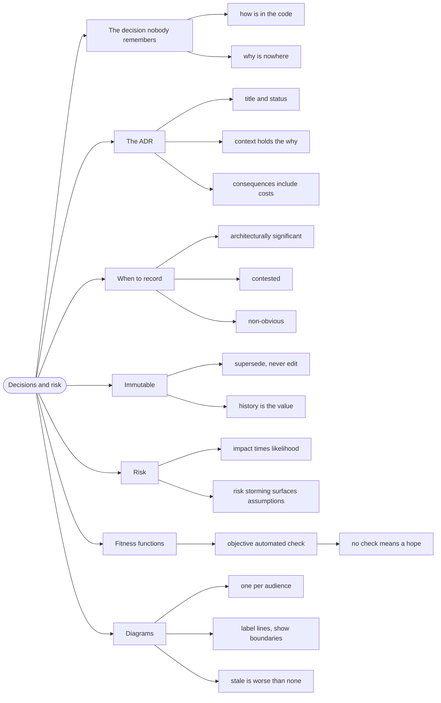

# Decisions and Risk — Recording the Why

> Source: *Fundamentals of Software Architecture* (Richards & Ford) — ch 19
> (Architecture Decisions), ch 20 (Analyzing Architecture Risk), ch 21
> (Diagramming and Presenting).

An **architecture decision record** (ADR) is a short document capturing one
decision, its context, and its consequences. The book's argument for them is
simple: **the *how* is in the code, but the *why* is nowhere** unless you
write it down.

## The decision nobody remembers

Six months after launch, someone asks: "why do we have this Argo CD health
customization?" The person who added it has left. The commit says "fix
health check". Nobody knows that on-prem Traefik never sets
`status.loadBalancer`, so the customization cannot be removed — and someone
removes it.

The code survived. The reasoning didn't. That is the failure ADRs prevent.

## 1. The ADR structure

The book's template, in its essential parts:

```text
Title:        Short noun phrase — "Use Argo CD health customization for Traefik"
Status:       Proposed | Accepted | Superseded | Deprecated
Context:      The forces at play — constraints, requirements, and the
              situation that makes this a decision at all
Decision:     What we will do, in the active voice: "We will..."
Consequences: What follows — benefits, costs, and what becomes harder
```

Two fields carry disproportionate weight:

- **Context** is where the *why* lives. Without it, an ADR is just a
  statement of fact, and facts are in the code already.
- **Consequences** must include the **costs**. An ADR that lists only
  benefits is marketing, not a record.

## 2. When a decision deserves an ADR

Not every choice. The book's filter:

- **Architecturally significant** — expensive to change, or it constrains
  other decisions.
- **Contested** — a reasonable person could have chosen differently. This is
  the key one: if there was no real alternative, there is nothing to record.
- **Non-obvious** — a future reader will ask "why on earth?".

If a decision is none of those, a code comment is enough.

## 3. Immutable, not edited

An ADR is **never rewritten**. When a decision changes, you write a new ADR
that **supersedes** the old one, and update the old one's status to
`Superseded by ADR-N`.

The reason: the value of the record is historical. If you edit an ADR to
match today's reality, you lose the ability to answer "why did we believe
that then?" — which is often the more useful question.

## 4. Risk: analyze before it bites

The book's **risk matrix** — a grid with **impact** on one axis and
**likelihood** on the other. Each risk lands in a cell; the cells near
high-impact/high-likelihood get attention first.

**Risk storming** is the group technique: everyone individually marks risks
on the matrix, then the marks are compared. Disagreement is the output —
where two people put the same risk in different cells, there is an
assumption to surface.

The point of the exercise is not the diagram. It is that **a risk nobody
names is a risk nobody mitigates**, and the naming has to be deliberate
because risks are invisible in a requirements document.

## 5. Fitness functions make decisions stick

A recorded decision still decays, because *modularity is important but never
urgent*. The book's answer is the **fitness function** (see
[architectural-characteristics](../architectural-characteristics/index.md)):
an objective, automated check on the decision.

```text
Decision:  "The domain layer must not depend on infrastructure."
Fitness:   a test that fails if Domain.fs references a database namespace.
```

This repo's own example is the strongest one available: the nav is
**generated** from a manifest, and the golden test fails if the committed
output drifts. The decision "the manifest is the source of truth" is
enforced mechanically, so it cannot quietly erode.

The rule: **if a decision matters, there is a check for it.** If there is no
check, it is a hope.

## 6. Communicating the architecture

Diagrams are how most architecture is communicated, and the book is specific
about what makes one useful:

- **One diagram per audience.** Executives want context; developers want
  components and dependencies. A single diagram serves neither.
- **Label the lines.** An unlabelled arrow is ambiguous — is it a
  dependency, a data flow, or a deployment relationship?
- **Show the boundaries.** Contexts, services, and layers are the
  information; boxes without boundaries are just a list.
- **Keep it current or delete it.** A stale diagram is worse than none: it
  actively misleads.

## Revise



## Cross-links

- The laws that make the why matter:
  [architectural-thinking](../architectural-thinking/index.md).
- Fitness functions in context:
  [architectural-characteristics](../architectural-characteristics/index.md).
- Getting the decision agreed: [teams-and-negotiation](../teams-and-negotiation/index.md).
- Choosing the style being recorded: [architecture-styles](../architecture-styles/index.md).
