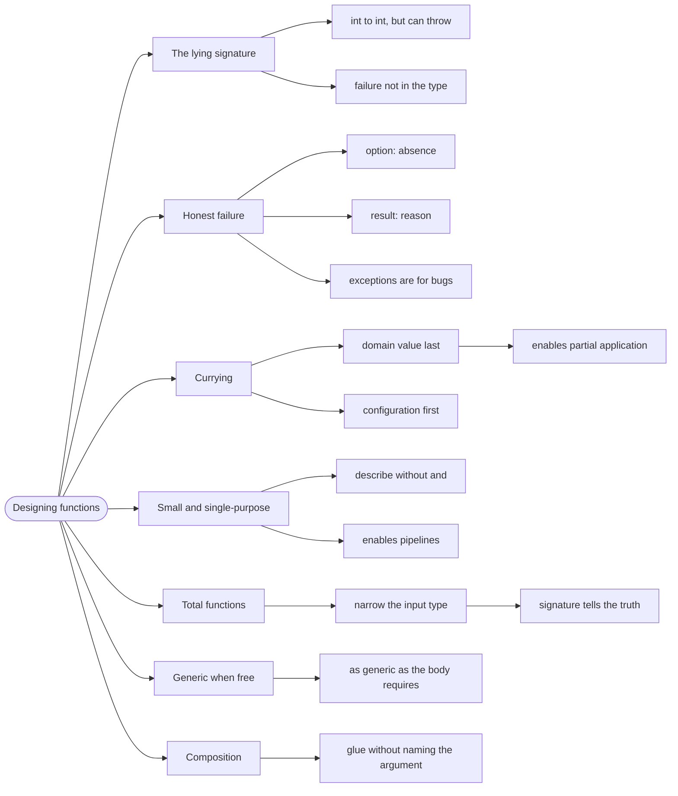

# Designing Functions — Signatures That Can't Be Misused

> Source: *Stylish F# 6* (Eason) — ch 2 «Designing Functions Using Types»,
> ch 9 «Programming with Functions»; *Domain Modeling Made Functional*
> ch 8 «Understanding Functions».

A function **signature** is its name plus its parameter and return types. In
F# the signature is unusually load-bearing: because there is no `null`, no
implicit conversion, and no overload resolution to hide behind, a signature
tells you nearly everything about a function — including how to call it
correctly and how it can fail.

## The signature that lied

*Stylish F#* opens its functions chapter with a function whose signature
promises something it does not deliver — and *Domain Modeling Made
Functional* makes the same point with the same example:

```fsharp
// ❌ DMMF ch 8 — "returns an int", but it might not return at all
let twelveDividedBy (n: int) = 12 / n
```

`int -> int`. The signature says: give me an `int`, get an `int`. But call
`twelveDividedBy 0` and you get a `DivideByZeroException` — an outcome
that appears nowhere in the type. The caller has no warning and no way to
handle it except a `try`.

This is the central design problem of a signature: **the type must mention
every outcome.**

*Domain Modeling Made Functional* ch 8 makes the same point with the same
example, and adds the vocabulary: a function that returns a value for every
input is **total**; one that does not is **partial**.

## 1. Honest signatures for failure

SF6 gives two cures, and the choice between them is a design decision:

```fsharp
// ✅ cure 1 — option: "there may be no answer"
let twelveDividedBy (n: int) =
    match n with
    | 0 -> None
    | n -> Some (12 / n)
```

```fsharp
// ✅ cure 2 — result: "here is why there is no answer"
let twelveDividedBy (n: int) =
    if n = 0 then Error "Cannot divide by zero"
    else Ok (12 / n)
```

- **`Option<'T>`** — "absent, and absence needs no explanation". Use when
  the caller genuinely does not care why.
- **`Result<'T, 'E>`** — "failed, and here is the reason". Use when the
  reason matters to someone: the user, the log, or the retry logic.

The rule: **if a function can fail, the failure is in the return type.**
Exceptions are for bugs, not for outcomes.

## 2. Currying: the argument order matters

F# functions are **curried** — a function of two arguments is a function of
one argument returning a function of the other. This is not trivia; it
determines whether the function composes.

```fsharp
// ✅ SF6 ch 2 — the domain (a greeting) is the *last* parameter
let sayGreeting greeting name = sprintf "%s, %s" greeting name
let sayHello = sayGreeting "Hello"
sayHello "Alice"     // "Hello, Alice"
```

```fsharp
// ❌ the same function, arguments swapped — cannot be partially applied
let sayGreetingWrong name greeting = sprintf "%s, %s" greeting name
// you cannot write `let sayHello = sayGreetingWrong "Hello"`
```

The convention that falls out: **put the thing being transformed last**, and
the configuration first. That way `|>` and partial application both work:

```fsharp
let activePlayers =
    players
    |> List.filter (fun p -> p.IsActive)   // predicate first, list last
    |> List.map (fun p -> p.Name)
```

## 3. Keep functions small and single-purpose

A function should do one thing and its name should say what. SF6's test:
can you describe it without "and"?

```fsharp
// ❌ "validate the order AND save it AND send the email"
let processOrder order = ...

// ✅ one job each, composed by the caller
let validateOrder : OrderDto -> Result<Order, OrderError> = ...
let saveOrder     : Order -> Async<unit> = ...
let sendConfirmation : Order -> Async<unit> = ...
```

Small functions are not an aesthetic preference — they are what makes
pipelines possible. A function that does three things cannot be reused in a
pipeline that needs only one of them.

## 4. Total functions, or say so

A **total function** returns a value for every possible input.

A **partial function** does not — it throws, loops, or returns garbage for some inputs.

Total functions are better because the type tells the whole truth. The way
to make a function total is to narrow its input type so illegal inputs
cannot be constructed — the move from
[modeling-with-types](../modeling-with-types/index.md):

```fsharp
// ❌ partial — what does 0 mean here? Negative?
let area (radius: float) = System.Math.PI * radius * radius
```

```fsharp
// ✅ total — a radius type that cannot be negative
type Radius = private Radius of float
module Radius =
    let create r =
        if r < 0.0 then Error "radius must not be negative"
        else Ok (Radius r)

let area (Radius r) = System.Math.PI * r * r
```

Now `area` cannot fail, and its signature says so.

## 5. Generic when it costs nothing, specific when it helps

```fsharp
// ✅ generic — works for any element type, signature stays honest
let firstOrNone (items: 'T list) =
    match items with
    | [] -> None
    | x :: _ -> Some x
```

```fsharp
// ❌ generic where the domain should be specific
let save (x: 'T) = ...   // save what, where? The type says nothing useful
```

The guideline: **be as generic as the *implementation* requires and no
more.** A function whose body never looks at the element type should be
generic. A function that talks to a database should say *which* entity.

## 6. Function composition beats long bodies

The payoff for all of the above is that small, curried, honest functions
compose:

```fsharp
let processPlayers =
    List.filter (fun p -> p.IsActive)
    >> List.map (fun p -> p.Name)
    >> List.sort
```

`>>` is **composition**: it glues two functions into one without naming the
argument. The result is a new function that reads like a description of the
transformation.

See [functions-and-composition](../functions-and-composition/index.md) for
the full mechanics.

## Revise



## Cross-links

- The mechanics of composition:
  [functions-and-composition](../functions-and-composition/index.md).
- Making illegal inputs unconstructable:
  [modeling-with-types](../modeling-with-types/index.md).
- Pipelines of these functions:
  [workflows-as-pipelines](../workflows-as-pipelines/index.md).
- Naming and layout: [sense-of-style](../sense-of-style/index.md).
