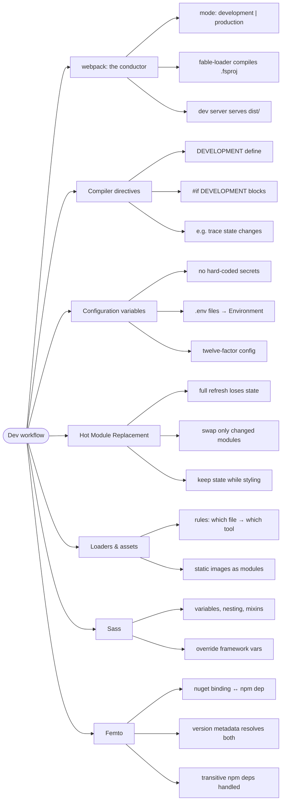

# Dev Workflow — From Source to Browser

> Source: *The Elmish Book* (Zaid Ajaj) — part 5 (Improving Development
> Workflow): webpack-mode, compiler-directives, configuration-variables,
> hot-module-replacement, understanding-webpack-loaders, static-images,
> styling-with-sass, introducing-femto.

Learning templates hide the build; production needs it tuned. This page is
the mental model of the Fable toolchain: what runs, when, and why.

## webpack: the build's conductor

- webpack **calls Fable** (via `fable-loader`) to compile the `.fsproj`
  into JS, then bundles and serves it. `webpack.config.js` is the whole
  pipeline definition.
- **`mode`** switches personalities: `development` (fast, unminified,
  sourcemaps) vs `production` (minified, tree-shaken, optimized). Extract
  `argv.mode` and branch your config on it — dev-only plugins, prod-only
  minification.
- The dev server is a **static file server** for `dist/` — which is why
  you can already "talk HTTP" while developing (see
  [commands-and-async-data](../commands-and-async-data/index.md)).

## Compiler directives: mode in F# code

- Pass `define: ["DEVELOPMENT"]` through fable-loader options; guard code
  with `#if DEVELOPMENT ... #endif` — e.g. log every state change while
  developing, compile that out in production.

## Configuration variables

- Never hard-code per-machine values (API keys, feature flags). Twelve-
  factor rule: config lives **outside** the code.
- Front-end idiom: `.env` files (dev) / environment variables (CI) exposed
  as typed `Environment` lookups in F#.

## Hot Module Replacement

- Full page refresh on every save **loses app state** (log in again after
  a font tweak!). **HMR** swaps just the changed module and re-executes it
  — state survives, prototyping gets fast.
- Dev-only: the HMR runtime (websockets to the dev server) is compiled
  out of production bundles.

## Loaders and static assets

- A webpack **rule** maps a file pattern to a tool: `.fs(x|proj)?` →
  fable-loader, images → asset loaders. Understanding this table is
  understanding the pipeline.
- Static images become **modules**: import them like code and webpack
  handles URLs/hashing in dev and prod.

## Sass

- Inline styles (Feliz) are great from scratch; teams/designers bring CSS
  frameworks. **Sass** = CSS superset: variables, nesting, mixins, module
  imports — and crucially, **overriding third-party framework variables**
  before import.

## Femto: nuget ↔ npm dependency bridge

- Fable bindings are thin F# shells over **npm packages** (Feliz needs
  `react@x`, `react-dom@x`), and versions must match. Manual installs and
  transitive dependency guesswork don't scale.
- **Femto** reads the version metadata inside the nuget binding and
  installs/resolves the exact npm dependencies — including transitive
  ones — with `dotnet tool install femto --global` once.

## Cross-links

- The app this pipeline builds: [fable-and-elm-architecture](../fable-and-elm-architecture/index.md).
- BCL-vs-JS boundaries behind the bindings: [fable-and-elm-architecture](../fable-and-elm-architecture/index.md).
- Config as a deployment concern: [architecture-decisions-and-soft-skills](../architecture-decisions-and-soft-skills/index.md).
- Measuring builds like measuring code (no guessing): [functions-and-composition](../functions-and-composition/index.md).
