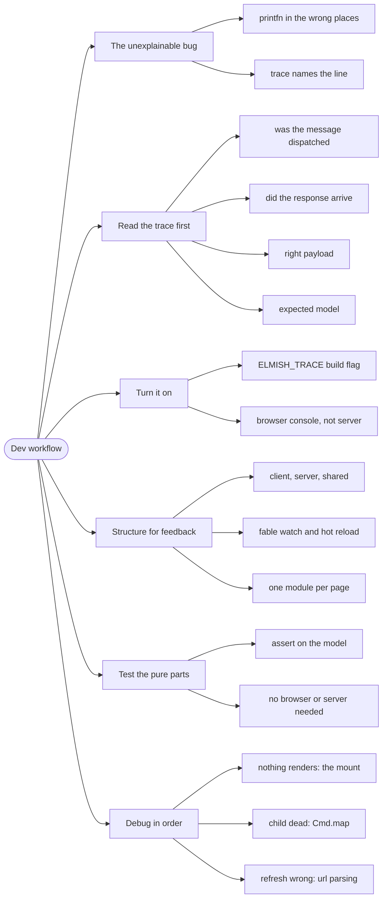

# Dev Workflow — Trace First, Fix Second

> Source: *The Elmish Book* — `dev-flow/*` (project structure, hot reload,
> debugging); plus this repo's `ELMISH_TRACE` practice.

The Elmish architecture gives you something no other UI framework does: a
complete, replayable log of every state transition. A **development
workflow** built on that log is faster than any amount of guessing.

## The bug that "made no sense"

A page shows an empty list. The API returns data. The model looks right. The
`view` looks right. You add `printfn` in three places, none of them fire, and
you conclude the framework is broken.

Ten minutes with the message trace would have shown: `GotGames` was never
dispatched — because the `Cmd.OfAsync.either` success callback was mapped to
a message the parent didn't handle. The bug is one line, and the trace names
it.

## 1. Read the trace before you change code

The rule from this repo's `AGENTS.md`: **when something is wrong at runtime,
read the MVU message trace first.** It runs in the **browser console**, not
the server terminal.

What to look for, in order:

1. **Is the initiating message dispatched?** (`GetGames` — if not, the
   trigger is wrong: an event handler, an `init`, a route change.)
2. **Does the response message arrive?** (`GotGames` — if not, the command
   failed or the mapping is wrong.)
3. **Does it carry the right payload?** (An empty list, or an error?)
4. **Does `update` produce the model you expect?** (The trace shows the
   model before and after.)

The trace answers *which step broke* before you write a single line. This is
worth being strict about: guessing at a fix without the trace is how you
"fix" three things that were never broken.

## 2. Turn the trace on

```fsharp
// ✅ in the client project file — a compile-time flag
<DefineConstants>$(DefineConstants);ELMISH_TRACE</DefineConstants>
```

With the flag set, Elmish logs each dispatched message and the resulting
model. Without it, the log is compiled out entirely, so there is no runtime
cost in production.

Two practical notes:

- **It is a build flag, not a runtime setting** — a rebuild is needed to
  toggle it.
- **The log is in the browser**, so browser devtools is the tool. The server
  terminal will show nothing.

## 3. Structure the project for fast feedback

The book's dev-flow guidance, condensed:

- **`Client` / `Server` / `Shared`.** Shared holds the domain types and the
  remoting API definition, so both sides compile against one contract.
- **Hot reload during UI work.** `dotnet fable watch` recompiles on save;
  the browser reloads. Keep the server running separately.
- **Small modules.** A page per module means a save recompiles one page, not
  the app.

## 4. Test the pure parts directly

The architecture's payoff: `update` is a pure function, so most tests need no
browser and no server.

```fsharp
// ✅ a state-transition test — no mocks, no async, no DOM
[<Test>]
let ``Loading sets status to Loading`` () =
    let model, _cmd = update Load initialModel
    model.Status |> shouldEqual Loading
```

Two rules that keep this fast:

- **Assert on the model, not the HTML.** The view is a pure function too, but
  model assertions are more stable.
- **Ignore the `Cmd` in most tests.** Assert it is `Cmd.none` when it should
  be; otherwise test the async function separately.

## 5. Debug in this order

A concrete order that saves time:

| Symptom | First place to look |
| --- | --- |
| Nothing renders | the `Program.run` wiring and the mount element id |
| A button does nothing | is `dispatch` called in the `OnClick`? |
| Data never appears | the trace: did the `Got…` message arrive? |
| Data appears then vanishes | `update` returning a model built from the *old* model instead of the new one |
| A child component is dead | `Cmd.map` missing in the parent |
| Wrong page after refresh | URL parsing — the URL is the source of truth |

Every row in that table is a question the trace answers directly.

## 6. The habit

The workflow is not a set of tools; it is an order of operations:

```text
❌ guess → edit → hope → repeat
✅ observe (trace) → locate the broken step → fix that step
```

The trace exists because the architecture makes it possible: one pure
`update`, one message type, every transition observable. Using it is the
cheapest performance improvement available to an Elmish developer.

## Revise



## Cross-links

- The loop being traced: [fable-and-elm](../fable-and-elm/index.md).
- Effects and their failure messages:
  [commands-and-async](../commands-and-async/index.md).
- Composed apps and `Cmd.map`: [scaling-and-routing](../scaling-and-routing/index.md).
- Tests for pure functions: [workflows-as-pipelines](../workflows-as-pipelines/index.md).
