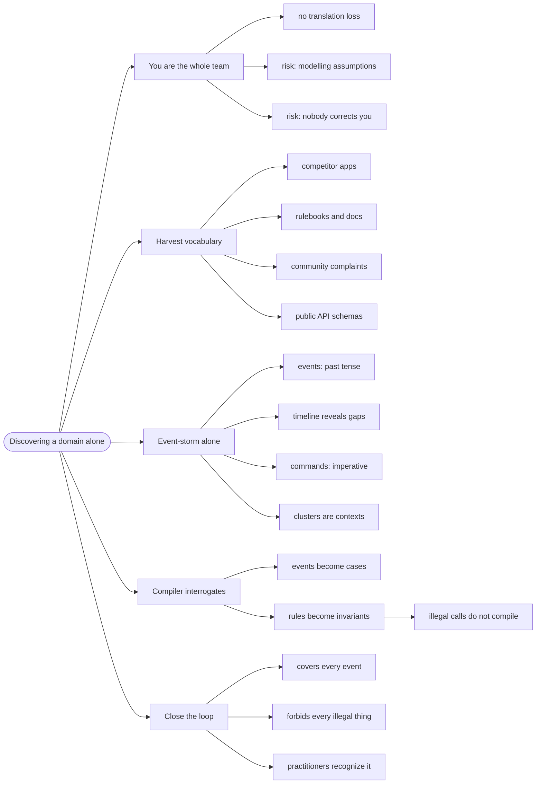

# Discovering a Domain Alone — You Are the Whole Team

> Source: synthesis. Draws on *Domain Modeling Made Functional* ch 1–2
> (event storming, ubiquitous language) and Brandolini's *Introducing
> EventStorming*, adapted for a solo developer.

DDD assumes a room: domain experts, stakeholders, a wall of sticky notes.
But if you are the business, the product owner, the designer, **and** the
developer, there is no room and no expert to interview. This page is the
method for that situation.

## The risk you don't have — and the two you do

The canonical DDD failure is **translation loss**: Brandolini's line is
that *it is not the domain experts' knowledge that goes to production, it
is the assumption of the developers*. Solo, that failure disappears — you
are both sides.

Two different risks replace it:

1. **You think you already know the field.** ("How hard can tournaments
   be?") So you model your assumptions, not the domain's actual rules.
2. **Nobody corrects you.** No Ollie says "we call it a Placed Order", so a
   wrong name quietly becomes the code's name and stays there.

Both are fixed the same way: **treat the field's own artifacts as your
domain expert.**

## 1. Harvest the vocabulary before you write a type

The ubiquitous language already exists — out in the world. Your job is to
collect it, not invent it.

| Source | What to take |
| --- | --- |
| **Competitor apps** | their nav labels, button text, empty states, error messages — a domain model made visible |
| **Rulebooks and docs** | the actual rules: registration windows, seeding, brackets, forfeits |
| **Community threads** | what people *complain* about — complaints are unhandled domain events |
| **Public APIs** | a schema is a pre-harvested vocabulary, already formalized |

A worked example. Harvesting real tournament platforms produces:

```text
bracket   seeding   check-in   bye   forfeit   round   swiss   double-elimination
```

Now compare with a first-draft model:

```fsharp
// ❌ first draft — the model has none of those words
type Tournament =
    { id: string
      name: string
      gameId: string
      startsAt: DateTime
      prize: string
      registrationOpen: bool }
```

The gap between the harvested list and the type is the gap between the
model and the field. That gap is the work.

## 2. Event-storm the wall alone

The workshop collapses to a solo protocol that keeps the useful part — the
**timeline of past-tense facts** — and drops the facilitation.

**Step 1 — write the events.** Past tense, one per note:

```text
Tournament announced
Registration opened
Player registered
Check-in started
Bracket generated
Match played
Winner reported
```

**Step 2 — put them on a timeline.** Order them. Every gap is a missing
requirement, exactly as in the multi-person workshop: *what happens between
"registration opened" and "bracket generated"?* (Answer: check-in — a phase
the first-draft type has no room for.)

**Step 3 — add commands.** The imperative requests that trigger each event:

```text
Open registration   → Registration opened
Register player     → Player registered
Generate bracket    → Bracket generated
```

**Step 4 — group.** Clusters that appear are candidate bounded contexts.

Solo, the workshop's "anyone who has questions, anyone who has answers"
becomes: **ask the artifacts the questions.** "What happens to a no-show?"
is answered by the rulebook's forfeit policy, not by a colleague.

## 3. Let the compiler interrogate the model

Here is where solo work gets its missing second opinion. Turn the wall into
types, then let the compiler ask you the questions a domain expert would
have asked:

```fsharp
// ✅ the event wall becomes the state machine
type TournamentPhase =
    | Announced
    | RegistrationOpen
    | CheckInOpen
    | InProgress
    | Concluded

// each event is a transition; the type says which are legal
let openRegistration (t: AnnouncedTournament) = ...
let generateBracket (t: CheckInClosed) = ...
```

Rules harvested in step 1 become **invariants**. If the rulebook says a
bracket can only be generated after check-in closes, then
`generateBracket` takes `CheckInClosed` — the illegal call does not
compile. You did not have to remember the rule; the type remembers it.

When a later artifact contradicts the model, the change ripples as compiler
errors at exactly the sites that care — the payoff described in
[modeling-with-types](../modeling-with-types/index.md), now doing double
duty as your missing reviewer.

## 4. Close the loop against reality

The workshop team validates by debate. You validate by re-checking the
model against the artifacts:

- **Coverage:** can the model express *every* event on your timeline? If
  not, a case is missing.
- **Prohibition:** does the model *forbid* what the rules forbid (double
  registration, a bracket from an open tournament)? If not, an invariant is
  missing.
- **Recognition:** would a practitioner recognize the names? Type names
  should read like the forum posts you harvested.

When all three pass, the model is as validated as a solo developer can make
it — and better grounded than most team models, because every name traces
back to a real artifact.

## Revise



## Cross-links

- The team version of this method:
  [domain-driven-design](../domain-driven-design/index.md).
- Turning the model into types:
  [modeling-with-types](../modeling-with-types/index.md).
- Rules that must always hold: [integrity-and-invariants](../integrity-and-invariants/index.md).
