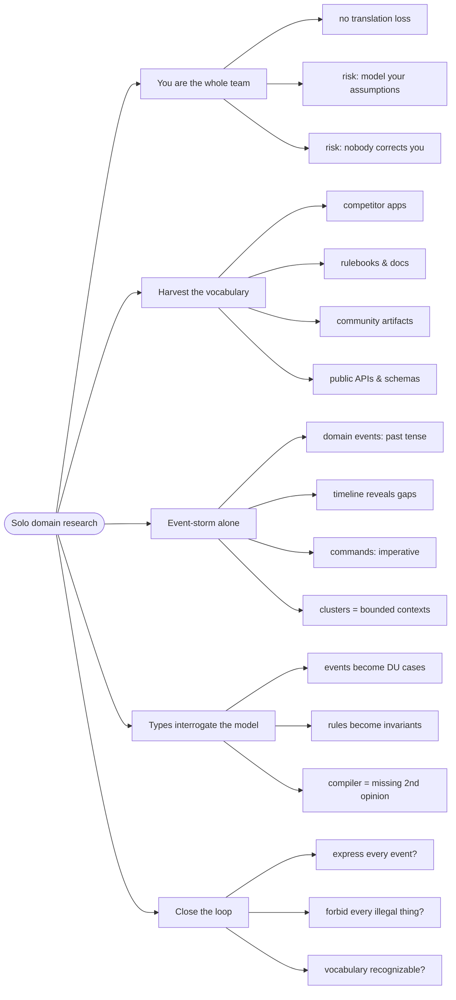

# Discovering a Domain Alone — Solo Domain Research and Modeling

> Source: synthesis (2026-10-14). Draws on *Domain Modeling Made Functional*
> (Wlaschin) ch 1–2 (event storming, ubiquitous language), Brandolini's
> *Introducing EventStorming*, and the artifact-research practice of
> building this very repo's domain types.

DDD books assume a room: domain experts, stakeholders, a wall of sticky
notes. But **you are the whole team** — business, product owner, designer,
developer in one person. The knowledge is already in your head; what you
lack is a method to **research a field you are new to or weak in**, turn
it into a model quickly, and trust the model enough to build on it.

## The proxy problem you don't have

The canonical DDD failure mode is translation loss: Brandolini's law —
*it is not the domain experts' knowledge that goes to production, it is
the assumption of the developers*. Teams fight this with workshops and
ubiquitous language. Solo, the fight is different: **you are both expert
and developer**, so nothing is lost in translation — but two new risks
appear:

1. **You think you know the field** ("how hard can tournaments be?") and
model your assumptions instead of the field's actual rules.
2. **Nobody corrects you** — no Ollie says "we call it a Placed Order", so
a wrong vocabulary silently becomes the code's vocabulary.

The method below is the solo adaptation of event storming plus one move
the books never needed: **treat the field's own artifacts as your domain
expert.**

## 1. Harvest the vocabulary first

Before writing any type, collect the field's *own words* — the
**ubiquitous language** (DMMF ch 1: the shared vocabulary used in speech
and code) exists out there already; you just haven't read it yet:

- **Competitor apps**: sign up and click through them. Their nav items,
  buttons, empty states, and error messages are their domain model made
  visible. Write down every noun and verb.
- **Rulebooks and docs**: for a game community — tournament rules
  formats, registration windows, seeding and bracket rules.
- **Community artifacts**: forum threads, Discord channels, subreddit
  posts. What do players *complain about*? Complaints are unhandled
  domain events ("tournament started while registration was still
  open").
- **APIs and schemas**: any competitor or platform with a public API
  (Steam, Battle.net, Challonge for tournaments) publishes a **schema —
  a pre-harvested vocabulary**.

Example: harvesting tournament platforms yields `bracket`,
`seeding`, `check-in`, `bye`, `forfeit`, `round` — words this repo's
`Tournament` type doesn't have yet. Their absence is the gap between the
model and the field.

## 2. Event-storm the wall alone

Brandolini's workshop collapses to a solo protocol that keeps what
matters — the **timeline of past-tense facts** — and drops what doesn't
(the facilitator, the consensus building):

1. Write **domain events** (past tense, DMMF ch 2: "something happened,
   a fact that can't be changed") on sticky notes — real or digital:
   `Tournament announced`, `Registration opened`, `Player registered`,
   `Check-in started`, `Bracket generated`, `Match played`, `Winner
   reported`.
2. Lay them on a **timeline**. Gaps in the timeline are missing
   requirements — DMMF's own trick from the Widgets Inc session
   ("do you tell the customer the order was placed? I don't see that on
   the wall").
3. Add **commands** (imperative, the requests that trigger workflows):
   `Open registration`, `Register player`, `Generate bracket`.
4. Group the notes. The clusters that appear are your candidate
   **bounded contexts**; the events are your candidate workflows.

Solo adaptation of the multi-person rule "anyone who has questions and
anyone who has answers": **ask the artifacts the questions** — "what
happens after check-in closes?" is answered by the rulebook's
no-show/no-check-in policy, not by a colleague.

## 3. Let the compiler interrogate the model

DMMF ch 4–5 turns the vocabulary and events into types; solo, the type
system becomes your missing domain expert — every match is a question
the model must answer:

```fsharp
// ✅ straight from the event wall to types (DMMF's method):
type TournamentState =
    | Announced
    | RegistrationOpen
    | CheckInOpen
    | InProgress
    | Concluded

type Msg =
    | RegistrationOpened
    | PlayerRegistered of PlayerId
    | CheckInStarted
    | BracketGenerated of Bracket
    | MatchPlayed of MatchResult
```

Rules from step 1's artifacts become **invariants**: if the rulebook says
check-in always precedes bracket generation, the transition function
`generateBracket : CheckInClosed -> Bracket` *requires* the prior state
(see [domain-modeling-with-types](../domain-modeling-with-types/index.md)).
When a later artifact contradicts the model, the change ripples as
compiler errors at exactly the sites that care — the payoff of modeling
with types, now doing double duty as your missing second opinion.

## 4. Close the loop against reality

The workshop team validates by debate; you validate by checking the
model against the artifacts again:

- Can the model express **every event** on your timeline? If not, a
  state or a case is missing.
- Does the model **forbid** what the rules forbid (double registration,
  bracket from an open tournament)? If not, an invariant is missing.
- Would a **practitioner** recognize the vocabulary? Type names should
  read like the forum posts from step 1.

## Revise

The flowchart below is the **review map** of this page — each node a chunk
you just walked. Don't try to learn from it; use it to check coverage.



## Cross-links

- The modeling move this method feeds:
  [domain-modeling-with-types](../domain-modeling-with-types/index.md).
- Event storming and ubiquitous language, team-sized:
  [domain-driven-design](../domain-driven-design/index.md).
- Workflows the events trigger: [workflows-and-error-handling](../workflows-and-error-handling/index.md).
- Partitioning the discovered contexts: [architecture-styles](../architecture-styles/index.md).
