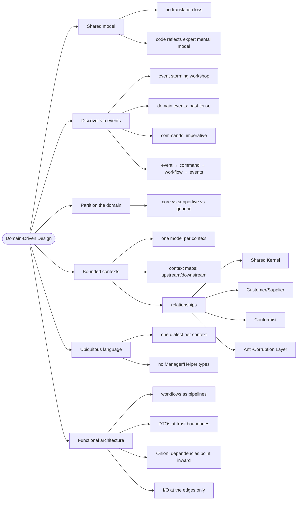

# Domain-Driven Design — Understanding the Problem First

> Source: *Domain Modeling Made Functional* (Scott Wlaschin) — ch 1
> (Introducing DDD), ch 2 (Understanding the Domain), ch 3 (A Functional
> Architecture). Echoed by *FSA* ch 7 (bounded contexts as quanta) and
> ch 18 (microservices).

Code is the easy part; understanding the problem is the hard part. DDD =
build a **shared model** between domain experts and developers so the code
reflects the expert's mental model directly — no translation loss.

## The shared model

A mismatch between the developer's understanding and the domain expert's
understanding is fatal — like the children's game "Telephone". Three
approaches to capturing requirements:

| Approach | Mechanism | Problem |
| --- | --- | --- |
| ✅ DDD | code **is** the shared model | needs discipline |
| Agile iteration | feedback loop corrects drift | developer still a translator |
| ❌ Telephone | expert → translator → code | distortion at every hop |

Guidelines: focus on **business events** and workflows (not data
structures), partition into subdomains, model each subdomain, develop a
**ubiquitous language** shared by everyone and used everywhere in the code.

## Discover the domain: events and commands

Run an **event storming** workshop with domain experts:

- **Domain events** — things that happen, written in the past tense:
  `OrderPlaced`, `BillableOrderShipped`.
- **Commands** — requests to do something, imperative: `PlaceOrder`.
- The pattern: `command → workflow (decision process) → events`.

Focus on the *state changes* of the business, not the nouns. "What
happened?" reveals more than "what table should we have?"

## Partitioning: subdomains and bounded contexts

- **Core domain** = what makes money / competitive advantage. Supportive
  and generic subdomains can be bought or simplified.
- A large domain splits into multiple **bounded contexts** — each with its
  own model, its own dialect, its own data.
- Contexts relate via a **context map**: Shared Kernel, Customer/Supplier,
  Conformist, or the all-important **Anti-Corruption Layer** (translate
  foreign models at the boundary; never let them leak in).

## The ubiquitous language

- One dialect **per bounded context**. "Ship" means something different to
  Sales and to the Warehouse — and that's fine.
- ❌ `ProductManager`, `Helper`, `DataManager` — words that carry no
  domain meaning.
- ✅ `OrderAcknowledgementSent`, `UnpaidSupplyOrder` — the expert's words,
  in the code. No translation step, no `Manager`.

## Functional architecture: the onion

- Each bounded context = an autonomous component: a set of
  **workflows as pipelines** (functions in, functions out).
- **DTOs at trust boundaries** — serialize at the edge, pass domain types
  inside.
- **Onion / Hexagonal / Clean**: domain at the center, infrastructure
  around it, **dependencies point inward**.
- **I/O at the edges only** — no DB, randomness, or mutation inside a
  workflow. Pure workflows are testable workflows ("IO sandwich").

## Cross-links

- Modeling those events as types: [domain-modeling-with-types](../domain-modeling-with-types/index.md).
- Workflows as pipelines in code: [workflows-and-error-handling](../workflows-and-error-handling/index.md).
- Bounded contexts as architecture quanta: [architecture-characteristics-and-governance](../architecture-characteristics-and-governance/index.md).
- Domain partitioning and microservices: [architecture-styles](../architecture-styles/index.md).
- The same "pages as programs" decomposition on the client: [scaling-and-routing](../scaling-and-routing/index.md).
