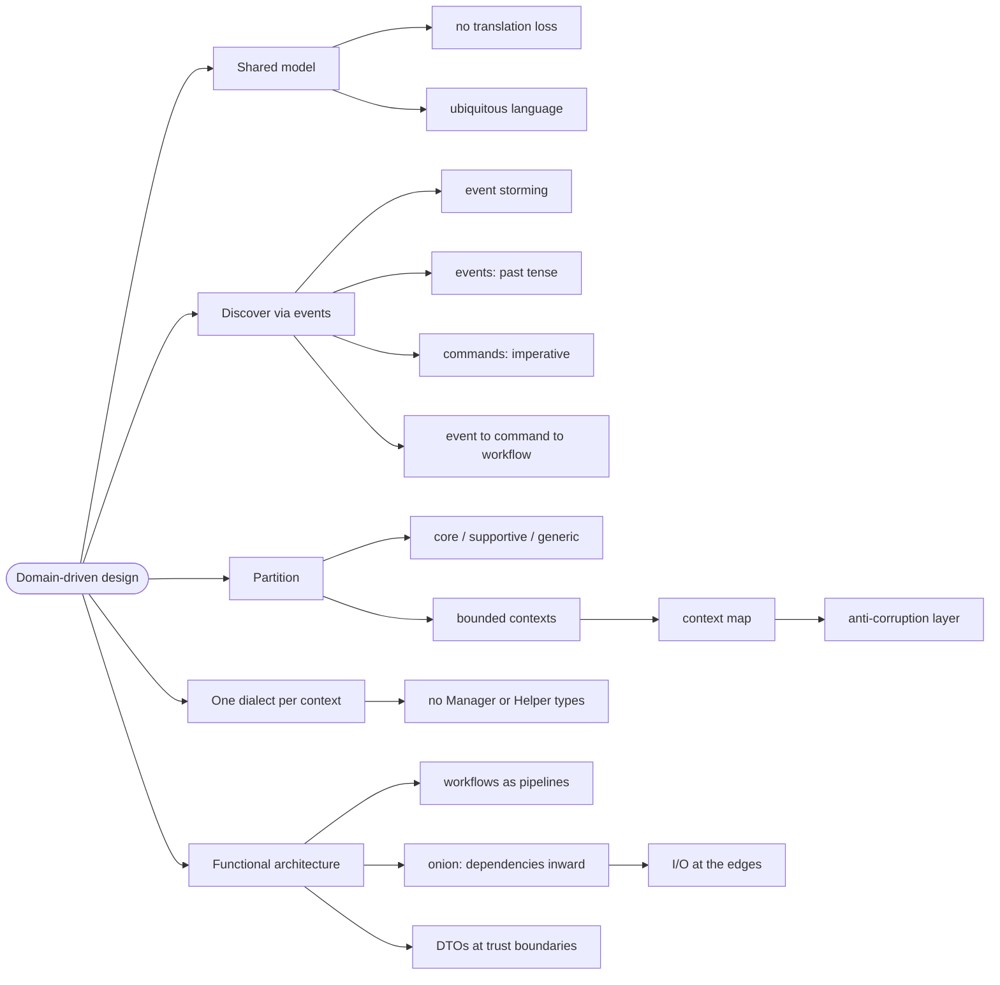

# Domain-Driven Design — Understanding the Problem First

> Source: *Domain Modeling Made Functional* (Wlaschin) — ch 1 «Introducing
> Domain-Driven Design», ch 2 «Understanding the Domain», ch 3 «A
> Functional Architecture».

Code is the easy part. The hard part is understanding what the business
actually does — and building a model that everyone agrees on, in the same
words, before anyone writes a line of it.

## "We call it a Placed Order"

DMMF's running example is a fictional company, Widgets Inc, and a
requirements meeting. Watch a vocabulary get born:

> **You:** "What would you call that as an event?"
> **Sam (shipping):** "How about 'Order Available'?"
> **Ollie (orders):** "We call an order that's completed and ready to ship
> a 'Placed Order'. Can we agree on using that term everywhere?"
> **Sam:** "So 'Order Placed' would be the event we care about, yes?"

Sam said one thing, Ollie said another, and the same fact had two names.
The moment they agreed, the code got its name: the event type, the
workflow, the message. That agreement is the **ubiquitous language** — the
shared vocabulary used in speech *and* in code, with no translation step
between them.

When there is a translation step, meaning leaks at every hop. DMMF calls
the failure "Telephone": expert → translator → code, with distortion at
each hop.

## 1. Why events, not data structures

A business doesn't have data; it **transforms** data. Value is created in
the transformation, so the transformation is what you must understand.
Static data sitting in a table contributes nothing.

That is why DDD starts with **domain events** — things that happened,
always in the past tense, because a fact can't be changed:

```text
Order form received
Order placed
Order shipped
Order change requested
Quote form received
Quote provided
```

And **commands** — requests to do something, in the imperative:

```text
Place an order      → Order placed
Send a shipment     → Shipment sent
```

The pattern that emerges: **event → command → workflow → events**. An
event triggers a command; the command runs a workflow; the workflow emits
new events. Those events trigger further commands.

## 2. Event storming

**Event storming** is the workshop that discovers all of this. DMMF's
description: bring together "anyone who has questions, and anyone who has
answers", give them a long wall and sticky notes, and have them post
business events in rough chronological order.

Three things the wall reveals that requirements documents hide:

- **Gaps.** "Do you tell the customer the order was placed? I don't see it
  on the wall." — the missing event *is* the missing requirement.
- **Connections.** One team's output is another team's input, and it shows
  up as adjacent notes.
- **Vocabulary clashes.** Two departments naming the same thing differently,
  settled on the spot.

Follow the chain to the edges in both directions: what triggers the first
event, and what happens after the last one? Both directions surface
requirements nobody wrote down.

## 3. Partitioning: subdomains and bounded contexts

A large domain splits into **bounded contexts** — each with its own model,
its own dialect, and its own data.

- **Core domain** — what makes money or creates competitive advantage.
  This is where your best effort goes.
- **Supportive** and **generic** subdomains can be simplified, bought, or
  outsourced.

Contexts relate through a **context map**. The four relationships the book
covers:

| Relationship | Meaning |
| --- | --- |
| **Shared Kernel** | two contexts share a small model, by agreement |
| **Customer/Supplier** | downstream context has a say in upstream changes |
| **Conformist** | downstream accepts upstream's model unchanged |
| **Anti-Corruption Layer** | downstream translates upstream's model at the boundary |

The **Anti-Corruption Layer** is the one to remember. Never let a foreign
model leak into your domain — translate it at the edge, in one place.

## 4. One dialect per context

"Ship" means something different to Sales and to the Warehouse, and that is
**fine**. Forcing one vocabulary across the whole company is how you get
models that are wrong everywhere.

```fsharp
// ❌ words that carry no domain meaning
type ProductManager = ...
let helper data = ...

// ✅ the expert's words, verbatim — no translation step
type OrderPlaced = ...
type OrderAcknowledgementSent = ...
```

## 5. The functional architecture

Each bounded context becomes an autonomous component — a set of **workflows as pipelines**.

Around it, the **onion** (also called hexagonal or clean) architecture:

```text
        ┌──────────────────────────────┐
        │  Infrastructure (I/O, DB)    │   ← outer: replaceable
        │  ┌────────────────────────┐  │
        │  │  Workflows (pure)      │  │
        │  │  ┌──────────────────┐  │  │
        │  │  │  Domain types    │  │  │   ← inner: the business
        │  │  └──────────────────┘  │  │
        │  └────────────────────────┘  │
        └──────────────────────────────┘
             dependencies point INWARD
```

Two rules follow:

- **Dependencies point inward.** The domain knows nothing about the
  database, the web, or the clock.
- **I/O at the edges only.** No DB calls, no randomness, no mutation inside
  a workflow. Pure workflows are testable workflows — DMMF calls the result
  an "I/O sandwich".

**DTOs at the trust boundary**: serialize to a plain data-transfer object at
the edge, and pass real domain types inside. The DTO has no rules; the
domain type has all of them.

## Revise



## Cross-links

- Researching a domain when you're the whole team:
  [discovering-a-domain-alone](../discovering-a-domain-alone/index.md).
- Turning the vocabulary into types:
  [modeling-with-types](../modeling-with-types/index.md).
- The workflows this architecture is made of:
  [workflows-as-pipelines](../workflows-as-pipelines/index.md).
- Partitioning decisions at the architecture level:
  [modularity-and-components](../modularity-and-components/index.md).
