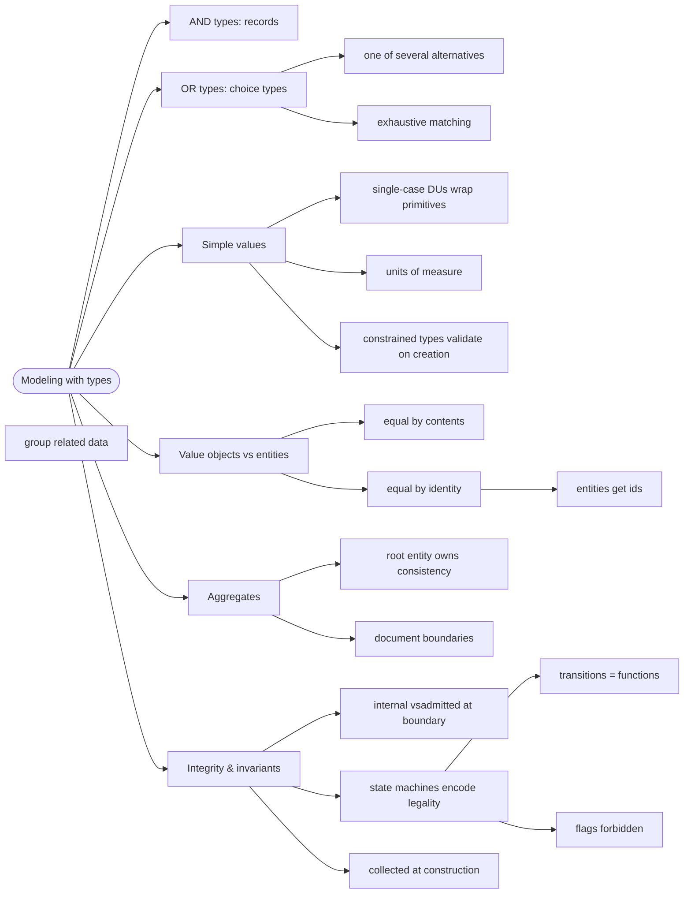

# Domain Modeling with Types — Making Illegal States Unrepresentable

> Source: *Domain Modeling Made Functional* (Scott Wlaschin) — ch 4
> (Understanding Types), ch 5 (Domain Modeling with Types), ch 6
> (Integrity and Consistency). Practiced throughout *Stylish F# 6* ch 2
> and 7; applied to UI state in *The Elmish Book* part 2.

An F# type system is **algebraic**: AND-types (records/structs) and
OR-types (choice types) compose. Modeling = expressing the domain expert's
rules as combinations of these, so the compiler rejects nonsense for you.



## The algebra of types

- **AND (record)**: a `Contact` has a name AND an email.
- **OR (choice type / discriminated union)**: a `ContactInfo` is an email
  OR a phone OR a postal address. Each case can carry different data.
- Requirement docs are full of AND/OR — "a payment method is a card OR a
  cash-on-delivery; every order MUST have a customer id". Translate the
  conjunctions directly into types.

## Simple values: wrap primitives

```fsharp
// ❌ primitive obsession — anything fits, mix-ups compile
type Order = { UserId: int; InvoiceId: int; Kilograms: float }

// ✅ single-case DUs give each concept its own type
type UserId = private UserId of int
type Kilograms = Kilograms of decimal
type Email = Email of string        // constructed only via validation
```

- **Units of measure** (`float<kg>`, `float<m>`) make dimension errors
  compile errors — the same trick SF6 uses for miles.yards.
- **Constrained types**: make the constructor `private`, expose a
  `create : string -> Result<Email, Error>` so an invalid value cannot
  exist.
- **Optional data**: use `Option<'T>` (see [fsharp-style](../fsharp-style/index.md))
  — or better, design the optionality out.

## Value objects vs entities

| | Value object | Entity |
| --- | --- | --- |
| Identity | contents (no id) | an explicit id |
| Equality | same data = equal | same id = equal |
| Lifetime | replace wholesale | changes over time |
| Example | `EmailAddress`, `Money` | `Customer`, `Order` |

## Aggregates and document boundaries

- An **aggregate** is a cluster of entities with a **root** that owns all
  consistency rules; outsiders touch children only via the root.
- Aggregate = the boundary of what must be updated **in one transaction**.
  Order + its lines yes; Order + Customer no (Customer is a reference by
  id).
- Aggregates map naturally to whole **documents** in a document database
  (see cross-links).

## Integrity: invariants in types

- **Internal** integrity = rules inside one context (invariants).
  Enforce them **at construction**: collect and validate all input first,
  then build types that are valid by construction. The rest of the code
  never re-checks.
- **State machines**: if a domain concept has states (Unpaid → Paid →
  Shipped), model **each state as its own type**; transitions are
  functions from one state type to the next.

```fsharp
type UnvalidatedOrder = { (* anything *) }
type ValidatedOrder  = { CheckedShipping: ShipmentMethod; (* ... *) }
type PricedOrder     = { Lines: PricedLine list; Total: Total }

// ❌ flags: one type + IsPaid + IsShipped = 6 illegal combinations
// ✅ states as types: ShippedOrder can only be created from PaidOrder
```

Every illegal combination becomes **unrepresentable** — a whole class of
bugs vanishes before it is written.

## Cross-links

- `Option` and pattern-matching mechanics: [fsharp-style](../fsharp-style/index.md).
- The workflows these types feed: [workflows-and-error-handling](../workflows-and-error-handling/index.md).
- Serialization/persistence of aggregates: [dev-workflow](../dev-workflow/index.md) tooling and [fable-and-elm-architecture](../fable-and-elm-architecture/index.md) for the wire format.
- Ubiquitous language naming these types: [domain-driven-design](../domain-driven-design/index.md).
- Aggregates as bounded-context quanta: [architecture-characteristics-and-governance](../architecture-characteristics-and-governance/index.md).
