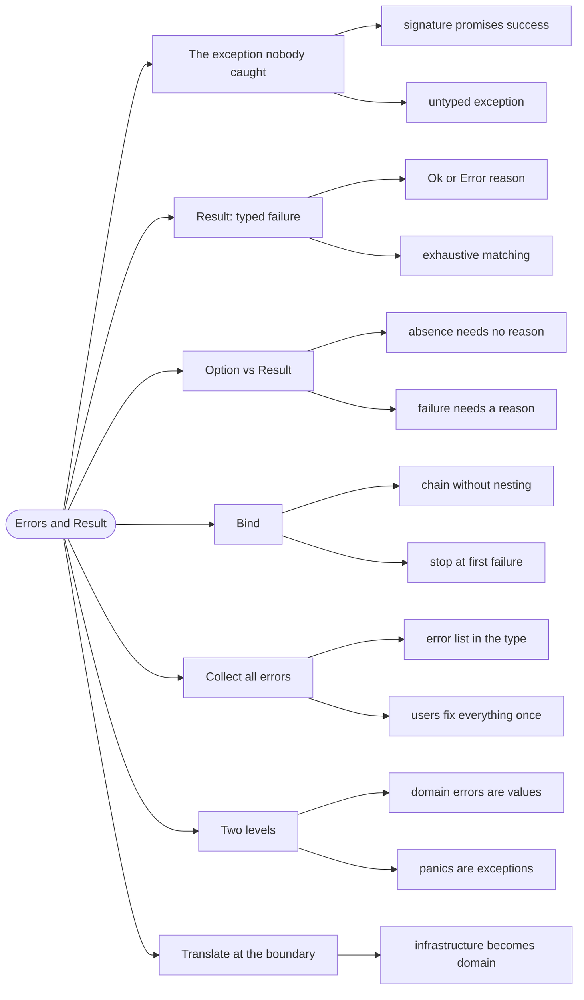

# Errors and Result — Failure as a Value

> Source: *Domain Modeling Made Functional* (Wlaschin) — ch 8 «Understanding
> Functions», ch 10 «Implementation: Working with Errors»; *Stylish F# 6*
> ch 11 «Railway Oriented Programming» for the same idea in a different
> metaphor.

In F# an error is a **value**, not an event. A function that can fail says so
in its return type, and the caller must handle it — the compiler will not
let you forget.

## The exception nobody caught

```fsharp
// ❌ the signature promises an Order; the body throws
let placeOrder (dto: OrderDto) : Order =
    if dto.Lines.IsEmpty then failwith "no lines"
    // ...
```

`OrderDto -> Order`. A caller reading that signature has no reason to expect
a failure, so no caller handles one. The exception unwinds through three
layers and surfaces as a 500 in a page that knows nothing about orders.

Worse: `failwith` throws `System.Exception`, so even a `try/with` cannot
distinguish "empty order" from "database down".

## 1. Result: success or a typed reason

```fsharp
// ✅ the failure is in the type, and the reason is a domain type
type PlaceOrderError =
    | EmptyOrder
    | InvalidQuantity of line: int
    | UnknownProduct of ProductCode

let placeOrder (dto: OrderDto) : Result<Order, PlaceOrderError> = ...
```

`Result<'T, 'E>` has two cases: `Ok value` and `Error reason`. It is a
choice type, so everything you know about
[pattern-matching](../pattern-matching/index.md) applies — and `match` on it
is exhaustive.

The signature now answers the question the exception hid: **what can go
wrong, and what does the caller do about it?**

## 2. Option vs Result: the design decision

| | `Option<'T>` | `Result<'T, 'E>` |
| --- | --- | --- |
| **Cases** | `Some` / `None` | `Ok` / `Error` |
| **Says** | "might be absent" | "might fail, here's why" |
| **Use when** | absence is normal and needs no explanation | someone must react to the reason |
| **Example** | `tryFindPlayer` | `placeOrder` |

If the caller would log the reason, show it to a user, or retry differently
— use `Result`. If the caller only cares *whether* the value is there — use
`Option`.

## 3. `bind`: chain failures without nesting

```fsharp
// ❌ nesting — every step adds a layer
match validate dto with
| Error e -> Error e
| Ok valid ->
    match price valid with
    | Error e -> Error e
    | Ok priced -> acknowledge priced
```

```fsharp
// ✅ bind — the happy path reads straight through
validate dto
|> Result.bind price
|> Result.bind acknowledge
```

`Result.bind` is "if `Ok`, feed the value to the next function; if `Error`,
pass the error through untouched". The pipeline stops at the first failure
with no explicit branching.

`Result.map` is the sibling for steps that cannot fail: it transforms the
`Ok` value and leaves `Error` alone.

## 4. Collect all errors, not the first

A user who fixes one error, resubmits, and gets the next one has been failed
by the design. Validation should report everything at once:

```fsharp
// ✅ validate all fields, accumulate the errors
let validateOrder (dto: OrderDto) : Result<ValidatedOrder, ValidationError list> =
    let errors =
        [ if System.String.IsNullOrWhiteSpace dto.CustomerId then
              yield "customer id is required"
          if dto.Lines.IsEmpty then
              yield "an order needs at least one line"
          if dto.Lines |> List.exists (fun l -> l.Quantity <= 0) then
              yield "quantities must be positive" ]
    if errors.IsEmpty then Ok (buildOrder dto) else Error errors
```

Note the error type: `ValidationError list`, not a single error. That is the
type telling the truth about the contract.

## 5. Two levels of error

Not every failure deserves the same treatment. DMMF draws the line:

| | Domain error | Panic |
| --- | --- | --- |
| **Cause** | a business rule said no | a bug or a broken invariant |
| **Examples** | empty order, unknown product | database unreachable, null where impossible |
| **Represented as** | `Result` — a value | exception — crashes loudly |
| **Handled by** | the workflow, shown to the user | logged, alert, fail the request |

The mistake to avoid: turning infrastructure failures into domain errors.
"Database down" is not a validation failure; the user cannot fix it, and
retrying is the only sensible response.

## 6. At the boundary, translate

Errors from outside must become domain errors at the edge — the same
anti-corruption rule as
[domain-driven-design](../domain-driven-design/index.md):

```fsharp
// ✅ translate at the edge, once
let loadOrder id =
    try
        db.LoadOrder id |> Ok
    with
    | :? SqlException as ex -> Error (StorageFailure ex.Message)
```

Inside the workflow, there are no `SqlException`s — only `PlaceOrderError`.
That is what makes the core testable and the failure modes finite.

## Revise



## Cross-links

- Absence without a reason: [missing-data](../missing-data/index.md).
- Where errors short-circuit a pipeline:
  [workflows-as-pipelines](../workflows-as-pipelines/index.md).
- Validation at the edge: [integrity-and-invariants](../integrity-and-invariants/index.md).
- Errors in the UI: [commands-and-async](../commands-and-async/index.md).
