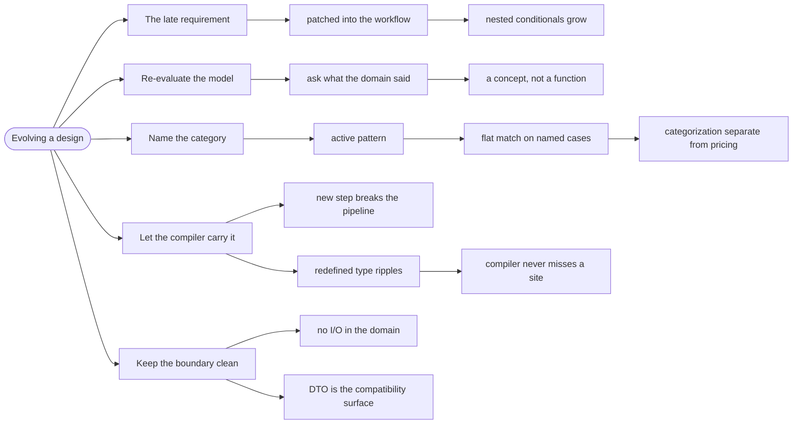

# Evolving a Design — Changing the Model, Not the Code

> Source: *Domain Modeling Made Functional* (Wlaschin) — ch 13 «Evolving a
> Design and Keeping It Clean».

Requirements change. A model that was clean when it was written becomes a
tangle if you patch the implementation instead of re-examining the model.
This page is the discipline for that moment: **change the model first, then
follow the compiler**.

## The requirement that arrives six months later

The order workflow ships. Then finance asks for shipping charges. The
fastest response is to add a branch to the existing pipeline:

```fsharp
// ❌ patched into the workflow — and now every step knows about shipping
let calculateShippingCost validatedOrder =
    let address = validatedOrder.ShippingAddress
    if address.Country = "US" then
        match address.State with
        | "CA" | "OR" | "AZ" | "NV" -> 5.0
        | _ -> 10.0
    else 20.0
```

It works, and it is the beginning of the ball of mud. The pricing rule is
now a nested conditional inside a workflow step, and the next change adds
another branch to the same conditional.

## 1. Re-evaluate the model first

The book's rule, stated plainly: **when the requirements change, start by
re-evaluating the domain model, rather than just patching the
implementation.**

The question to ask is not "where do I put this code?" but "what did the
domain just tell me that I didn't know?"

Here, the domain said: *shipping cost depends on a category of address.*
That is a new **concept**, not a new function. So model it as one.

## 2. Name the category, then match on it

The book's fix is an active pattern, which turns the nested conditional into
a set of named choices:

```fsharp
// ✅ DMMF ch 13 — the categorization, named
let (|UsLocalState|UsRemoteState|International|) address =
    if address.Country = "US" then
        match address.State with
        | "CA" | "OR" | "AZ" | "NV" -> UsLocalState
        | _ -> UsRemoteState
    else
        International
```

The pricing logic is now a flat match over three named cases:

```fsharp
// ✅ the business rule reads as three prices, not nested ifs
let calculateShippingCost address =
    match address with
    | UsLocalState -> 5.0
    | UsRemoteState -> 10.0
    | International -> 20.0
```

The win is that the **categorization** and the *pricing* are separate.

If the state list changes, only the pattern changes. If the prices change, only the match changes. Neither edit touches the other.

## 3. Let the compiler carry the change

Because the workflow stages have distinct types, a change to a type surfaces
as compile errors at exactly the sites that must decide — not as a runtime
surprise.

The book follows four kinds of change through the whole design:

| Change | What the types do |
| --- | --- |
| **A new workflow step** | the new stage's input type does not match the previous stage's output — the pipeline will not compile until it is inserted correctly |
| **A new workflow input** | the input record changes; every construction site is a compile error |
| **A key type redefined** | the ripple is the *point* — every function touching it must be revisited |
| **The workflow transformed** | the stage types change, so the composition operator stops type-checking |

The book's summary: the heavy use of types gives **high confidence that the
code is not accidentally broken** when the model changes. The compiler is
the reviewer, and it never misses a site.

## 4. Keep the boundary clean while you change it

Two rules that keep an evolving model from rotting:

- **The domain layer stays free of I/O.** When a change tempts you to reach
  for the database inside a workflow step, that is a signal the step belongs
  at the edge.
- **The DTO is the compatibility surface.** Change the domain freely; change
  the wire format only deliberately, with a version
  (see [serialization-and-persistence](../serialization-and-persistence/index.md)).

## Revise



## Cross-links

- Active patterns in depth: [pattern-matching](../pattern-matching/index.md).
- The pipeline being changed: [workflows-as-pipelines](../workflows-as-pipelines/index.md).
- The wire format boundary: [serialization-and-persistence](../serialization-and-persistence/index.md).
- Recording why the model changed: [decisions-and-risk](../decisions-and-risk/index.md).
