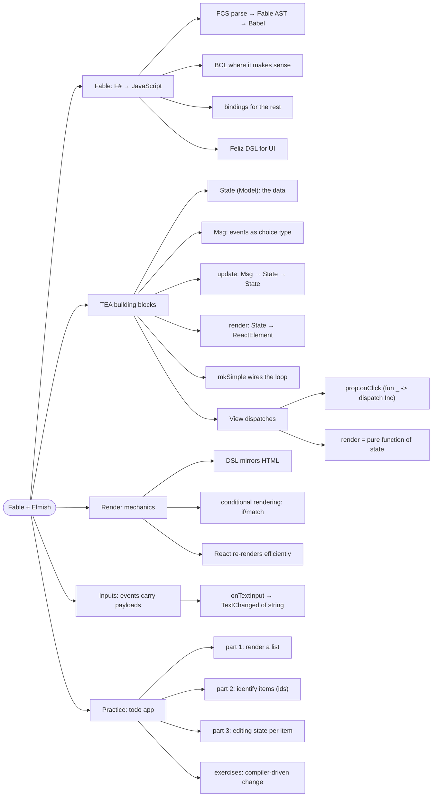

# Fable and The Elm Architecture — State, Message, Update, View

> Source: *The Elmish Book* (Zaid Ajaj) — part 1 (Understanding Fable) and
> part 2 (The Elm Architecture): the-architecture, counter, render-html,
> conditional-rendering, form-inputs, react-in-elmish, todo-app.

Fable compiles F# to JavaScript. The Elm Architecture (TEA) — via the
Elmish library — structures every UI as one loop: **state** in, **events**
in, **next state** out, **view** computed from state.



## Fable: F# in the browser

- Pipeline: F# Compiler Services parses/type-checks → **Fable AST** →
  translated into **Babel AST** → JavaScript. Replacements map F#
  constructs to JS counterparts.
- BCL support is pragmatic, not total: `System.Random` works (maps to
  `Math.random()`); `System.Threading` threads and `System.IO` don't —
  JS runtimes are single-threaded and sandboxed. Where BCL can't reach,
  use **bindings** (`Fable.Browser.*`, `Fable.Node`).
- **Feliz** is the UI DSL: `Html.div [ prop.onClick ...; prop.text ... ]`
  — typed, composable, no stringly-typed markup.

## The Elm Architecture: four blocks

| Block | Type | Role |
| --- | --- | --- |
| **State** (Model) | a record | all data the app tracks |
| **Msg** | choice type | every event that can change state |
| **update** | `Msg -> State -> State` | computes the *next* state |
| **render** (View) | `State -> (Msg -> unit) -> ReactElement` | computes the UI from state |

```fsharp
type State = { Count: int }
type Msg = Increment | Decrement

let update msg state =
    match msg with
    | Increment -> { state with Count = state.Count + 1 }
    | Decrement -> { state with Count = state.Count - 1 }

let render (state: State) (dispatch: Msg -> unit) =
    Html.div [
        Html.button [ prop.onClick (fun _ -> dispatch Increment); prop.text "+" ]
        Html.h1 state.Count
    ]

Program.mkSimple init update render
|> Program.withReactSynchronous "elmish-app"
|> Program.run
```

Key properties:

- **update is synchronous and pure** — the same state + msg always gives
  the same next state. Trivially testable (see cross-links).
- **render is the only place that dispatches** — nothing happens unless
  the view (or a command) fires an event.
- The UI is a **snapshot of state**: render(state) is recomputed on every
  change; React diffs it efficiently.

## Rendering and inputs

- Conditional rendering is just F#: `if`/`match` produce different
  elements — show the "even" badge when `state.Count % 2 = 0`.
- Inputs carry payloads: `TextOfMonth of string` events flow through the
  same dispatch loop; the state stays the single source of truth.
- **Contrast with vanilla JS** (the book's first counter): DOM apps grab
  elements and attach handlers imperatively (`getElementsById`,
  `innerText`, callbacks) — state lives in the DOM and drifts. TEA
  inverts it: state lives in one value, and the DOM is recomputed from
  it. No stale-handler bugs, no state scattered across nodes.

## Practice: the todo app

The book builds a todo app in three escalating parts: render a list →
identify items by id (update in place) → edit items (per-item local
state). Then exercises flip the flow: change a type (`int` → `Guid`) and
let **the compiler enumerate every place to fix**.

## Cross-links

- Modeling the state with domain types: [domain-modeling-with-types](../domain-modeling-with-types/index.md).
- When update needs side effects (HTTP/timers): [commands-and-async-data](../commands-and-async-data/index.md).
- Splitting one program into many: [scaling-and-routing](../scaling-and-routing/index.md).
- The build pipeline that serves this: [dev-workflow](../dev-workflow/index.md).
- `update` = pure transition functions: [functions-and-composition](../functions-and-composition/index.md).
