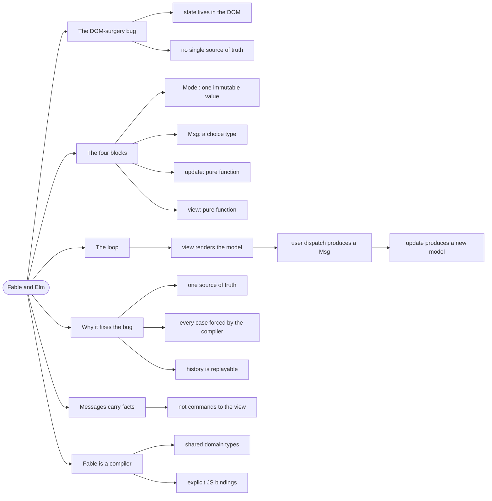

# Fable and Elm — The Model-View-Update Loop

> Source: *The Elmish Book* — `elm/the-architecture.md`, `elm/counter.md`,
> `elm/render-html.md`, `fable/how-fable-works.md`.

**Fable** compiles F# to JavaScript, so the browser runs the same language
as the server. **Elmish** is the UI architecture that Fable apps use: a
single immutable model, a single `update` function, and a `view` that
renders it.

## The UI state that fought itself

```fsharp
// ❌ ad-hoc DOM updates — the state lives in the DOM itself
let addRow (data: Row) =
    let table = document.getElementById "table"
    table.innerHTML <- table.innerHTML + renderRow data   // string surgery
    document.getElementById("count").innerText <- string rows.Length
```

Every update site must remember to update every dependent part of the
screen. Miss one and the UI is inconsistent with reality — and there is no
single place where "the current state" exists to compare against.

## 1. The four blocks

Elmish defines an application as four things, and the book's definition is
worth quoting exactly:

- **Model** — the data, a single immutable value.
- **Message** — the things that can happen, as a choice type.
- **Update** — `Msg -> Model -> Model`, a pure function.
- **View** — `Model -> Html<Msg>`, a pure function.

```text
       ┌──────────┐   view    ┌──────────┐
       │  Model   │ ────────► │   HTML   │
       └──────────┘           └────┬─────┘
              ▲                    │ user clicks
              │ update             ▼
       ┌──────┴─────┐         ┌──────────┐
       │   Model'   │ ◄────── │   Msg    │
       └────────────┘         └──────────┘
```

The loop is the whole architecture. There is no other path by which the
screen can change.

## 2. A complete program

The book's counter, which is small enough to hold entirely in your head.
First the model, the messages, and the pure `update`:

```fsharp
// ✅ the entire state machine, and nothing else
type Model = int

type Msg =
    | Increment
    | Decrement

let init () = 0
```

```fsharp
// ✅ update is pure: (Msg, Model) -> Model
let update msg model =
    match msg with
    | Increment -> model + 1
    | Decrement -> model - 1
```

Then the view, which turns the model into HTML and turns clicks into
messages:

```fsharp
// ✅ view is a pure function of the model
let view model dispatch =
    div [] [
        button [ OnClick (fun _ -> dispatch Decrement) ] [ str "-" ]
        div [] [ str (string model) ]
        button [ OnClick (fun _ -> dispatch Increment) ] [ str "+" ]
    ]
```

Then the runtime is started with the three functions:

```fsharp
// ✅ the program is the three pure functions, wired together
Program.mkSimple init update view
|> Program.withReactSynchronous "elmish-app"
|> Program.run
```

Read the signatures and note what is *absent*: no DOM access, no `let
mutable`, no event listeners. `update` is a pure function from `(Msg, Model)`
to `Model`. Testing it is `update Increment 0 = 1` — no browser needed.

## 3. Why this shape fixes the inconsistency bug

Three properties fall out of the loop, and they are the reason the
architecture exists:

- **One source of truth.** There is exactly one `Model` value. The screen is
  a *function* of it, so the screen cannot disagree with it.
- **State transitions are enumerable.** `Msg` is a choice type, so the
  compiler forces `update` to handle every possible event — including the
  ones you forgot.
- **Every change is inspectable.** Log each `(msg, model)` pair and you have
  a complete, replayable history of the UI. This repo does exactly that with
  its `ELMISH_TRACE` build flag — see
  [dev-workflow](../dev-workflow/index.md).

That last point is worth emphasising: when something is wrong at runtime,
**read the message trace first**. It tells you which `Msg` fired, in what
order, with what payload — and where the flow broke.

## 4. Messages carry data, not commands

A message should describe *what happened*, not *what to do*:

```fsharp
// ❌ imperative — the message tries to control the view
type Msg = | UpdateTheTableWith of Row

// ✅ declarative — the message reports a fact
type Msg =
    | RowAdded of Row
    | SearchTextChanged of string
```

The `update` function decides what a fact means for the model. That keeps
all the logic in one place instead of scattered across the view.

## 5. How Fable actually runs

Fable is a **compiler**, not an interpreter: `dotnet fable` turns your F#
into JavaScript that the browser runs natively. Consequences worth knowing:

- **The whole app is F#** — client and server share the domain types, so a
  change to `Tournament` breaks both sides at compile time.
- **Interop is explicit.** Calling a JS library requires a **binding** — a
  declared signature for a JS function. The book's
  `fable/fable-bindings.md` covers this.
- **The output is plain JS**, so browser devtools work normally: the console
  is where `ELMISH_TRACE` output appears, and where breakpoints go.

## Revise



## Cross-links

- Side effects in the loop: [commands-and-async](../commands-and-async/index.md).
- Splitting a large model: [scaling-and-routing](../scaling-and-routing/index.md).
- Reading the trace when things break: [dev-workflow](../dev-workflow/index.md).
- Immutable state as a value: [immutability-and-state](../immutability-and-state/index.md).
