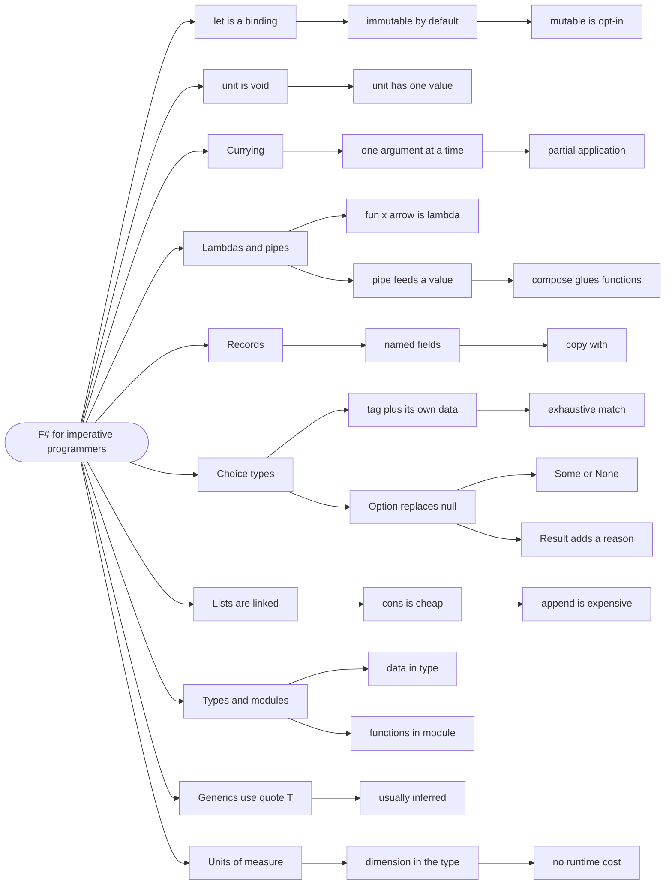

# F# for Imperative Programmers — Python, C, C++ to F#

> Source: *F# Documentation* (Microsoft / .NET Foundation) — CC BY 4.0 —
> `tour`, `language-reference/functions`, `records`,
> `discriminated-unions`, `options`, `units-of-measure`, `style-guide`.
> Cross-checked against *Stylish F# 6* and *Domain Modeling Made Functional*.

You already know Python, C, and C++. This page translates. Every chunk takes
a concept you already have, shows the F# spelling, and names the one thing
that is genuinely new — so the later pages read as design, not as syntax.

## The first F# file you will see

```fsharp
module Shop.Cart

type Cart = { Items: string list; Total: decimal }

let addItem item cart =
    { cart with Items = item :: cart.Items }
```

If that already looks readable, skip to chunk 3. If the `{ cart with ... }`
or the `::` is unclear, this page is for you. Nothing here is a new idea —
it is `let` instead of `=`, `::` instead of `append`, and a record instead
of a `dict`.

## 1. `let` is assignment, but it never changes

```python
# Python — a variable can be reassigned
x = 1
x = 2
```

```fsharp
// ✅ F# — a binding, not a variable
let x = 1
let x = 2          // a NEW binding that shadows the first
// x <- 3          // error: there is no `<-` for immutable values
```

**Term you need:** a **binding** is a name attached to a value. F# `let` is
not a C assignment — it declares a name, and the name cannot be pointed at a
different value afterwards. The second `let x` is a *new* name that hides
the first inside its scope.

Where C has `const int x = 1;` for the safe case and `int x` for the
dangerous one, F# has only the safe case. Mutation is opt-in:

```fsharp
// ✅ mutation exists, but you have to ask for it
let mutable count = 0
count <- count + 1
```

**The new concept:** default immutability. In C and Python the compiler
lets you reassign and you rely on discipline; in F# reassignment does not
compile unless you wrote `mutable`.

## 2. `unit` is `void`, and `()` is its value

```c
// C
void logMessage(const char* s) { printf("%s\n", s); }
```

```fsharp
// ✅ F# — a function with no useful result returns `unit`
let logMessage (s: string) : unit = printfn "%s" s
```

**Term you need:** `unit` is a type with exactly one value, written `()`.
It is F#'s `void` — but it is a real value, so it can be passed and
returned.

```fsharp
// ✅ `()` means "no arguments" AND "no result"
let greet () = printfn "hello"     // unit -> unit
```

Where C++ writes `f(void)` to mean "no parameters", F# writes `f ()`. The
parentheses are the argument.

## 3. Functions take one argument; the rest is currying

```python
# Python — all arguments at once
def add(a, b):
    return a + b
add(1, 2)          # 3
```

```fsharp
// ✅ F# — two arguments, but conceptually one at a time
let add a b = a + b
add 1 2            // 3
let addOne = add 1 // a NEW function: b -> 1 + b
```

**Term you need:** **currying** is representing a two-argument function as a
one-argument function that returns another function. Give fewer arguments
than expected and you get a function back — that is **partial
application**.

This is not trivia; it is why pipelines work. `List.filter` takes a
predicate and *then* a list, so `List.filter isActive` is a ready-made
pipeline stage.

```fsharp
// ✅ no parentheses, no commas — application is a space
let active = List.filter (fun p -> p.IsActive) players
```

Where C++ writes `std::bind` and lambdas to achieve this, F# gets it from
the syntax.

## 4. `fun ... ->` is a lambda; `|>` is a reversed call

```python
# Python
result = sorted(map(lambda x: x * 2, filter(lambda x: x > 0, nums)))
```

```fsharp
// ✅ F# — `fun x -> ...` is the lambda, `|>` feeds a value forward
let result =
    nums
    |> List.filter (fun x -> x > 0)
    |> List.map (fun x -> x * 2)
    |> List.sort
```

**Term you need:** the **pipeline operator** `|>` takes a value and a
function and applies the function: `x |> f` means `f x`. It exists so the
data reads first and each transformation follows, top to bottom.

```fsharp
// ✅ the two operators, side by side
let addOne x = x + 1
let timesTwo x = 2 * x

addOne 3 |> timesTwo        // 8  — value, then function
(addOne >> timesTwo) 3      // 8  — two functions glued
```

`>>` is **composition**: it glues two functions into a new one. `|>` applies
one to a value. Both are defined in the language, not magic.

## 5. Records are structs you do not have to initialise

```c
// C
struct Point { int X; int Y; };
struct Point p = { .X = 1, .Y = 2 };
```

```fsharp
// ✅ F# — named fields, structural equality, free printing
type Point = { X: int; Y: int }

let p = { X = 1; Y = 2 }
printfn "%A" p          // { X = 1; Y = 2 }
```

**Term you need:** a **record** is a group of named fields that always
exist together. It is F#'s struct — but immutable by default, and two
records with the same field values are equal.

Changing one field does not mutate; it copies:

```fsharp
// ✅ copy-and-update: a new record sharing everything not named
let moved = { p with X = 10 }
// p is still { X = 1; Y = 2 }
```

Where C++ writes a copy constructor and hopes it is deep, F# gives you
`with` and guarantees the original is untouched.

## 6. Choice types are tagged unions — the biggest new idea

This is the concept with no direct C, C++, or Python equivalent, and it is
the one the whole course leans on.

```c
// C — the "tagged union" idiom, hand-rolled and unchecked
enum Kind { CASH, CHECK, CARD };
struct Payment {
    enum Kind kind;
    int check_number;     // only valid if kind == CHECK
    char* card_number;    // only valid if kind == CARD
};
```

```fsharp
// ✅ F# — the tag and the data are one thing, checked by the compiler
type PaymentMethod =
    | Cash
    | Check of checkNumber: int
    | Card of cardNumber: string
```

**Term you need:** a **discriminated union** (also **choice type**, or DU)
is a type whose value is exactly one of a fixed set of named cases, and each
case may carry its own data.

The C version has four illegal states (a `CASH` with a card number, etc.).
The F# version has three legal states and no way to express a fourth.

```fsharp
// ✅ construct a case, then match on it
let payment = Check 1024

let describe p =
    match p with
    | Cash -> "cash"
    | Check n -> $"check {n}"
    | Card c -> $"card ending {c}"
```

**Term you need:** `match` is F#'s `switch`, but it is **exhaustive** — the
compiler rejects it if you miss a case. That is the safety C's `switch`
never had.

## 7. `Option` replaces null and sentinel values

```c
// C — three conventions for "no value", all unchecked
int find_index(...);   // returns -1 for missing
char* get_name(...);   // returns NULL for missing
```

```fsharp
// ✅ F# — one type for absence, and the caller must handle it
let tryFindIndex (xs: int list) (target: int) : int option =
    xs |> List.tryFindIndex ((=) target)

match tryFindIndex [ 1; 2 ] 2 with
| Some i -> printfn "found at %d" i
| None -> printfn "not found"
```

**Term you need:** `Option<'T>` is a choice type with two cases — `Some
value` and `None`. It says "there may be no value", and it is part of the
type, so the compiler forces the caller to consider `None`.

`tryFindIndex` is the F# convention: the `try` prefix means "returns an
option" rather than throwing.

## 8. `Result` replaces error codes and exceptions

```c
// C — the error is a return code someone will forget to check
int parse_port(const char* s, int* out);   // 0 ok, -1 bad
```

```fsharp
// ✅ F# — the error is in the return type, with a reason
let parsePort (s: string) : Result<int, string> =
    match System.Int32.TryParse s with
    | true, n when n > 0 && n < 65536 -> Ok n
    | true, _ -> Error "port out of range"
    | false, _ -> Error "not a number"
```

**Term you need:** `Result<'T, 'E>` is a choice type with `Ok value` and
`Error reason`. It is `Option` with an explanation attached.

The C habit is to return a code and ignore it. Here the compiler will not
let you read the value without handling `Error`.

## 9. Lists are linked lists — `::` is not `append`

```python
# Python — a list is an array; append is cheap
xs = [1, 2, 3]
xs = [0] + xs      # copies
```

```fsharp
// ✅ F# — a list is a linked list; prepend is O(1)
let xs = [ 1; 2; 3 ]
let ys = 0 :: xs           // O(1), shares the tail
let zs = xs @ [ 4 ]        // O(n) — appends by copying the left list
```

**Term you need:** `::` is the **cons** operator — it puts one element on
the front of a list. `@` is append, and it costs time proportional to the
left list's length.

The practical rule from C++ `std::vector` intuition is reversed: appending
is expensive, prepending is free. Build lists by prepending, then
`List.rev` once at the end.

```fsharp
// ✅ the C-family separator is a semicolon, not a comma
let numbers = [ 1; 2; 3 ]
let pair = (1, 2)          // tuples use commas
```

Commas make tuples; semicolons separate list elements. Mixing them is the
single most common syntax error for newcomers.

## 10. `type` and `module` are the two containers

```cpp
// C++ — a class holds data and methods
class Cart {
public:
    std::vector<std::string> items;
    void add(const std::string& item);
};
```

```fsharp
// ✅ F# — a type holds data, a module holds the functions
type Cart = { Items: string list }

module Cart =
    let add item cart = { cart with Items = item :: cart.Items }
    let count cart = cart.Items.Length
```

**Term you need:** a **module** is a named group of functions and types — a
namespace with behaviour. There is no `this` and no hidden state; the cart
is passed in explicitly.

Where C++ puts methods inside the class, F# usually puts functions in a
module beside the type. Both work; the module version makes it obvious that
nothing is mutated.

## 11. Generics use `'T`, not `template`

```cpp
// C++
template <typename T>
T first(std::vector<T> xs) { return xs[0]; }
```

```fsharp
// ✅ F# — a leading quote marks a type parameter
let first (xs: 'T list) : 'T = List.head xs
```

**Term you need:** `'T` is a **type parameter** — a placeholder for any
type, F#'s version of a C++ template parameter or a Python type variable.
F# usually infers it, so you rarely write it.

```fsharp
// ✅ inferred: the body never inspects the element type
let firstOrNone xs =
    match xs with
    | [] -> None
    | x :: _ -> Some x
```

Where C++ needs `template <typename T>`, F# often needs nothing at all —
the compiler generalises automatically.

## 12. Units of measure have no C-family equivalent

```c
// C — two doubles, one meaning seconds and one milliseconds
double timeout_s = 5.0;
double timeout_ms = 5000.0;   // passing the wrong one compiles fine
```

```fsharp
// ✅ F# — the unit is part of the type
[<Measure>] type s
[<Measure>] type ms

let timeout = 5000.0<ms>
let sleepFor (d: float<s>) = Async.Sleep(int (d * 1000.0<ms/s>))
// sleepFor timeout          // error: ms is not s
```

**Term you need:** a **unit of measure** is a compile-time annotation on a
number, so mixing metres with kilograms is a type error. It has zero
runtime cost — the units exist only in the type checker.

This is the one feature with no analogue in Python, C, or C++, and it
removes the most common numerical bug in software.

## 13. The syntax cheat sheet

| Concept | Python | C / C++ | F# |
| --- | --- | --- | --- |
| bind a value | `x = 1` | `int x = 1;` | `let x = 1` |
| reassign | `x = 2` | `x = 2;` | `let mutable x = 1` then `x <- 2` |
| function | `def f(a, b):` | `int f(int a, int b)` | `let f a b =` |
| lambda | `lambda x: x * 2` | `[](int x){return x*2;}` | `fun x -> x * 2` |
| no result | `None` | `void` | `unit` / `()` |
| call | `f(1, 2)` | `f(1, 2)` | `f 1 2` |
| list | `[1, 2, 3]` | `std::vector<int>` | `[ 1; 2; 3 ]` |
| tuple | `(1, 2)` | `std::pair` | `(1, 2)` |
| struct | `@dataclass` | `struct` | `type P = { X: int }` |
| tagged union | — | hand-rolled enum + union | `type T = A \| B of int` |
| nullable | `None` | `NULL` / `nullptr` | `Option<'T>` |
| error | `raise` / return code | return code / `errno` | `Result<'T, 'E>` |
| switch | `match` (3.10+) | `switch` | `match` (exhaustive) |
| generic | `TypeVar` | `template<typename T>` | `'T` |
| namespace | `module` | `namespace` | `module` / `namespace` |
| loop | `for x in xs:` | `for (int i...)` | `for x in xs do` |

## 14. What is genuinely new, in one list

Four ideas have no direct equivalent in the three languages you know. They
are the ones the rest of the course builds on:

- **Default immutability** — reassignment requires `mutable`.
- **Discriminated unions** — a tag and its data as one type, with
  exhaustive matching.
- **Exhaustive `match`** — a missing case is a compile error, not a bug.
- **Units of measure** — numbers carry their dimension in the type.

Everything else on this page is syntax you can look up. These four change
what you can express, which is why the course spends its time on them.

## Revise



## Cross-links

- The two composite shapes in depth:
  [records-and-unions](../records-and-unions/index.md).
- Matching and exhaustiveness: [pattern-matching](../pattern-matching/index.md).
- Absence without a reason: [missing-data](../missing-data/index.md).
- Failure with a reason: [errors-and-result](../errors-and-result/index.md).
- Collections and their costs: [collections](../collections/index.md).
- Currying and composition: [functions-and-composition](../functions-and-composition/index.md).
- Naming and layout: [sense-of-style](../sense-of-style/index.md).
