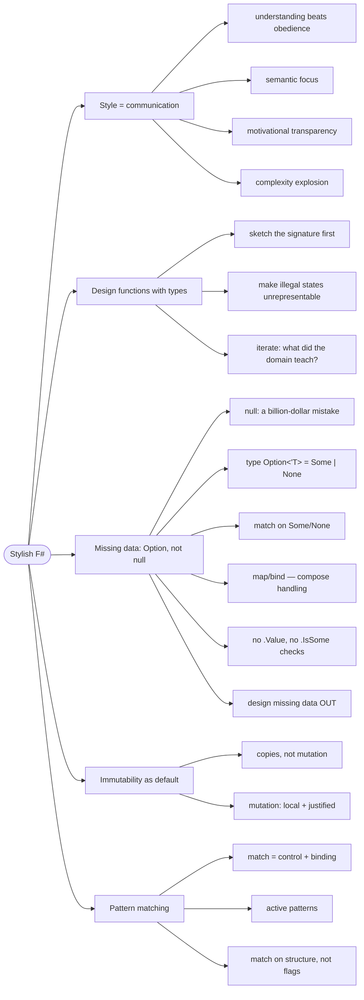

# F# Style — Code Is Communication

> Source: *Stylish F# 6* (Kit Eason) — ch 1 (The Sense of Style), ch 3
> (Missing Data), ch 5 (Immutability and Mutation), ch 6 (Pattern
> Matching). *The Elmish Book* parts 1–2 practice the same idioms.

The aim of style is not elegance for its own sake — it is to
**communicate** with peers and with the computer. Code that explains
itself needs no archaeology.

## The silent fallback

Real code from this repo (`Pages/Tournaments.fs`) — turning a split-button
action into a message:

```fsharp
// ❌ actual repo code — the last case swallows every unknown value
let actionMsg (tournamentId: string) (action: string option) =
    match action with
    | None | Some "toggle" -> ToggleRegistration tournamentId
    | Some "details" -> ViewDetails tournamentId
    | Some "share" -> ShareTournament tournamentId
    | Some _ -> ToggleRegistration tournamentId  // ← "shre" silently toggles
```

A typo'd action string doesn't error — it **silently toggles tournament
registration**. No crash, no warning, just the wrong thing happening. This
is a style failure, not a logic failure: the code never says "I know all
the possible actions", so it can't promise anything.

## 1. Why style matters: four traits of unreadable code

Kit Eason opens the book with what all bad code bases share. Each has a
name worth knowing, because the rest of the book fixes them one by one:

- **Poor semantic focus** — you must hold scattered, distant code in your
  head to understand any one piece.
- **Poor revisability** — you can't predict what a change will touch.
- **Poor motivational transparency** — you can't tell what the author was
  *thinking*.
- **Hidden inefficiency** — you can't tell if it's fast without
  experimenting.

SF6's own ❌ (Listing 1-1) — you literally cannot predict its behavior
without hunting for `checkRate` and `checkAmount` elsewhere:

```fsharp
// ❌ from SF6 ch 1: primitive soup — any int, any float, silent mutation
let addInterest (interestType: int, amt: float, rate: float, y: int) =
    let rate = checkRate rate
    let mutable amt = amt
    checkAmount(&amt)
    let mutable intType = interestType
    if intType <= 0 then intType <- 1
    if intType = 1 then
        amt + (amt * rate / 100.) * (float y)
    else
        amt * System.Math.Pow(1. + (rate/100.), float y)
```

Under deadline pressure, unreadable code causes a **complexity explosion**:
maintainers stop reasoning, duplicate code, program by coincidence, and
pile on special cases. Style is the antidote.

## 2. Design functions with types: the loop

The book's method for any function — and note it starts with the
**signature** (a function's name plus the types of its inputs and output),
not the body:

1. Sketch the signature, naively. Code the body, naively.
2. Ask: does the signature cover the use cases and **eliminate errors**?
   Refine.
3. Ask: what did the domain teach me? Push new error cases into the
   signature. Loop until stable.

SF6 works this loop on a real, gnarly domain: British railways record
distances as *miles.yards* — one float where `1.0880` means one mile and
880 yards (a fractional part over `.1759` is invalid, because 1,760 yards
is the next mile).

**Round 1 — naive.** It works, but any float is accepted, so `1.1760`
silently converts to 2.0 miles:

```fsharp
// ❌ SF6 ch 2: works fine, accepts nonsense silently
let convertMilesYards (milesPointYards : float) : float =
    let wholeMiles = milesPointYards |> floor
    let fraction = milesPointYards - float(wholeMiles)
    wholeMiles + (fraction / 0.1760)
```

**Round 2 — detect after the fact.** Better, but this detects an invalid
state *after it happened*; the caller can still hand any float to any
function:

```fsharp
// ❌ still SF6 ch 2: an exception inside is not illegal-state-unrepresentable
if fraction > 0.1759 then
    raise <| ArgumentOutOfRangeException(nameof(milesPointYards),
                "Fractional part must be <= 0.1759")
```

**Round 3 — make the type carry the rule.** A **single-case discriminated
union** (a one-case DU wrapping its data; see
[domain-modeling-with-types](../domain-modeling-with-types/index.md))
whose *constructor validates*, plus a module associating functions with
the type — SF6's final polished form (Listing 2-11):

```fsharp
// ✅ SF6 ch 2 (Listing 2-11) — construction (validating) is separate
// from computation (can't fail)
type MilesYards = MilesYards of wholeMiles: int * yards: int

module MilesYards =
    let fromMilesPointYards (milesPointYards : float) : MilesYards =
        let wholeMiles = milesPointYards |> floor |> int
        let fraction = milesPointYards - float(wholeMiles)
        if fraction > 0.1759 then
            raise <| ArgumentOutOfRangeException(nameof(milesPointYards),
                        "Fractional part must be <= 0.1759")
        let yards = fraction * 10_000. |> round |> int
        MilesYards(wholeMiles, yards)

    let toDecimalMiles (MilesYards(wholeMiles, yards)) : float =
        (float wholeMiles) + ((float yards) / 1760.)
```

Every step of that loop improved **motivational transparency** — even a
reader who has never heard of miles.yards sees instantly what the code is
deliberately doing. The final polish, pattern-matching **in the parameter**
(`(MilesYards(wholeMiles, yards))` — the DU is destructured at the
function boundary), is legal *only* for single-case DUs.

## 3. Missing data: `Option`, not null

**`null`** is the "absent" reference C-based languages use — Tony Hoare
called inventing it his "billion-dollar mistake" because every use is a
potential crash. F# pushes it to the interop edges. The idiomatic F# type
for "might be missing" is `Option<'T>` — a two-case DU, `Some of 'T` or
`None`, so "missing" is a *value you can see*, not a landmine.

```fsharp
// ❌ the antipatterns — a lurking null-ref, and hand-rolled dispatch
if opt.IsSome then opt.Value.ToUpper()
match opt with | Some x -> x | _ -> ""

// ✅ compose the handling — map over Some, default out of None
opt |> Option.map String.upper |> Option.defaultValue ""
```

The **Option module** (`map`, `bind`, `defaultValue`…) treats "handle the
missing case" as a *function you compose*, not an `if` you write. And the
best move of all: **design missing data out**. If delivery is optional
because it's either electronic or physical, that's not "optional" — it's
two different things:

```fsharp
// ✅ SF6/DMMF style: the optionality was really a domain rule
type DeliveryMethod =
    | Electronic            // no delivery address needed
    | Physical of Address    // must have one
```

## 4. Immutability as default

**Immutability** means: once a value is created, it never changes — you
create a *new* value instead. F# records make that a one-liner with the
**copy-and-update expression** (`{ old with Field = newValue }`):

```fsharp
// ✅ a new tournament record; the old one is untouched
let closed = { t with registrationOpen = false }
```

Why default to it? Mutation forces every reader to reason about *history*
— "who changed this, when?" Immutable values have no history to track.
Reserve mutation for where performance or the operation itself demands it,
and then keep it **local** (inside one function) and justified.

## 5. Pattern matching everywhere

A **`match`** expression compares a value against a list of *patterns* and
runs the first branch that fits — combining control flow, destructuring,
and exhaustiveness checking (the compiler errors if a case is missing) in
one construct. Match on **structure and content**, never on boolean flags:

```fsharp
// ❌ the story's bug, generalized: flags hide what's really distinct states
match (action, isToggle, isShare) with ...

// ✅ match the structure itself
match action with
| Some "toggle" | None -> ToggleRegistration id
| Some "details" -> ViewDetails id
| Some "share" -> ShareTournament id
| Some other -> failwith $"unknown action: %s{other}"
//  ↑ unknown input now FAILS LOUDLY instead of silently toggling
```

**Active patterns** — functions used inside patterns, named `(|Case|)` —
let you match on *computed* classifications:

```fsharp
// ✅ SF6 ch 6: classify first, then match the classification
let (|Even|Odd|) n = if n % 2 = 0 then Even else Odd
match count with Even -> "even" | Odd -> "odd"
```

## 6. When classes earn their place

A **class** (an OO type bundling data and behavior, optionally with hidden
mutable state) is the right tool only when internal and external
representations must differ, when state must be **held or mutated over
time** (streams, connections, caches), or when interoping with OO
hierarchies. Keep the boundary crisp: immutable functional core,
class-based **adapters** at the edges.

## Revise

The flowchart below is the **review map** of this page — each node a chunk
you just walked. Don't try to learn from it; use it to check coverage.



## Cross-links

- These types in domain modeling: [domain-modeling-with-types](../domain-modeling-with-types/index.md).
- Pattern matching the two-track model: [workflows-and-error-handling](../workflows-and-error-handling/index.md).
- Currying / partial application (the machinery behind signatures): [functions-and-composition](../functions-and-composition/index.md).
- The same state-as-data thinking in the UI: [fable-and-elm-architecture](../fable-and-elm-architecture/index.md).
- Readability as ubiquitous language: [domain-driven-design](../domain-driven-design/index.md).
