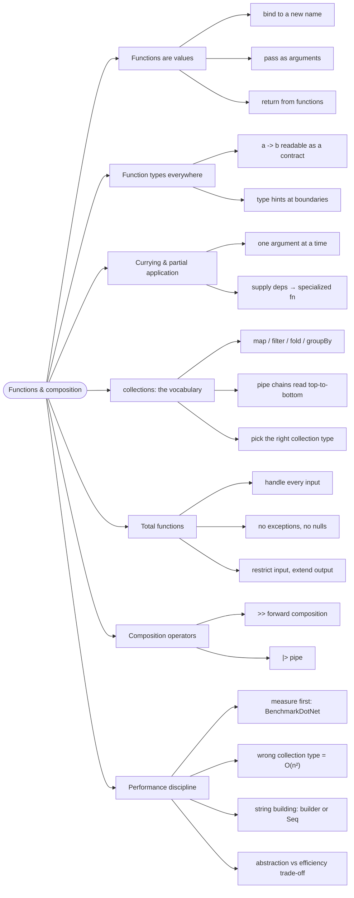

# Functions and Composition — Small Parts, Big Programs

> Source: *Stylish F# 6* (Kit Eason) — ch 4 (Collection Functions), ch 9
> (Programming with Functions), ch 12 (Performance). *DMMF* ch 8
> (Understanding Functions) for total functions; *The Elmish Book* uses
> these idioms throughout.

Functions are things: they can be named, passed, returned, and combined.
Composition — building pipelines from small functions — is how F# programs
grow without collapsing.

## The signature that lied

DMMF ch 8 opens with a function whose type is a **lie**:

```fsharp
// ❌ from DMMF ch 8 — the signature says int -> int
let twelveDividedBy n =
    match n with
    | 6 -> 2
    | 5 -> 2
    | 4 -> 3
    // ...
    | 0 -> failwith "Can't divide by zero"   // ...but zero has no answer
```

The type promises *any int in, some int out* — but zero **crashes**. A
function that answers for *every* input of its type is a **total
function**; this one is **partial**. DMMF's two cures, both moving the
truth into the type:

```fsharp
// ✅ cure 1 — restrict the input (a type that excludes zero)
let twelveDividedBy (NonZeroInteger n) = (* ... *)   // NonZeroInteger -> int

// ✅ cure 2 — extend the output (answer "undefined" explicitly)
let twelveDividedBy n =
    match n with
    // ...
    | 0 -> None
    | m -> Some (12 / m)                    // int -> int option
```

"This function does not lie. Everything is explicit." This page is the
toolkit around that idea.

## 1. Functions are values

```fsharp
let add a b = a + b
let addUp = add            // bind a function to another label
let applyAndPrint f a b = printfn "%i" (f a b)   // pass as argument
```

A function's type — `float -> float -> float` — is a **contract** readable
at a glance: two floats in, one float out. Write signatures first (see
[fsharp-style](../fsharp-style/index.md)); add explicit type hints where
inference would be ambiguous.

## 2. Currying and partial application

**Currying** means parameters are written separately (not tupled), so a
function "takes one argument and returns a function that takes the next".
**Partial application** supplies only some arguments — the result is a
specialized function. SF6 ch 9's canonical demo:

```fsharp
// ✅ from SF6 ch 9 — int -> int -> int
let add a b = a + b

// partial application: int -> int
let addTwo = add 2

// 5
printfn "%i" (addTwo 3)
```

The reuse payoff — one function, many specialized variants:

```fsharp
// ✅ from SF6 ch 9 — surround: prefix -> suffix -> s
let surround prefix suffix s =
    sprintf "%s%s%s" prefix s suffix

let roundParen = surround "(" ")"
let xmlComment = surround "<!--" "-->"
let doubleQuote = surround "\"" "\""
```

DMMF's domain use: **dependencies first, data last** — partial application
becomes dependency injection:

```fsharp
// ✅ from DMMF ch 8 — bake the deps in once
let sayGreeting greeting name =            // string -> string -> unit
    printfn "%s %s" greeting name

let sayHello = sayGreeting "Hello"         // string -> unit
let sayGoodbye = sayGreeting "Goodbye"     // string -> unit
```

## 3. The collection vocabulary

- Learn the core chords so they're instinctive: `map`, `filter`, `fold`,
  `groupBy`, `sortBy`, `sumBy`, `collect`.
- Pipes make chains read top-to-bottom — SF6 ch 4's canonical shape:

```fsharp
// ✅ from SF6 ch 4 — the collection *is* the first parameter
House.getRandom 20
|> Array.filter (fun h -> h.Price > 100_000m)
|> Array.iter (fun h ->
    printfn "Address: %s Price: %f" h.Address h.Price)
```

- Choose the right collection type: `List` = prepended, immutable stacks;
  `Array` = indexed mutation, performance; `Seq` = lazy pipelines;
  `Map`/`Set` = lookup.

## 4. Composition operators

- `|>` pipes a value into a function — the data flows left-to-right.
- `>>` composes two functions into one — pipelines become values:

```fsharp
// ✅ from SF6 ch 9 — fixTypographic via composition, then point-free
let fixTypographic (s : string) =
    s |> (fixSingle >> fixDouble)

// same thing, parameter eliminated:
let fixTypographic = fixSingle >> fixDouble
```

SF6's restraint warning: *composition isn't a goal in itself* —
motivational transparency and semantic focus trump conciseness. Don't
compress code "down to the most concise expression humanly possible".

## 5. Performance: measure, then fix

- Design is a **compromise between abstraction and efficiency** — F#'s
  high level can land you on the wrong end. Fix with measurement, not
  folklore: **BenchmarkDotNet**, and keep tests green while tuning.
- SF6 ch 12's discipline, verbatim: code a baseline that works, put tests
  and benchmarks in place, *then* tackle bottlenecks — "improvements of
  several orders of magnitude without compromising clarity".
- Classic traps: `List` where random access is needed (O(n) indexing →
  O(n²) loops), naive string concatenation in loops (quadratic copies),
  short-lived object churn in hot paths.

## Revise

The flowchart below is the **review map** of this page — each node a chunk
you just walked. Don't try to learn from it; use it to check coverage.



## Cross-links

- Signatures as design: [fsharp-style](../fsharp-style/index.md); total
  functions in pipelines: [workflows-and-error-handling](../workflows-and-error-handling/index.md).
- Partial application as DI in workflows: [workflows-and-error-handling](../workflows-and-error-handling/index.md).
- Composition of UI programs: [scaling-and-routing](../scaling-and-routing/index.md).
- Trade-off thinking (abstraction vs efficiency): [architecture-thinking](../architecture-thinking/index.md).
