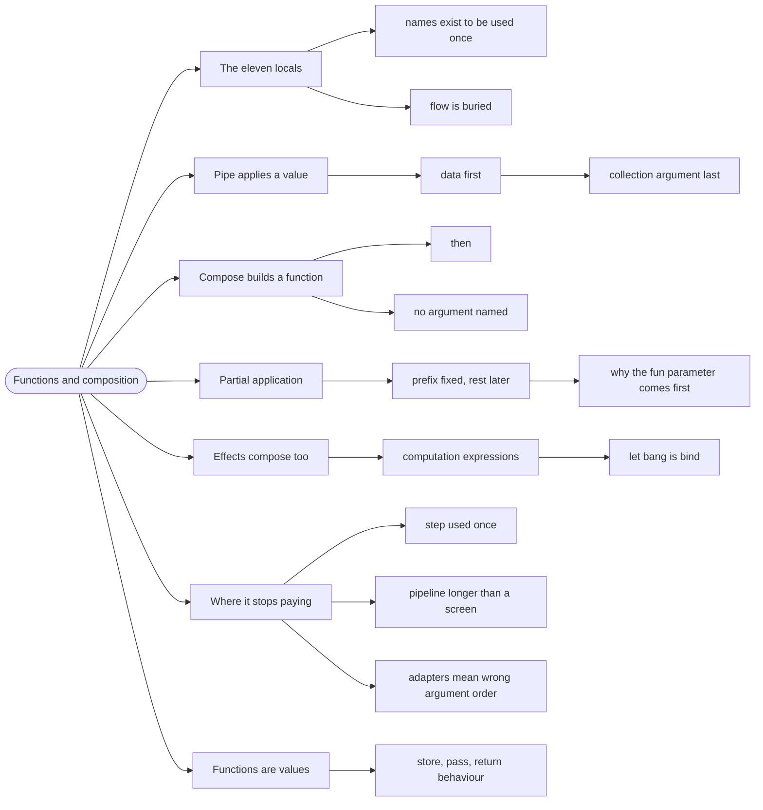

# Functions and Composition — Building by Gluing

> Source: *Stylish F# 6* (Eason) — ch 7 (Coping with Complexity), ch 9
> (Functions); *Domain Modeling Made Functional* ch 8.

**Composition** is building a new function from existing ones without
naming the argument in between. It is the core reason functional code stays
readable as it grows: the pipeline describes *what*, and each named step
describes *how*.

## The function with eleven locals

```fsharp
// ❌ every intermediate value is named, and the flow is buried
let processOrders orders =
    let filtered = List.filter (fun o -> o.Paid) orders
    let mapped = List.map (fun o -> o.Amount) filtered
    let sorted = List.sort mapped
    let summed = List.sum sorted
    summed
```

Every `let` is a new name the reader must hold in working memory, and most
of them exist only to be used once, immediately. This is the imperative
habit leaking into F# — it compiles, and it hides the shape of the
transformation.

## 1. Pipe: apply a value

```fsharp
// ✅ the flow reads top to bottom, no intermediate names
let processOrders orders =
    orders
    |> List.filter (fun o -> o.Paid)
    |> List.map (fun o -> o.Amount)
    |> List.sum
```

`|>` is defined as `let (|>) x f = f x` — it takes a value and a function and
applies the function. Nothing more. It exists purely so the *data* reads
first and each transformation follows.

Why it works: F# puts the collection **last** in its library signatures
(`List.filter predicate list`), which is what lets `list |> List.filter pred`
line up. That argument-order convention is the whole reason pipelines feel
natural — see [designing-functions](../designing-functions/index.md).

## 2. Compose: build a function

```fsharp
// ✅ a new function, defined without naming its argument
let processOrders =
    List.filter (fun o -> o.Paid)
    >> List.map (fun o -> o.Amount)
    >> List.sum
```

`>>` is `let (>>) f g = fun x -> g (f x)` — apply `f`, then `g`.

The distinction that matters:

| | `|>` | `>>` |
| --- | --- | --- |
| **Operates on** | a value | functions |
| **Produces** | a value | a function |
| **Read as** | "take this and pass it to" | "then" |
| **Use when** | you have data now | you are defining a pipeline |

`<<` is composition in the other direction (`g << f` = "g after f"). Prefer
`>>` — it reads in execution order.

## 3. Partial application: supply arguments later

Because F# functions are curried, giving fewer arguments than expected
returns a function waiting for the rest:

```fsharp
// ✅ the prefix is fixed; the list arrives later
let paidOnly = List.filter (fun o -> o.Paid)
let amounts = List.map (fun o -> o.Amount)

let processOrders = paidOnly >> amounts >> List.sum
```

This is why the `fun` parameter comes first: `List.filter predicate` is a
ready-made pipeline stage, while `List.filter list` would not be.

## 4. Composition with effects

Composition is not limited to pure functions. `Result` composes with
`Result.bind`, `Async` with `Async.bind` — and F# has **computation
expressions** to make those chains read like ordinary code:

```fsharp
// ✅ async workflows compose with let! — no callback nesting
let loadDashboard (api: IApi) = async {
    let! games = api.GetGames()
    let! news = api.GetNews()
    let! standings = api.GetStandings()
    return { Games = games; News = news; Standings = standings } }
```

`let!` is **bind** with nicer syntax: it unwraps the value and continues.
Each `let!` is a step in an implicit pipeline, and failures/awaits propagate
without manual nesting.

The composition operators still apply underneath — `async { ... }` is
`Async.bind` written readably.

## 5. Where composition stops paying

Composition is a tool, not a rule. It stops paying when:

- **A step is used once and has no name worth having.** Inline it.
- **The pipeline is longer than a screen.** Split it into named sub-pipelines
  — a 20-stage pipe is as unreadable as a 200-line function.
- **The types stop lining up without adapters.** If you need `fun x -> ...`
  wrappers at every step, the underlying functions have the wrong argument
  order — fix them, don't paper over it.

The honest test: **can you read the pipeline out loud as a sentence?**
"Take the orders, keep the paid ones, take their amounts, sum them." If yes,
the composition is doing its job. If you have to stop and trace, it isn't.

## 6. Function values are first-class

The reason all of this works is that functions are values — you can store
them, pass them, and return them:

```fsharp
// ✅ behaviour as a value, chosen at runtime
type SortOrder = Ascending | Descending

let comparer =
    match sortOrder with
    | Ascending -> id
    | Descending -> List.rev

let sorted = players |> List.sortBy (fun p -> p.Rating) |> comparer
```

This replaces most of what other languages do with strategy interfaces and
factories. See [records-and-unions](../records-and-unions/index.md) for why
that trade is worth it.

## Revise



## Cross-links

- Argument order that makes pipes work:
  [designing-functions](../designing-functions/index.md).
- Pipelines of business steps:
  [workflows-as-pipelines](../workflows-as-pipelines/index.md).
- Collections these operate on: [collections](../collections/index.md).
- Async composition in the browser:
  [commands-and-async](../commands-and-async/index.md).
