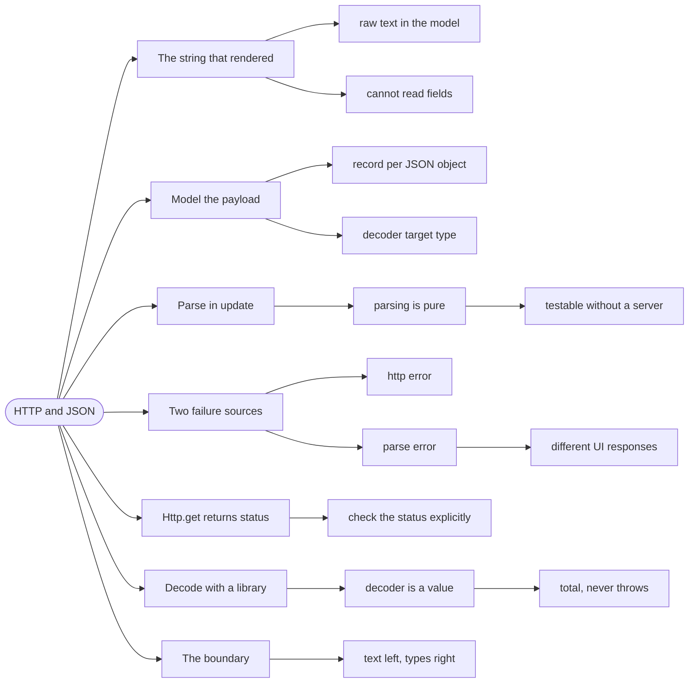

# HTTP and JSON — Turning Text Into Types

> Source: *The Elmish Book* — `commands/http.md`, `commands/async-xhr.md`,
> `commands/using-json.md`.

A browser app's data arrives as **JSON** — a text format for structured data.
Text is not a type, so every response must cross a boundary: parse it into a
record, and decide what to do when the text does not fit.

## The string that rendered as a wall of text

A first attempt at loading store information keeps the response as a string:

```fsharp
// ❌ the model holds raw JSON text
type State =
    { StoreInfo: Deferred<Result<string, string>> }
```

The view can only print it. It cannot read `storeInfo.name`, cannot sum
product prices, and cannot tell whether a field is missing. The data is in
the app and still unusable.

## 1. Model the JSON shape as a record

The first step is to describe the JSON as F# types — the **decoder** target:

```fsharp
// ✅ the shape of the payload, as a type
type Product = { name: string; price: float }

type StoreInfo =
    { name: string
      since: string
      daysOpen: string list
      products: Product list }
```

Now the model can hold `StoreInfo`, and the view can read fields.

## 2. Parse in `update`, not in the command

The book makes a specific choice worth copying: parsing happens in `update`,
not inside the async command.

```fsharp
// ✅ parsing is pure, so it belongs with the other pure logic
| LoadStoreInfo (Finished (Ok json)) ->
    match parseStoreInfo json with
    | Ok info -> { state with StoreInfo = Resolved (Ok info) }, Cmd.none
    | Error e -> { state with StoreInfo = Resolved (Error e) }, Cmd.none
```

The reason is testability: `parseStoreInfo` takes a string and returns a
`Result`, so it can be tested with no HTTP, no async, and no browser. If
parsing lived inside the command, every test would need a server.

## 3. Failure has two distinct sources

A request can fail in two ways, and they are different messages:

| Failure | Cause | What the user sees |
| --- | --- | --- |
| **HTTP failure** | non-200 status, network down | "could not load" |
| **Parse failure** | 200, but the JSON doesn't fit the type | "unexpected data" |

Collapsing both into one `string` error loses the distinction that matters
for debugging — a parse failure means the server contract changed.

```fsharp
// ✅ two cases, so the UI can respond differently
type LoadError =
    | HttpError of status: int
    | ParseError of message: string
```

## 4. `Http.get` returns a status and a body

The book's XHR chapter shows the primitive:

```fsharp
// ✅ status code plus body — the caller decides what a non-200 means
let! (statusCode, body) = Http.get "/store.json"
if statusCode = 200 then
    return LoadStoreInfo (Finished (Ok body))
else
    return LoadStoreInfo (Finished (Error "Could not load"))
```

Note that the status is checked explicitly rather than assumed. A `200` is a
fact about the response, not a guarantee.

## 5. Decode with a library, not by hand

`Thoth.Json` builds a decoder from the type. The decoder is a *value* you
can test and reuse:

```fsharp
// ✅ one decoder, tested once, used by every caller
let parseStoreInfo (json: string) : Result<StoreInfo, string> =
    Decode.fromString StoreInfo.Decoder json
```

Two properties to insist on:

- **The decoder is total.** Every possible JSON string produces either `Ok`
  or `Error` — never an exception.
- **The decoder is separate from the request.** It can be tested against
  captured payloads, including malformed ones.

## 6. Where the boundary sits

```text
server ──HTTP──► string ──decode──► StoreInfo ──► update ──► view
                  │                    │
                  └── parse errors ────┘
```

Everything left of `StoreInfo` is untrusted text. Everything right of it is
a domain type. The decoder is the only place that translation happens —
the same trust-boundary rule as
[serialization-and-persistence](../serialization-and-persistence/index.md),
seen from the client side.

## Revise



## Cross-links

- Where the decoded value goes: [commands-and-async](../commands-and-async/index.md).
- The same boundary on the server: [serialization-and-persistence](../serialization-and-persistence/index.md).
- Failure as a value: [errors-and-result](../errors-and-result/index.md).
- The loop that consumes it: [fable-and-elm](../fable-and-elm/index.md).
