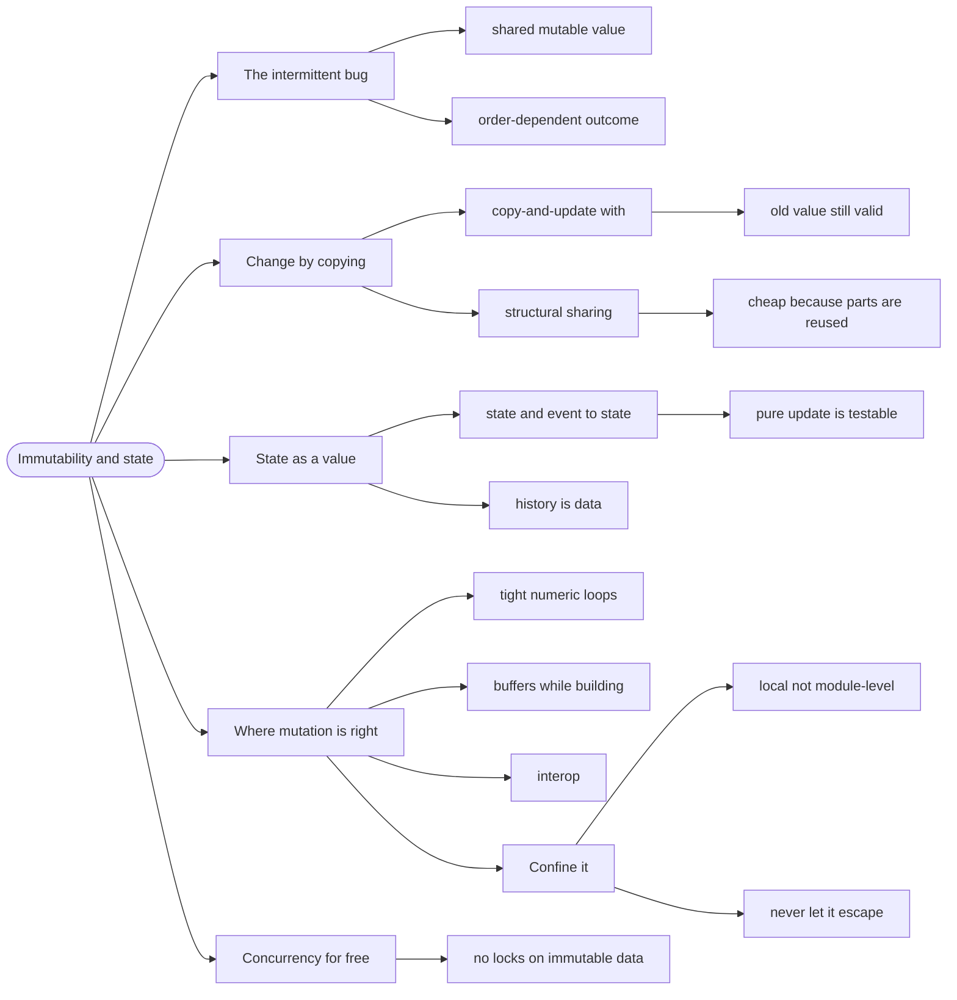

# Immutability and State — Change by Copying

> Source: *Stylish F# 6* (Eason) — ch 5 «Immutability and Mutation»,
> ch 10 «Asynchronous and Parallel Programming».

An **immutable** value cannot be changed after it is created. In F# that is the default: `let` bindings cannot be reassigned, and records cannot be mutated.

Change is expressed by making a **new** value that shares most of the old one.

## The bug that only happens sometimes

```fsharp
// ❌ shared mutable state — who changed it? when?
let mutable currentTournament = loadTournament id
// ... 200 lines later, in another function ...
currentTournament <- { currentTournament with registrationOpen = false }
```

A bug appears in testing, once, and cannot be reproduced. The cause: two
code paths write the same mutable value, and the outcome depends on order.
There is no single place to look.

Immutability removes this class of bug entirely — not by discipline, but
because **the write is not expressible**.

## 1. Records: copy-and-update

```fsharp
// ✅ a new value; the original is untouched
let closed = { tournament with registrationOpen = false }
// `tournament` still has registrationOpen = true
```

The `with` syntax is **copy-and-update**: it makes a shallow copy with the
named fields replaced. Everything not named is shared, not copied — which
is why this is cheap for large records.

The crucial property: the old value is still valid and unchanged. Any code
holding it is unaffected. There is no "when did this change?" question,
because nothing changes.

## 2. Why this scales: structural sharing

A list of 10,000 items where you prepend one element does **not** copy
10,000 items. It creates one new node pointing at the existing list:

```fsharp
let updated = newItem :: originalList   // O(1), shares the tail
```

That is **structural sharing** — immutable data structures are cheap
because they reuse unchanged parts. It is why "just copy everything" is not
the cost you would assume.

## 3. State is a value, not a place

The functional way to have state that changes over time is to model it as a
value that is *replaced*, not mutated. Instead of a mutable field, you have
a current state and a function from `(state, event) -> state`:

```fsharp
// ✅ state as a value: pure, testable, replayable
type Model = { Count: int; History: int list }

let update (msg: Msg) (model: Model) =
    match msg with
    | Increment -> { model with Count = model.Count + 1; History = model.Count :: model.History }
    | Decrement -> { model with Count = model.Count - 1; History = model.Count :: model.History }
```

This is the Elmish architecture in miniature (see
[fable-and-elm](../fable-and-elm/index.md)) — and the reason it is popular
is exactly this: a pure `update` is trivially testable (call it, compare
values), and the history is data you can inspect.

## 4. Where mutation is still right

F# does not ban mutation. SF6 is explicit that some code is genuinely
better with it:

- **Tight numeric loops** — allocating a new array per iteration is real
  cost.
- **Building a large buffer** — `ResizeArray<'T>` (a .NET `List`) is the
  right tool while accumulating, then convert to a list or array at the
  end.
- **Interop** — .NET APIs that mutate in place.

The rules that keep it safe:

1. **Confine it.** A `mutable` local inside one function is fine; a
   `mutable` module-level value shared across the app is not.
2. **Never let it escape.** Copy to an immutable value before returning.
3. **Keep the scope small enough to read in one screen.**

```fsharp
// ✅ mutation confined, immutable result
let buildLookup (players: Player list) =
    let buffer = ResizeArray()
    for p in players do buffer.Add(p.Id, p)
    buffer |> Seq.map (fun (k, v) -> k, v) |> Map.ofSeq
```

## 5. Concurrency falls out for free

The practical payoff: **immutable data can be shared across threads with no
locking**. There is no race condition because there is no write.

This is why F# concurrency (`Async.Parallel`, `Async.StartChild`) is
dramatically simpler than the equivalent in a mutable-first language — the
data being passed around cannot be corrupted by another thread, so the only
question left is coordination, not safety.

```fsharp
// ✅ no locks needed — the data cannot be mutated
let! results = players |> List.map fetchPlayer |> Async.Parallel
```

## Revise



## Cross-links

- Collections and their costs: [collections](../collections/index.md).
- State as a value in the browser: [fable-and-elm](../fable-and-elm/index.md).
- Async without locks: [commands-and-async](../commands-and-async/index.md).
- Records in depth: [records-and-unions](../records-and-unions/index.md).
