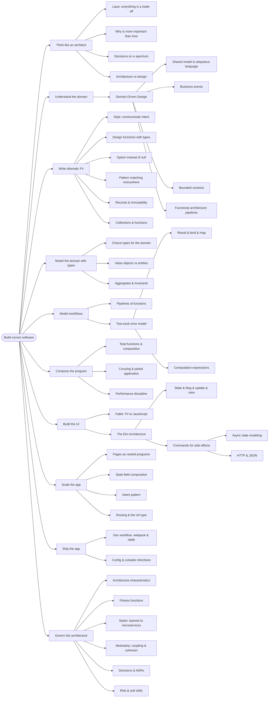

# Architecture Crash Course

A distilled guide to four books on building correct software, organized by
**knowledge topic** (not by book), in reading order from first principles to
production practice. The sources live in the repository under `knowledge/md/`
and `knowledge/src/the-elmish-book/`. Every page cross-references the other
books where the same concept appears — the course is meant to be read as one
connected body of knowledge.

## Reading order (beginner → end)

### Part I — Think like an architect

1. **[architecture-thinking](architecture-thinking/index.md)** — what an
   architect is, the three laws of software architecture, architecture vs
   design, trade-off analysis. *(FSA ch 1–2, 27.)*

### Part II — Understand the problem first

2. **[domain-driven-design](domain-driven-design/index.md)** — shared models,
   business events, subdomains, bounded contexts, ubiquitous language,
   functional architecture. *(DMMF ch 1–3; echoed by FSA's bounded-context
   scoping in ch 7.)*
3. **[discovering-a-domain-alone](discovering-a-domain-alone/index.md)** —
   the solo-developer companion: when you are business, product owner, and
   developer in one, harvest the field's artifacts as your domain expert,
   event-storm alone, and let the compiler interrogate the model.
   *(Synthesis: DMMF ch 1–2 + Brandolini, solo-adapted.)*

### Part III — Model with types and functions

4. **[fsharp-style](fsharp-style/index.md)** — code as communication: the
   four traits of unreadable code, designing functions with types, option
   instead of null, pattern matching, immutability. *(SF6 ch 1, 3, 5, 6.)*
5. **[domain-modeling-with-types](domain-modeling-with-types/index.md)** —
   modeling the domain in the type system: simple values, choice types,
   records, value objects vs entities, aggregates, invariants, state
   machines. *(DMMF ch 4–6; SF6 ch 2, 7 for the same ideas in practice.)*
6. **[workflows-and-error-handling](workflows-and-error-handling/index.md)** —
   workflows as pipelines; the two-track model; `Result`, `bind`, `map`,
   computation expressions; error types as choice types. *(DMMF ch 7, 10;
   SF6 ch 11 railway-oriented programming is the same idea in a factory
   analogy.)*
7. **[functions-and-composition](functions-and-composition/index.md)** —
   functions as values, currying and partial application, composition,
   collections, and the discipline of performance measurement. *(SF6 ch 4,
   9, 12; DMMF ch 8 for total functions.)*

### Part IV — Build the application

8. **[fable-and-elm-architecture](fable-and-elm-architecture/index.md)** —
   Fable compiles F# to JavaScript; The Elm Architecture (state / message /
   update / view); rendering and inputs. *(Elmish Book parts 1–2.)*
9. **[commands-and-async-data](commands-and-async-data/index.md)** —
   `Cmd<'msg>` explained from first principles; async start/finish event
   pairs; `Deferred<'T>`; HTTP and JSON with Thoth. *(Elmish Book part 3.)*
10. **[scaling-and-routing](scaling-and-routing/index.md)** — splitting an
    app into nested programs; state-field composition; the Intent pattern;
    routing and the `Url` type. *(Elmish Book part 4; composition echoes
### Part V — Ship and operate

11. **[dev-workflow](dev-workflow/index.md)** — webpack modes, compiler
    directives, configuration variables, hot module replacement, Sass,
    Femto for npm dependencies. *(Elmish Book part 5.)*

### Part VI — Govern and evolve

12. **[architecture-characteristics-and-governance](architecture-characteristics-and-governance/index.md)** —
    identifying characteristics from domain concerns; measuring and
    governing with fitness functions; component-based thinking; modularity
    metrics. *(FSA ch 3–8.)*
13. **[architecture-styles](architecture-styles/index.md)** — the style
    catalog from layered to microservices; monolith vs distributed;
    partitioning technical vs domain; choosing a style. *(FSA ch 9–19.)*
14. **[architecture-decisions-and-soft-skills](architecture-decisions-and-soft-skills/index.md)** —
    ADRs, analyzing risk with risk storming, diagramming with C4, team
    personalities, negotiation. *(FSA ch 20–26.)*

## Concept cross-reference (where topics recur across books)

| Concept | FSA | DMMF | SF6 | Elmish Book |
| --- | --- | --- | --- | --- |
| Everything is a trade-off | ch 1, 2, 27 | ch 3 (architecture) | ch 12 (abstraction vs efficiency) | ch 2 (design choices) |
| Bounded contexts as modules | ch 7 (quanta), 18 (microservices) | ch 1–3 | — | part 4 (pages as programs) |
| Model with types, not flags | — | ch 4–6 | ch 2, 3, 7 | part 2 (State/Msg types) |
| Explicit errors over exceptions | ch 22 (risk) | ch 6, 10 | ch 11 (ROP) | part 3 (Result in async) |
| Composition of small parts | ch 8 (components) | ch 7, 9 (pipelines) | ch 9 (composition), 4 | part 4 (nested programs) |
| Communicate intent | ch 21 (ADRs) | ch 2 (ubiquitous language) | ch 1 (semantic focus) | part 4 (Intent pattern) |
| Immutability / pure cores | — | ch 5, 9 | ch 5 | part 2 (state copies in update) |
| Measuring instead of guessing | ch 3 (metrics), 6 (fitness) | — | ch 12 (BenchmarkDotNet) | part 5 (bundle analysis) |
| Partitioning: technical vs domain | ch 9, 18 | ch 3 (vertical slices) | — | part 4 (page modules) |
| Data at the edges | ch 26 (data topologies) | ch 11–12 | — | part 3 (HTTP/JSON) |

## About this course

- Distilled from four books: *Fundamentals of Software Architecture*
  (Richards & Ford), *Domain Modeling Made Functional* (Wlaschin),
  *Stylish F# 6* (Eason), and *The Elmish Book* (Ajaj). The source chapter
  is noted on every page so you can go deeper.
- Each topic page ends with **Cross-links** to related knowledge wherever
  it lives in the course.
- The full-text search index over the source books
  (`knowledge/distill/_index/` in the repository) is repo-local tooling
  and is not published with the site.
