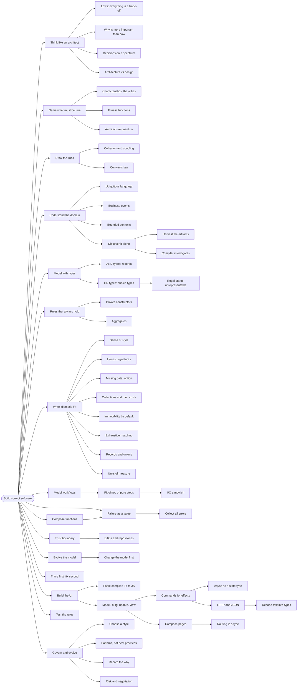

# Architecture Crash Course

A distilled guide to four books on building correct software, organized by
**knowledge topic** (not by book), in reading order from first principles to
production practice. The sources live in the repository under `knowledge/md/`
and `knowledge/src/the-elmish-book/`. Every page cross-references the other
books where the same concept appears — the course is meant to be read as one
connected body of knowledge.

## Reading order (beginner → end)

### Part I — Think like an architect

1. **[architectural-thinking](architectural-thinking/index.md)** — what an
   architect is, the three laws as tests, architecture vs design, breadth
   over depth, and a worked trade-off. *(FSA ch 1–2, 27.)*
2. **[architectural-characteristics](architectural-characteristics/index.md)** —
   naming the "-ilities", translating business concerns, measuring with
   metrics, governing with fitness functions, and the architecture quantum.
   *(FSA ch 4–7.)*
3. **[modularity-and-components](modularity-and-components/index.md)** —
   cohesion and coupling, technical vs domain partitioning, Conway's Law,
   components as the architect's unit, and the coupling metrics.
   *(FSA ch 3, 8.)*

### Part II — Understand the problem first

4. **[domain-driven-design](domain-driven-design/index.md)** — shared
   models, business events, subdomains, bounded contexts, ubiquitous
   language, and the functional architecture. *(DMMF ch 1–3.)*
5. **[discovering-a-domain-alone](discovering-a-domain-alone/index.md)** —
   the solo-developer companion: harvest the field's artifacts as your
   domain expert, event-storm alone, and let the compiler interrogate the
   model. *(Synthesis: DMMF ch 1–2 + Brandolini, solo-adapted.)*
6. **[modeling-with-types](modeling-with-types/index.md)** — AND types, OR
   types, the refined-type process, wrapping primitives, smart constructors,
   value objects vs entities. *(DMMF ch 4–5, 9; SF6 ch 2.)*
7. **[integrity-and-invariants](integrity-and-invariants/index.md)** — the
   verified-email bug, internal vs external integrity, aggregates as
   consistency boundaries, and why consistency is a business term.
   *(DMMF ch 6.)*

### Part III — Write idiomatic F#

8. **[sense-of-style](sense-of-style/index.md)** — naming, layout, types as
   documentation, and comments that explain why rather than what.
   *(SF6 ch 1–2.)*
9. **[designing-functions](designing-functions/index.md)** — honest
   signatures, `Option` vs `Result` for failure, currying and argument
   order, total functions, and when to be generic. *(SF6 ch 2, 7–8.)*
10. **[missing-data](missing-data/index.md)** — the null problem, `Option`
    as a choice type, `map` vs `bind`, when `option` is the wrong tool, and
    interop at the edge. *(SF6 ch 6–7.)*
11. **[collections](collections/index.md)** — lists, arrays, and sequences;
    the cost of each operation; the four workhorses; laziness surprises.
    *(SF6 ch 4–5.)*
12. **[immutability-and-state](immutability-and-state/index.md)** —
    copy-and-update, structural sharing, state as a value, where mutation is
    still right, and concurrency for free. *(SF6 ch 5, 11.)*
13. **[pattern-matching](pattern-matching/index.md)** — exhaustiveness as a
    requirements checklist, the pattern vocabulary, active patterns, and
    when a partial match is legitimate. *(SF6 ch 6, 12.)*
14. **[records-and-unions](records-and-unions/index.md)** — the two building
    blocks, single-case wrappers, when a class earns its place, and modules
    for functions. *(SF6 ch 3, 8.)*
15. **[units-and-measures](units-and-measures/index.md)** — dimensional
    safety at compile time, explicit conversions, where units pay off most,
    and their limits. *(SF6 ch 2, 10.)*

### Part IV — Build the application

16. **[workflows-as-pipelines](workflows-as-pipelines/index.md)** —
    splitting a workflow into typed steps, the I/O sandwich, injecting
    dependencies as functions, and short-circuiting on error.
    *(DMMF ch 7–9.)*
17. **[functions-and-composition](functions-and-composition/index.md)** —
    pipe vs compose, partial application, composition with effects, and
    where composition stops paying. *(SF6 ch 9; DMMF ch 8.)*
18. **[errors-and-result](errors-and-result/index.md)** — failure as a
    value, `Option` vs `Result`, `bind`, collecting all errors, and the two
    levels of error. *(DMMF ch 8, 10; SF6 ch 11.)*
19. **[serialization-and-persistence](serialization-and-persistence/index.md)** —
    DTOs as a separate shape, two total mapping functions, versioning,
    repository boundaries, and event sourcing's honest trade.
    *(DMMF ch 11–13.)*
20. **[evolving-a-design](evolving-a-design/index.md)** — changing the model
    before the code, naming a category with an active pattern, and letting
    the compiler carry the change. *(DMMF ch 13.)*

### Part V — Build the UI

21. **[fable-and-elm](fable-and-elm/index.md)** — the four blocks, a
    complete counter program, why the loop fixes UI inconsistency, and how
    Fable runs. *(Elmish Book parts 1–2.)*
22. **[commands-and-async](commands-and-async/index.md)** — commands as
    values, `Cmd.OfAsync.either`, loading state as a type, `Deferred`, and
    composing commands. *(Elmish Book part 3.)*
23. **[http-and-json](http-and-json/index.md)** — modelling the payload as
    records, parsing in `update`, two failure sources, and the decode
    boundary. *(Elmish Book part 3, §HTTP and §Using Thoth.Json.)*
24. **[scaling-and-routing](scaling-and-routing/index.md)** — composing
    pages, the two composition forms, the Intent pattern, and the URL as a
    type. *(Elmish Book part 4.)*
25. **[dev-workflow](dev-workflow/index.md)** — trace first, fix second;
    turning the trace on; structuring for fast feedback; debugging in order.
    *(Elmish Book part 5.)*

### Part VI — Govern and evolve

26. **[architecture-styles](architecture-styles/index.md)** — layered,
    modular monolith, pipeline, microkernel, event-driven, service-based,
    microservices, and how to choose by elimination. *(FSA ch 9–19.)*
27. **[architecture-patterns](architecture-patterns/index.md)** — reuse,
    orchestration vs choreography, CQRS, and broker topologies; why a
    pattern is not a best practice. *(FSA ch 20.)*
28. **[decisions-and-risk](decisions-and-risk/index.md)** — the ADR, when a
    decision deserves one, immutability of records, risk matrices, and
    fitness functions that make decisions stick. *(FSA ch 21–23.)*
29. **[teams-and-negotiation](teams-and-negotiation/index.md)** — trading
    instead of refusing, knowing your audience, consensus without
    committee, and the 4 Cs. *(FSA ch 24–26.)*
30. **[testing](testing/index.md)** — why pure functions test easily, what
    the compiler cannot check, property-based tests, what not to test, and
    fitness functions as tests. *(DMMF ch 6, 9; FSA ch 24.)*

## Source map (claim → book/chapter)

Rule B5 of the distillation ruleset requires every claim to be traceable.
This table is the verifiable index — check any page against it.

| Page | DMMF | FSA | SF6 | Elmish Book |
| --- | --- | --- | --- | --- |
| architectural-thinking | — | 1, 2, 27 | — | — |
| architectural-characteristics | — | 4, 5, 6, 7 | — | — |
| modularity-and-components | — | 3, 8 | — | — |
| domain-driven-design | 1, 2, 3 | — | — | — |
| discovering-a-domain-alone | 1, 2 | — | — | — |
| modeling-with-types | 4, 5, 6, 9 | — | 2 | — |
| integrity-and-invariants | 6 | — | — | — |
| sense-of-style | — | — | 1, 13 | — |
| designing-functions | 8 | — | 2, 9 | — |
| missing-data | — | — | 3, 7 | — |
| collections | — | — | 4, 5, 12 | — |
| immutability-and-state | — | — | 5, 10 | — |
| pattern-matching | — | — | 6, 13 | — |
| records-and-unions | 4, 9 | — | 7, 8 | — |
| units-and-measures | 6 | — | 2 | — |
| workflows-as-pipelines | 7, 8, 9 | — | — | — |
| functions-and-composition | 8 | — | 9 | — |
| errors-and-result | 8, 10 | — | 11 | — |
| serialization-and-persistence | 11, 12, 13 | — | — | — |
| evolving-a-design | 13 | — | — | — |
| fable-and-elm | — | — | — | `elm/*`, `fable/*` |
| commands-and-async | — | — | — | `commands/*` |
| http-and-json | — | — | — | `commands/http.md`, `using-json.md` |
| scaling-and-routing | — | — | — | `scaling/*` |
| dev-workflow | — | — | — | `elm/project-structure.md` |
| architecture-styles | — | 9–19 | — | — |
| architecture-patterns | — | 20 | — | — |
| decisions-and-risk | — | 20, 21, 22, 23 | — | — |
| teams-and-negotiation | — | 23, 24, 25, 26 | — | — |
| testing | 6, 9 | 24 | — | — |

### Known gaps

Chapters read but **not** distilled into a page, with the reason:

| Source | Chapter | Why not covered |
| --- | --- | --- |
| FSA | 17 «Orchestration-Driven SOA» | Historical; the book itself treats it as superseded |
| FSA | 26 «Architectural Intersections» | Touches engineering practices beyond this course's scope |
| FSA | 27 (partly) | Its laws are on `architectural-thinking`; the rest is a worked case study |
| SF6 | 12 «Performance» | Only the collection-cost rule is used, on `collections` |
| SF6 | 14 «Summary» | Recap of chapters already covered |
| Elmish | `dev-flow/*` | Describes a webpack toolchain this repo does not use |
| Elmish | `elm/todo-app*.md` | Worked exercise series; rule A8 forbids exercises |

## Concept cross-reference (where topics recur across books)

| Concept | FSA | DMMF | SF6 | Elmish Book |
| --- | --- | --- | --- | --- |
| Everything is a trade-off | ch 1, 2, 27 | ch 3 (architecture) | ch 12 (abstraction vs efficiency) | ch 2 (design choices) |
| Bounded contexts as modules | ch 7 (quanta), 18 (microservices) | ch 1–3 | — | part 4 (pages as programs) |
| Model with types, not flags | — | ch 4–6 | ch 2, 3, 7 | part 2 (State/Msg types) |
| Explicit errors over exceptions | ch 22 (risk) | ch 6, 10 | ch 8 | part 3 (Result in async) |
| Composition of small parts | ch 8 (components) | ch 7, 9 (pipelines) | ch 9 (composition), 4 | part 4 (nested programs) |
| Communicate intent | ch 21 (ADRs) | ch 2 (ubiquitous language) | ch 1 (semantic focus) | part 4 (Intent pattern) |
| Immutability / pure cores | — | ch 5, 9 | ch 5 | part 2 (state copies in update) |
| Measuring instead of guessing | ch 3 (metrics), 6 (fitness) | — | ch 10 (BenchmarkDotNet) | part 5 (bundle analysis) |
| Partitioning: technical vs domain | ch 9, 18 | ch 3 (vertical slices) | — | part 4 (page modules) |
| Data at the edges | ch 26 (data topologies) | ch 11–12 | — | part 3 (HTTP/JSON) |

## About this course

- Distilled from four books: *Fundamentals of Software Architecture*
  (Richards & Ford), *Domain Modeling Made Functional* (Wlaschin),
  *Stylish F# 6* (Eason), and *The Elmish Book* (Ajaj). The source chapter
  is noted on every page so you can go deeper.
- Each page is a **tutorial**, not a reference: a story, numbered chunks
  with ❌/✅ worked examples, and a Revise flowchart at the end. There are
  no exercises.
- Every page ends with **Cross-links** to related knowledge wherever it
  lives in the course.
- The full-text search index over the source books
  (`knowledge/distill/_index/` in the repository) is repo-local tooling
  and is not published with the site.
