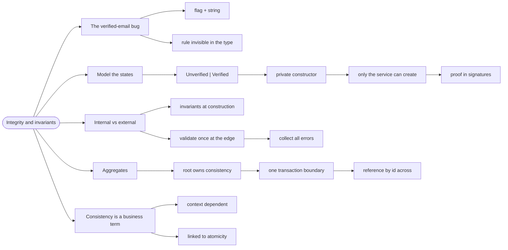

# Integrity and Invariants — Rules That Always Hold

> Source: *Domain Modeling Made Functional* (Wlaschin) — ch 6 «Integrity and
> Consistency in the Domain».

An **invariant** is a rule that must always be true of your data — "an
order's total equals the sum of its lines", "a verified email was verified
by the verification service". Integrity is the discipline of making those
rules impossible to break, rather than checking them everywhere and hoping.

## The verified email that wasn't

DMMF's example. A customer record has an email address and an `IsVerified`
flag:

```fsharp
// ❌ two fields, one business rule, zero enforcement
type Customer = {
    Email: string
    IsVerified: bool
}
```

Three things are wrong, and none of them is visible in the type:

- **Nothing sets the flag back** when the email changes. A developer who
  doesn't know the rule silently leaves a verified flag on an unverified
  address.
- **Nothing stops a bug** from setting `IsVerified = true` on any address at
  all — which would let a password reset go to an unverified mailbox.
- **The rule is invisible.** It lives in a comment, or in someone's head.

This is the integrity failure mode: the rule exists, but the type doesn't
know about it, so the compiler can't help you keep it.

## 1. Model the states as separate things

The domain expert says: *a customer's email is either verified or
unverified*. That is an OR — so model it as one:

```fsharp
// ✅ DMMF ch 6 — the two states are different things
type CustomerEmail =
    | Unverified of EmailAddress
    | Verified of VerifiedEmailAddress
```

But that alone still lets you construct `Verified` from an ordinary
address. So add the second move: make `VerifiedEmailAddress` a **different
type with a private constructor**.

```fsharp
// ✅ only the verification service can create this
type VerifiedEmailAddress = private VerifiedEmailAddress of EmailAddress

module VerifiedEmailAddress =
    /// the only door in — called by the verification service
    let create (address: EmailAddress) : VerifiedEmailAddress =
        VerifiedEmailAddress address
```

Now the chain is forced:

- To build `Verified`, you need a `VerifiedEmailAddress`.
- To get a `VerifiedEmailAddress`, you must call the verification service.
- Therefore **a verified email that was never verified cannot exist.**

The book's summary: *invalid situations cannot ever exist in the code, and
we never need to write unit tests for them — we have "compile-time" unit
tests instead.*

And it documents the domain better, because the workflow that sends a
password reset can now demand the proof in its signature:

```fsharp
// ✅ the business rule is now in the type
type SendPasswordResetEmail = VerifiedEmailAddress -> ...
```

Nobody can accidentally pass an unverified address. They can't construct
one.

## 2. Internal vs external integrity

The book splits integrity by *where* the rule lives:

- **Internal integrity** — invariants inside one context. Enforce them **at
  construction**: build values that are correct by construction, and the
  rest of the code never re-checks.
- **External integrity** — the boundary. Data arrives from outside (a DTO,
  a form post, a file) and must be validated **once**, at the edge, before
  it becomes a domain type.

Two rules for the boundary:

1. **Validate once, at the edge.** Not in every consumer.
2. **Collect all errors, not just the first.** A user who gets one error,
   fixes it, and gets the next one has been failed by the design.

```fsharp
// ✅ external integrity: one gate, all errors at once
let validateOrder (dto: OrderDto) : Result<ValidatedOrder, ValidationError list> =
    let errors =
        [ if String.IsNullOrWhiteSpace dto.OrderId then yield "order id is required"
          if dto.Lines.IsEmpty then yield "an order needs at least one line"
          if dto.Lines |> List.exists (fun l -> l.Quantity <= 0) then
              yield "quantities must be positive" ]
    if errors.IsEmpty then Ok (buildOrder dto) else Error errors
```

## 3. Aggregates: where consistency is enforced

An **aggregate** is a cluster of entities with one *root* that owns all the consistency rules.

Outsiders touch the children only through the root.

The rule of thumb the book gives: **the aggregate is the boundary of what
must be updated in one transaction.**

- Order + its lines: one aggregate. The total must match the lines, and that
  must be true atomically.
- Order + Customer: **not** one aggregate. Customer is referenced by id.
  Forcing them into one transaction makes the system rigid for no gain.

The root is the only component that "knows" how to preserve consistency, so
all updates go through it:

```fsharp
// ✅ the root owns the invariant: total = sum of lines
type Order = private {
    Id: OrderId
    Lines: OrderLine list
    Total: decimal
}
```

```fsharp
// ✅ the only way to change lines recalculates the total
module Order =
    let private recalculate order =
        { order with Total = order.Lines |> List.sumBy (fun l -> l.Price) }

    let addLine line order =
        recalculate { order with Lines = line :: order.Lines }
```

Note what is missing: there is no way to set the total independently. That
absence *is* the invariant.

## 4. Consistency is a business term

The book is careful here: **consistency means whatever the business needs it
to mean**, and it is always context-dependent.

- If a product's price changes, should unshipped orders be updated? There is
  no technical answer; it depends on the business.
- If a customer's default address changes, should pending orders follow?
  Again — a business decision.

Two consequences:

- **Consistency is expensive**, so avoid demanding it unnecessarily.
- **Consistency and atomicity are linked.** There is no point making an
  order internally consistent if its parts are persisted separately and one
  write can fail — a later read would load an inconsistent order.

This is why aggregate boundaries and transaction boundaries are usually the
same line.

## Revise



## Cross-links

- The type-level moves used here:
  [modeling-with-types](../modeling-with-types/index.md).
- Where validation sits in a pipeline:
  [workflows-as-pipelines](../workflows-as-pipelines/index.md).
- Errors as domain types: [errors-and-result](../errors-and-result/index.md).
- Aggregates and bounded contexts:
  [domain-driven-design](../domain-driven-design/index.md).
