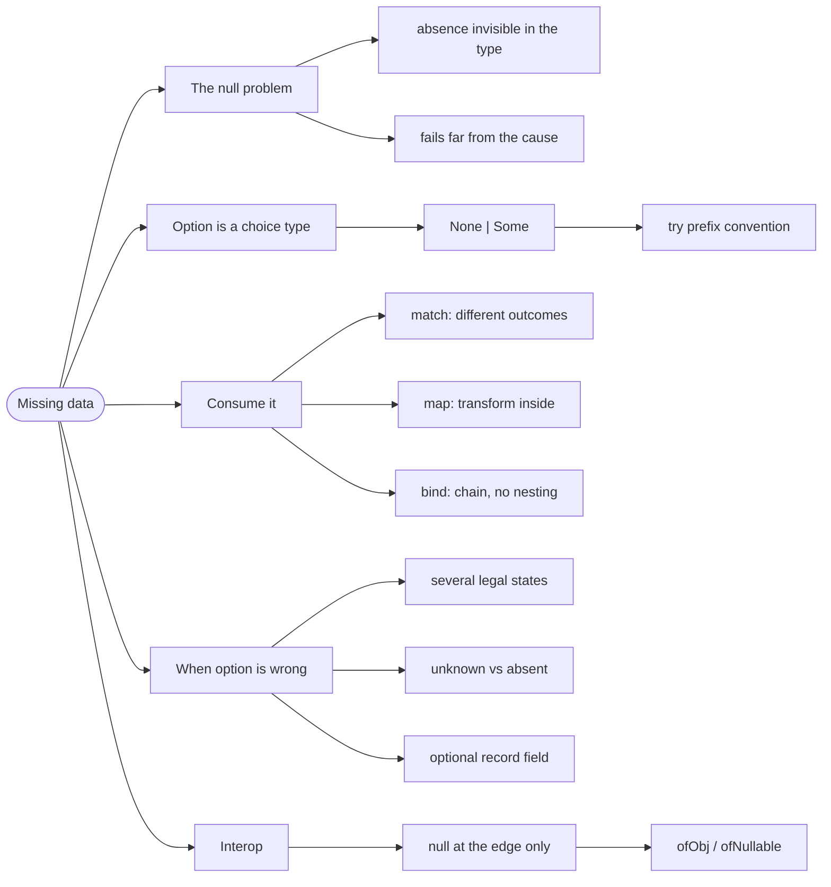

# Missing Data — Option and the Null Problem

> Source: *Stylish F# 6* (Eason) — ch 3 «Missing Data», ch 7 «Record
> Types».

**Missing data** is the everyday case where a value may or may not exist: a
middle name, a discount code, a search result. F# has no `null` for these —
it has `Option<'T>`, a type that makes absence explicit and forces every
caller to decide what to do about it.

## The null that crashed in production

```fsharp
// ❌ the shape that causes it: absence is invisible
let findPlayer (id: string) : Player =
    players |> List.find (fun p -> p.Id = id)   // throws if absent
```

The signature says `-> Player`. It cannot fail. It fails. And in a
distributed app the failure surfaces far from the cause — a 500 in a page
that has nothing to do with players.

The general name for this problem is **the billion-dollar mistake** (Tony
Hoare's phrase for inventing the null reference). F# avoids it by not
having `null` in the type system at all for F# types.

## 1. Option is a choice type with two cases

```fsharp
// the definition you never have to write — it is built in
type Option<'T> =
    | None
    | Some of 'T
```

`Some value` means the value is here; `None` means it is not. Nothing else
is possible — there is no "null but not null" third state, and no way to
read the value without first handling `None`.

```fsharp
// ✅ absence is in the type — the caller must decide
let findPlayer (id: string) : Player option =
    players |> List.tryFind (fun p -> p.Id = id)
```

Note the naming convention in F#: the `try` prefix means "returns an
option". `List.find` throws; `List.tryFind` returns an option. The same
pairing exists for `tryHead`, `tryPick`, `tryItem`, `tryParse`, and more.

## 2. Match on it, or map over it

The explicit way:

```fsharp
// ✅ every case answered — no way to forget None
let playerName id =
    match findPlayer id with
    | Some player -> player.Name
    | None -> "(unknown player)"
```

The composable way — `Option.map` applies a function *only if* the value is
there:

```fsharp
// ✅ map: transform the inside, leave None alone
let upperName = findPlayer id |> Option.map (fun p -> p.Name.ToUpper())
// Some "ALICE"  or  None
```

The rule of thumb: **use `match` when the two cases do different things;
use `map`/`bind` when you are transforming the success case.**

## 3. Option in a pipeline: bind

Chaining operations that each might fail needs `Option.bind`, not
`Option.map` — because `map` would give you a nested `Option<Option<'T>>`:

```fsharp
// ❌ map over a function that already returns option — nesting
let bad = findPlayer id |> Option.map findTeamOf   // Player option option

// ✅ bind flattens — one level of option
let good = findPlayer id |> Option.bind findTeamOf // Team option
```

`bind` is the workhorse. Whenever you see `Some (Some x)` in your code,
you wanted `bind`.

## 4. Don't use option where a choice type is better

This is the trap SF6 and DMMF both flag. An option says "present or
absent". Often the domain actually has **several** legal states, and
`option` flattens them into something ambiguous:

```fsharp
// ❌ what does None mean? No contact info? No email? Not loaded?
type Customer = { Contact: ContactInfo option }

// ✅ the real domain has three shapes
type ContactInfo =
    | EmailOnly of EmailAddress
    | AddrOnly of PostalAddress
    | EmailAndAddr of EmailAddress * PostalAddress
```

The same warning applies to optional *fields*: `option` inside a record
usually means the record is modelling two different things. Split it.

And for a value that is merely not-yet-known, `option` is also wrong — the
type should say *why* it is unknown (`NotAsked | Loading | Loaded | Failed`,
which is exactly what this repo's `RemoteData` does; see
[commands-and-async](../commands-and-async/index.md)).

## 5. Interop: the one place null appears

F# has to talk to .NET, and .NET has `null`. Two rules keep it contained:

- **At the boundary**, convert `null` to `Option` immediately:
  `Option.ofObj` and `Option.ofNullable`.
- **Inside your domain**, never let a `null`-able type in. Wrap it.

```fsharp
// ✅ null handled once, at the edge
let lookupFromDotNet (key: string) : string option =
    dict.TryGetValue key
    |> function
        | true, v -> Some v
        | false, _ -> None
```

## Revise



## Cross-links

- When several states are legal:
  [modeling-with-types](../modeling-with-types/index.md).
- When failure needs a reason: [errors-and-result](../errors-and-result/index.md).
- Absence in the UI: [commands-and-async](../commands-and-async/index.md).
- The F# mechanics: [records-and-unions](../records-and-unions/index.md).
