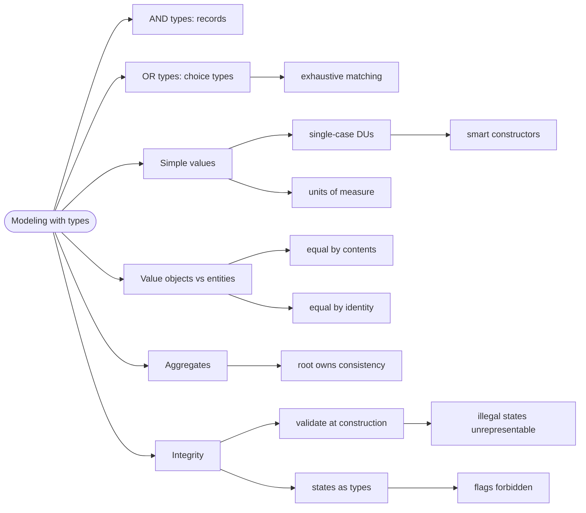

# Modeling with Types — Make Illegal States Unrepresentable

> Source: *Domain Modeling Made Functional* (Wlaschin) — ch 4
> (Understanding Types), ch 5 (Domain Modeling with Types).

An F# type system is **algebraic**: it has **AND types** (records, where all
fields exist together) and **OR types** (choice types, where the value is
exactly one case). Domain modeling is the act of expressing the business
rules as combinations of those two — so that nonsense is rejected by the
compiler instead of by a runtime check.

## The flag that lies

This repo's real tournament type:

```fsharp
type Tournament =
    { id: string
      name: string
      gameId: string
      startsAt: DateTime
      prize: string
      registrationOpen: bool }
```

Six fields, zero rules. Nothing stops `registrationOpen = true` on a
tournament that started three days ago. Nothing stops `gameId` and `id`
being swapped — both are `string`.

And the UI trusts the flag. The countdown badge checks only that:

```fsharp
if tournament.registrationOpen then
    let span = tournament.startsAt - System.DateTime.Now
    // ...
    else "Starting now"
```

So a tournament that concluded last week renders **"Starting now"
forever**. No crash — just a lie.

**Illegal states don't throw. They mislead.** Every consumer re-derives
"what phase is this?" from raw fields, and each derivation is a fresh
chance to be wrong.

## 1. The move you already made

This repo solved the same problem once already. From `State/RemoteData.fs`:

```fsharp
// ❌ the shape its doc comment warns against:
//    ad-hoc `bool IsLoading` / `bool HasError` fields
{ data = None; isLoading = true; hasError = true }   // contradictory, compiles
```

```fsharp
// ✅ four states, all legal, all forced-handled
type RemoteData<'T> =
    | NotAsked
    | Loading
    | Loaded of 'T
    | Failed of string
```

A **choice type** — also called a **discriminated union** or DU — is a type
whose value must be exactly one of a fixed list of named cases. Two
booleans give four combinations and answer no real question; four cases
answer every one of them, and the compiler forces every consumer to handle
each.

**A type is a claim about what can exist.** `bool` claims almost nothing.

## 2. AND and OR: reading the domain sentence

Take a sentence from the domain:

> *A tournament is announced, or registration is open, or check-in is open,
> or it is in progress, or it is concluded.*

One big **OR**. The current record has nowhere to put it, which is why a
`bool` had to smuggle it in as a flag.

- **AND (record):** a tournament has a name AND a start time AND a prize.
- **OR (choice type):** a payment method is cash OR check OR card.

DMMF's canonical demo of the OR form, where each case carries exactly the
data it needs:

```fsharp
// ✅ from DMMF ch 4 — each case carries its own data, no more
type CheckNumber = CheckNumber of int
type CardType = Visa | Mastercard
type CreditCardInfo = { CardType: CardType; CardNumber: string }

type PaymentMethod =
    | Cash
    | Check of CheckNumber
    | Card of CreditCardInfo
```

`Cash` carries nothing. `Check` carries a number. `Card` carries its
details. With a flag-based model you would have a nullable `CheckNumber`
*and* a nullable `CreditCardInfo`, and four illegal combinations.

## 3. The refined type

Process of elimination on what `registrationOpen: bool` could be:

| Option | Claims | Why it loses |
| --- | --- | --- |
| `bool` | two states | the domain has five phases; consumers mislead on the other three |
| `string` status | anything | unmatchable, no exhaustiveness, typos compile |
| `DateTime option closedAt` | two states | a timestamp is data; the phase is a rule, and every consumer re-derives it |
| **phase DU** | exactly the legal states | nothing else makes an illegal phase a *compile error* |

```fsharp
// ✅ the type now states what can exist
type TournamentPhase =
    | Announced
    | RegistrationOpen
    | CheckInOpen
    | InProgress
    | Concluded

type Tournament =
    { id: TournamentId
      name: string
      gameId: GameId
      startsAt: DateTime
      prize: string
      phase: TournamentPhase }
```

`registrationOpen` stops being a field and becomes a *question the type
answers*. The countdown, before and after:

```fsharp
// ❌ trusts a bool — a concluded tournament renders "Starting now" forever
let countdown t =
    if t.registrationOpen then countDown t.startsAt else none

// ✅ the match must answer for every phase
let countdown t =
    match t.phase with
    | Concluded | InProgress -> none
    | Announced | RegistrationOpen | CheckInOpen -> countDown t.startsAt
```

`Concluded` **cannot reach** the countdown branch. And when `Cancelled` is
added next month, the compiler lists every `match` that must decide — new
requirements arrive as **compiler errors at the sites that care**, not as
runtime surprises in a page you forgot.

## 4. Wrap the primitives

`id: string` and `gameId: string` did not survive the elimination table.
That was deliberate. In this repo, `persist t.gameId t.id` compiles today —
and it is backwards.

DMMF calls this **primitive obsession**: letting raw built-in types stand in
for domain concepts. The fix is a **single-case choice type** — a one-case
DU wrapping one primitive:

```fsharp
// ❌ both are strings — this compiles, and it's backwards
persist t.gameId t.id

// ✅ each concept its own type — the swap is now a compile error
type TournamentId = TournamentId of string
type GameId = GameId of string
persist t.gameId t.id          // rejected: the types don't match
```

To go further, make the constructor **private** — a **smart constructor**.
DMMF's canonical `OrderId`:

```fsharp
// ✅ from DMMF ch 9 — the constrained-type pattern
module Domain =
    type OrderId = private OrderId of string

    module OrderId =
        /// Smart constructor: string -> OrderId
        let create str =
            if System.String.IsNullOrEmpty str then
                failwith "OrderId must not be null or empty"
            elif str.Length > 50 then
                failwith "OrderId must not be more than 50 chars"
            else
                OrderId str

        /// Extract the inner value: OrderId -> string
        let value (OrderId str) = str
```

With `create` as the only door in, an invalid `OrderId` **cannot exist**.
Validation happens once, at construction, and no consumer ever re-checks.

The same family of fixes:

- **Units of measure** (`float<kg>`, `float<m>`) give numbers a dimension, so
  mixing kilograms with metres is a compile error.
- **Optional data**: use `Option<'T>` — or better, design the optionality
  out. "Delivery is optional" usually means "there are two kinds of
  delivery", which is a choice type, not an `option`.

## 5. Value objects and entities

Not everything with an id is the same kind of thing:

| | Value object | Entity |
| --- | --- | --- |
| **Identity** | the contents — no id | an explicit id |
| **Equality** | same data = equal | same id = equal |
| **Lifetime** | replaced wholesale | changes over time |
| **Examples** | `EmailAddress`, `Money`, `OrderId` | `Customer`, `Order`, `Tournament` |

`Game`, `News`, `Tournament` are entities. A `TournamentId` wrapper is a
value object.

This distinction decides how things reference each other. `Player`'s
`favoriteGames: string list` holds **ids of** games, never embedded copies —
the entity-reference pattern. That is also why the next page's aggregate
boundary matters.

## Revise



## Cross-links

- Rules that must always hold: [integrity-and-invariants](../integrity-and-invariants/index.md).
- Where these types flow: [workflows-as-pipelines](../workflows-as-pipelines/index.md).
- The F# mechanics behind the syntax: [records-and-unions](../records-and-unions/index.md).
- Naming the types from the domain: [domain-driven-design](../domain-driven-design/index.md).
