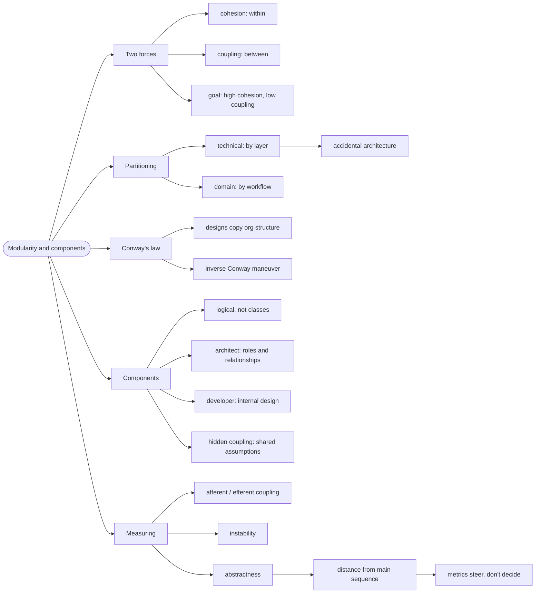

# Modularity and Components — Drawing the Lines

> Source: *Fundamentals of Software Architecture* (Richards & Ford) — ch 3
> (Modularity), ch 8 (Component-Based Thinking).

Modularity is the property that lets one part of a system change without
forcing every other part to change. **Cohesion** and **coupling** are the
two forces that decide whether you have it.

## The file that everyone edits

A team's codebase has one `Helpers.fs` — 3,000 lines, imported by every
module. Every feature adds to it. Nobody can delete anything, because
nobody knows what depends on what. Every change is risky, so every change
is slow.

That file is not a coding problem. It is a **modularity** problem: it has
near-zero cohesion (it does unrelated things) and near-total coupling
(everything depends on it). This page is the vocabulary for fixing it.

## 1. The two forces

**Cohesion** is *within*: does a module do one related job? High cohesion
means everything in the module belongs together.

**Coupling** is *between*: how much does a module depend on others? Low
coupling means you can change one without touching the rest.

The goal is always **high cohesion, low coupling** — and the two are linked.
Splitting by unrelated concerns gives you both at once.

## 2. Two ways to partition

| Partitioning | Organizes by | Consequence |
| --- | --- | --- |
| **Technical** | layer — presentation, business, persistence | familiar, easy to staff; every workflow cuts across all layers |
| **Domain** | workflow — ordering, shipping, billing | a change to a workflow touches one place |

The book's point: technical layering produces **accidental architecture** —
the structure reflects the framework, not the business. Domain partitioning
is DDD's answer (see [domain-driven-design](../domain-driven-design/index.md)).

## 3. Conway's Law

> Designs copy the organization's communication structure.

If three teams own three layers, you get three layers. If you want
domain-partitioned software, arrange teams by domain — the **Inverse Conway
Maneuver**.

This is a real constraint, not a metaphor: the software will mirror
whatever communication paths exist, whether you planned it or not.

## 4. Components are the architect's unit

A **logical component** is a container of related responsibilities — for
example a "Reference Manager" with `GetData`, `SetData`, `ReloadCache`.
It is *not* a class and not a file; it is the level at which structure is
visible.

The division of labour the book draws:

- The **architect** identifies components, their roles, and their
  relationships.
- The **developer** owns the internal design of each component.

That is the same "guide, don't specify" rule from
[architectural-thinking](../architectural-thinking/index.md), applied at
the component level.

**Component coupling** exists even without direct calls — two components
that assume the same date format are coupled. Shared assumptions are
coupling you cannot see in an import graph.

## 5. Measuring it

You can't improve modularity you don't measure. The core metrics:

```text
afferent coupling (Ca)  = how many components depend on me
efferent coupling (Ce)  = how many components I depend on
instability (I)         = Ce / (Ca + Ce)      -- 0 stable, 1 unstable
abstractness (A)        = abstract / total
distance (D)            = |A + I - 1|          -- 0 is balanced
```

Two rules of thumb the book gives:

- **Stable components should be abstract.** A component everyone depends on
  (low instability) that is also concrete is painful to change.
- **Unstable components should be concrete.** A component nobody depends on
  can change freely; making it abstract is wasted indirection.

`D` near 0 means the component is on the "main sequence" — balanced. `D`
near 1 means either a uselessly abstract component or a dangerously
concrete hub.

Metrics **steer**; they do not decide. A high `D` on a small, stable module
may be fine. The number starts a conversation; it doesn't end one.

## Revise



## Cross-links

- The characteristics modularity serves:
  [architectural-characteristics](../architectural-characteristics/index.md).
- Domain partitioning in depth:
  [domain-driven-design](../domain-driven-design/index.md).
- Workflows as the unit of code:
  [workflows-as-pipelines](../workflows-as-pipelines/index.md).
- Styles built on these boundaries:
  [architecture-styles](../architecture-styles/index.md).
