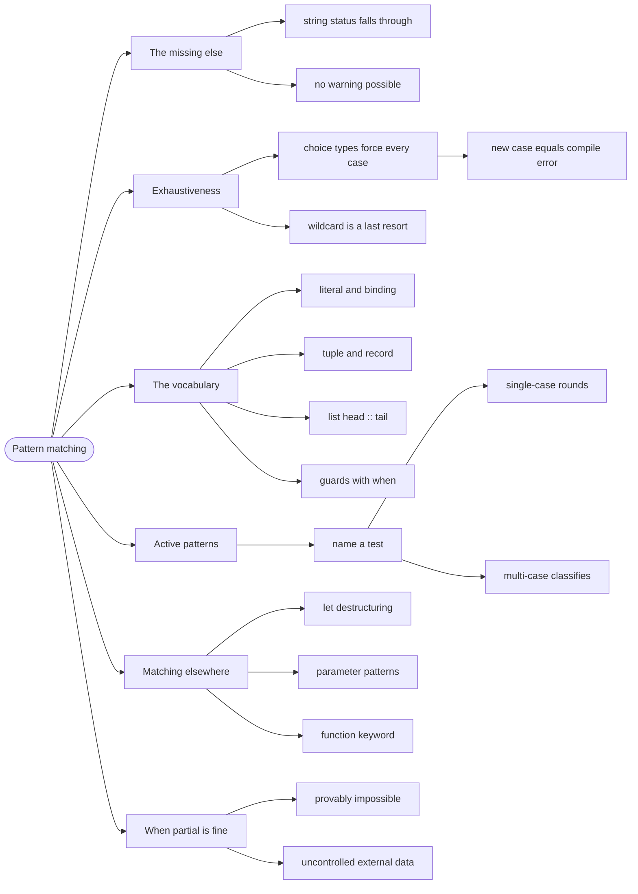

# Pattern Matching — Decomposing Values Safely

> Source: *Stylish F# 6* (Eason) — ch 6 «Pattern Matching», ch 13 «Layout
> and Naming».

**Pattern matching** is F#'s way of taking a value apart: you write the
shape you expect, and the compiler binds the pieces. Combined with choice
types it becomes a safety mechanism — the compiler proves you handled every
case.

## The `else` that was never written

```fsharp
// ❌ a chain that silently drops a case
let describe (status: string) =
    if status = "open" then "Open"
    elif status = "closed" then "Closed"
    // "cancelled" falls through and returns "" — no error, no warning
```

The function compiles. It returns an empty string for a status that exists
in production. Nothing warns you, because `string` has infinitely many
cases and the compiler cannot know which you meant.

Replace the `string` with a choice type and the same code becomes
**exhaustive by construction**.

## 1. Matching a choice type is exhaustive

```fsharp
// ✅ add a case and this stops compiling — the compiler lists every site
type Status = Open | Closed | Cancelled

let describe status =
    match status with
    | Open -> "Open"
    | Closed -> "Closed"
    | Cancelled -> "Cancelled"
```

This is the single highest-value use of pattern matching: **the compiler
becomes your requirements checklist.** When the domain grows a `Cancelled`
case, every `match` that needs to decide becomes a compile error — not a
silent fallthrough discovered in production.

That is why the `_` wildcard is a last resort with choice types:

```fsharp
// ❌ compiles forever — new cases silently take the default
let describe status =
    match status with
    | Open -> "Open"
    | _ -> "not open"
```

```fsharp
// ✅ only use _ when the remaining cases genuinely share behaviour
let isActionable status =
    match status with
    | Open -> true
    | Closed | Cancelled -> false
```

## 2. The pattern vocabulary

| Pattern | Shape | Matches |
| --- | --- | --- |
| **literal** | `0 -> ...` | that exact value |
| **variable** | `Some p -> p.Name` | anything, binding a name |
| **tuple** | `0, 0 -> ...` | two values together |
| **record field** | `{ Paid = true } -> ...` | a record whose field has that value |
| **list shape** | `first :: _ -> ...` | head plus anything |
| **type test** | `:? Circle as c -> ...` | a value of that .NET type |
| **guard** | `when a > 1000m -> ...` | a pattern plus a condition |

Two of these earn a worked example, because their shape is not obvious from
the table. The list shape is what makes recursion cheap:

```fsharp
// ✅ head :: tail — O(1), and the compiler warns if [] is missing
match items with
| [] -> "empty"
| [ single ] -> "exactly one"
| first :: _ -> $"starts with {first}"
```

A guard adds a condition to a pattern, so you can match on structure and
value in one line:

```fsharp
// ✅ the pattern binds `a`; the guard tests it
match order with
| { Amount = a } when a > 1000m -> "large"
| _ -> "small"
```

## 3. Active patterns: name a test

An **active pattern** is a named pattern — a function you can use in a
`match` as if it were a case. SF6's single-case example rounds a currency
value:

```fsharp
// ✅ SF6 Listing 6-25 — a single-case active pattern
let (|Currency|) (x: float) = System.Math.Round(x, 2)

let price = 12.3456
match price with
| Currency 12.35 -> "rounds to 12.35"
| _ -> "other"
```

The `(|Name|)` syntax defines the pattern; `Currency` in a `match` applies
it. This lets you give a *name* to a test and reuse it everywhere, instead
of repeating the same condition inline.

Multi-case active patterns split a value into named categories:

```fsharp
// ✅ classify once, use everywhere
let (|Positive|Zero|Negative|) n =
    if n > 0 then Positive elif n = 0 then Zero else Negative

match balance with
| Positive -> "in credit"
| Zero -> "settled"
| Negative -> "overdrawn"
```

The win is vocabulary: `Positive | Zero | Negative` is readable at the call
site in a way `if n > 0 then ... elif` never is.

## 4. Matching in `let` and function arguments

`match` is not only a statement — it appears in bindings and parameters:

```fsharp
// ✅ destructure in a let, and in a parameter
let (OrderId id) = order.Id
let area (Circle r) = System.Math.PI * r * r
```

```fsharp
// ✅ function keyword: match without repeating the argument
let describe =
    function
    | Open -> "Open"
    | Closed -> "Closed"
    | Cancelled -> "Cancelled"
```

The `function` keyword is sugar for `fun x -> match x with`. It reads better
when the whole function is one match.

## 5. Exceptions to the exhaustiveness rule

Two cases where a partial match is legitimate, and both must be deliberate:

- **Provably impossible cases.** `List.head` after an `isEmpty` check. Better:
  restructure so the type proves it.
- **Boundary data you do not control.** A JSON payload from an external
  service may have an unknown case; there, `_` is honest.

Everywhere else, exhaustiveness is free safety. Take it.

## Revise



## Cross-links

- The types that make this pay:
  [modeling-with-types](../modeling-with-types/index.md).
- Records and choice types in depth:
  [records-and-unions](../records-and-unions/index.md).
- Matching on errors: [errors-and-result](../errors-and-result/index.md).
- Matching on state in the UI: [fable-and-elm](../fable-and-elm/index.md).
