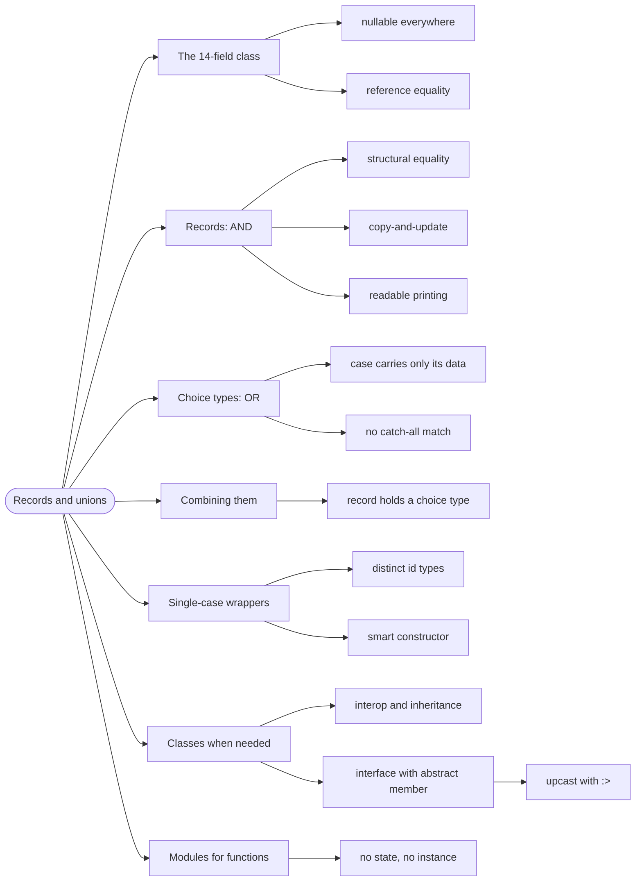

# Records and Unions — The Two Building Blocks

> Source: *Stylish F# 6* (Eason) — ch 7 «Record Types», ch 8 «Classes»;
> *Domain Modeling Made Functional* ch 4 «Understanding Types», ch 9
> «Implementation: Composing a Pipeline».

Almost every F# domain type is one of two things: a *record* (all fields together — an AND) or a **choice type** (exactly one case — an OR).

Learn those two shapes and the rest of the language's type machinery is decoration.

## The class with 14 fields

```fsharp
// ❌ a class that carries every combination of null-ness
type Player() =
    member val Id = "" with get, set
    member val Name = "" with get, set
    member val Team: Team = null with get, set
    // ...
```

Six of the fourteen fields are only meaningful sometimes. Constructing it
requires an object initializer and hope. Equality is reference equality, so
two identical players are not equal. `ToString` prints the type name.

Records and choice types replace this shape entirely, and give you equality,
immutability, and readable printing for free.

## 1. Records: an AND of named fields

```fsharp
// ✅ all fields always present, immutable, structural equality
type Player =
    { Id: PlayerId
      Name: string
      TeamId: TeamId option
      Rating: int }
```

What you get automatically:

- **Structural equality** — two records with the same field values are `=`.
- **Immutable by default** — change via `{ player with Rating = 1500 }`.
- **Readable output** — `printfn "%A" player` prints the fields.
- **Pattern matching** — `match player with { Rating = r } -> ...`.

Records are the right shape whenever the domain sentence is "**X has A and
B and C**".

## 2. Choice types: an OR of named cases

```fsharp
// ✅ DMMF ch 4 — the domain sentence is "cash OR check OR card"
type PaymentMethod =
    | Cash
    | Check of CheckNumber
    | Card of CreditCardInfo
```

Each case may carry its own data, and only its own. `Cash` carries nothing,
so there is no nullable `CardNumber` sitting unused on a cash payment.

The rules that make choice types work:

- **Give every case a name from the domain** — not `Case1`.
- **Carry only what that case needs.** If every case carries the same data,
  it belongs on a record wrapping the choice type.
- **Never add a `_` catch-all** in `match` — see
  [pattern-matching](../pattern-matching/index.md).

## 3. Combining them

Real models alternate between the two shapes:

```fsharp
// ✅ DMMF ch 6 — a record whose field is a choice type
type Customer =
    { Id: CustomerId
      Name: string
      Email: CustomerEmail }

type CustomerEmail =
    | Unverified of EmailAddress
    | Verified of VerifiedEmailAddress
```

The reading order is the same as the domain sentence: "a customer has an id
AND a name AND an email, and the email is unverified OR verified."

## 4. Single-case choice types: wrap a primitive

A one-case choice type looks pointless and is one of the most useful
patterns in the language — it gives a primitive a distinct type:

```fsharp
// ✅ from DMMF ch 9 — two ids that can no longer be confused
type OrderId = OrderId of string
type CustomerId = CustomerId of string
```

With a smart constructor, the value is also guaranteed valid:

```fsharp
// ✅ private case + validating create = the only door in
type OrderId = private OrderId of string
module OrderId =
    let create s =
        if System.String.IsNullOrEmpty s then Error "required"
        else Ok (OrderId s)
    let value (OrderId s) = s
```

Use this when a primitive has a rule, a unit, or a risk of being confused
with another primitive. It costs one line and removes a whole category of
bug.

## 5. When you actually need a class

F# has classes, and SF6 is clear about when they earn their place:

- **You need to interop with a .NET API** that requires inheritance.
- **You need mutable state with identity** — a UI control, a cache.
- **You are implementing an interface** for a library.

The mechanics, in the book's form:

```fsharp
// ✅ SF6 Listing 8-17 — abstract members, no behaviour
type IMediaPlayer =
    abstract member Open : mediaId: MediaId -> unit
    abstract member Play : unit -> unit
    abstract member Stop : unit -> unit
    abstract member Eject : unit -> unit
    abstract member Status : unit -> Status
```

```fsharp
// ✅ SF6 Listing 8-18 — implementing it explicitly
type DummyPlayer() =
    interface IMediaPlayer with
        member _.Open(mediaId) = ()
        member _.Play() = ()
        member _.Stop() = ()
        member _.Eject() = ()
        member _.Status() = Empty
```

Using it requires an upcast, which is Listing 8-19:

```fsharp
// ✅ the upcast exposes the interface, not the concrete class
let player = new DummyPlayer() :> IMediaPlayer
```

Note the two-step construction: `new DummyPlayer()` builds the concrete
type, and `:> IMediaPlayer` **upcasts** it to the interface. Without the
upcast the value is a `DummyPlayer` and only exposes its own members.

**Prefer functions over interfaces** when you can. An interface with one
method is a function with extra ceremony:

```fsharp
// ❌ a one-method interface
type IValidator = abstract member Validate: Order -> bool

// ✅ the same thing, as a value you can pass and compose
let validateOrder : Order -> bool = fun o -> o.Lines.Length > 0
```

Functions are values, so they compose, partial-apply, and test without a
mock. Interfaces are for polymorphism across *implementations you do not
control* — not for passing behaviour around.

## 6. Modules: where functions live

F# groups functions in **modules**, not classes:

```fsharp
// ✅ a module of related functions, no state, no instance
module Order =
    let total (order: Order) = order.Lines |> List.sumBy (fun l -> l.Price)
    let addLine line order = { order with Lines = line :: order.Lines }
```

A module is a namespace of functions. If you find yourself writing a class
with no mutable state and no inheritance, a module is what you wanted.

## Revise



## Cross-links

- Matching these types exhaustively:
  [pattern-matching](../pattern-matching/index.md).
- Modelling the domain with them:
  [modeling-with-types](../modeling-with-types/index.md).
- Absence and options: [missing-data](../missing-data/index.md).
- Style for type and field names: [sense-of-style](../sense-of-style/index.md).
