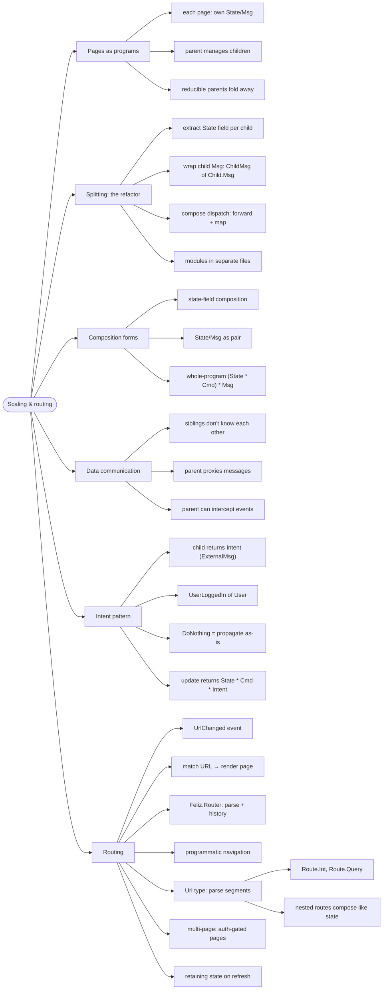

# Scaling and Routing — Programs Made of Programs

> Source: *The Elmish Book* (Zaid Ajaj) — part 4 (Composing Larger
> Applications): pages-as-programs, splitting-programs,
> integrating-commands, composition-forms, understanding-data-communication,
> intent, routing, url-type, multi-page-routing.

One giant `State`/`Msg` dies at three features. The scaling move: make
**each page its own Elmish program**, then compose parents from children —
the client-side echo of bounded contexts.



## Pages as programs

- A login page, a dashboard, a settings page — each is its own little TEA
  triplet. The **root program** holds "which page is active" plus the
  children.
- A parent that only forwards to children can be **reduced away** (state
  moves up a level) — don't pay syntactic overhead for a pointless layer.

## Splitting a program (the refactor)

1. Move a feature's state into a `Child.State` field of the parent.
2. Wrap its messages: `ChildMsg of Child.Msg`.
3. Compose dispatch: the parent maps child events into its own loop;
   child-facing dispatch is `ChildMsg >> dispatch` style forwarding.
4. Each program lives in **its own module/file** — `Login.fs`, `App.fs`,
   `Main.fs`.

## Composition forms

| Form | Shape | Trade-off |
| --- | --- | --- |
| **State-field** | child State is a field; child Msg a case | explicit, flexible; wiring at each level |
| **State/Msg pair** | same, but strictly paired | mechanical, easy to generate |
| **Whole program** | `(State * Cmd<Msg>)` + parent wraps `Program` | children fully encapsulate commands |

```fsharp
// state-field composition, three children
type Page = Counter | TextInput | Ticker

type State =
    { Counter: Counter.State; InputText: InputText.State
      CurrentPage: Page }

type Msg =
    | CounterMsg of Counter.Msg
    | InputTextMsg of InputText.Msg
    | SwitchPage of Page
```

Adding a child = one field, one wrapped-msg case, one forward rule in
`update`. The pattern is mechanical, which is the point.

## Data communication: proxy and Intent

- Siblings never reference each other — all traffic goes **through the
  parent**, which may inspect, forward, or act. The book's running
  example: a **Login page** that must hand the authenticated `User` to a
  **Home page** (which greets by username and offers logout). Login and
  Home know nothing of each other; `App` relays `LoginMsg`/`HomeMsg`
  between them.
- That interception surprises child developers — so encode it: the
  **Intent pattern** (a.k.a. `ExternalMsg`):

```fsharp
[<RequireQualifiedAccess>]
type Intent = UserLoggedIn of Api.User | DoNothing

let update msg state : State * Cmd<Msg> * Intent = (* ... *)
```

- The child *declares* what the parent must react to; the parent decides
  inspect-vs-propagate with the compiler checking both sides. Intent in
  the type system = motivational transparency for components (see
  [fsharp-style](../fsharp-style/index.md)).

## Routing

- Routing = listening for **URL changes** as just another event:
  `UrlChanged of string list`. Render by matching the current URL.
- **Feliz.Router** owns the history API and parsing: `Router.currentUrl`,
  `Router.onUrlChanged`, and `Router.navigate` (a `Cmd` — navigation after
  login is just a command).
- Turn raw URLs into a **`Url` type** — parse segments into cases
  (`Route.Int`, `Route.Query`); unknown → `NotFound`.
- **Nested routes compose like state**: the parent parses its segments and
  hands the rest to the child's own `Url` parser — children never see
  siblings' routes.
- Multi-page apps add **accessibility rules** (anonymous-only vs
  authenticated-only pages) and **re-initialization on F5** — decide what
  state must survive a refresh.

## Cross-links

- Bounded contexts → pages: [domain-driven-design](../domain-driven-design/index.md).
- Commands the children issue: [commands-and-async-data](../commands-and-async-data/index.md).
- Intent = choices in the type system: [domain-modeling-with-types](../domain-modeling-with-types/index.md).
- Components and boundaries (the architecture view): [architecture-characteristics-and-governance](../architecture-characteristics-and-governance/index.md).
- The whole TEA loop these pages plug into: [fable-and-elm-architecture](../fable-and-elm-architecture/index.md).
