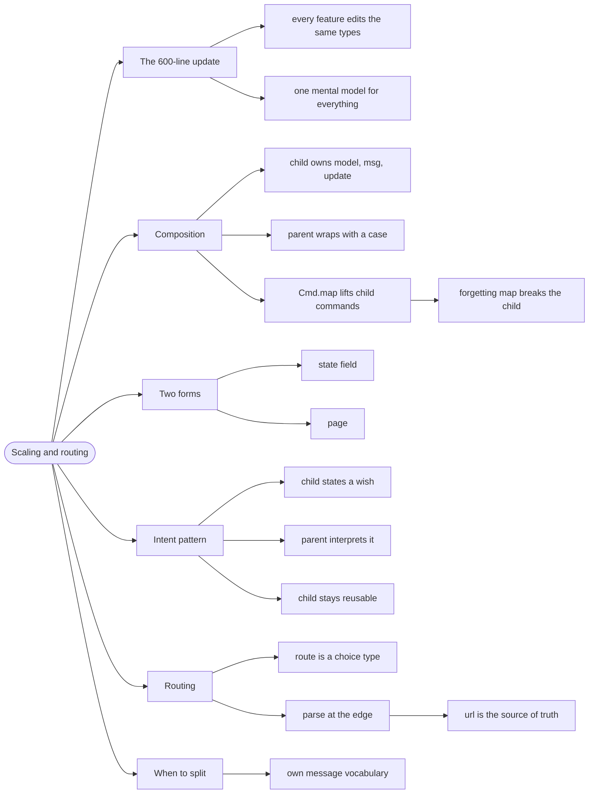

# Scaling and Routing — Composing a Large App

> Source: *The Elmish Book* — `scaling/composition-forms.md`,
> `scaling/intent.md`, `scaling/introducing-url-type.md`.

A single `Model` and `update` work beautifully until the app has twenty
pages. **Composition** is how Elmish scales: each page is its own
model/message/update, and the parent wires them together.

## The `update` that grew to 600 lines

```fsharp
// ❌ one message type for every page — forever
type Msg =
    | GamesLoaded of Game list
    | NewsLoaded of News list
    | PlayerSelected of string
    | BracketGenerated of Bracket
    // ... 40 more cases
```

Nothing is wrong with any individual branch. The problem is that every
feature must edit the same three types, so the app has one merge conflict
and one mental model for all of it.

## 1. Composition: each page owns its own loop

```fsharp
// ✅ a child: its own Model and Msg
module Games =
    type Model = { Games: RemoteData<Game list> }

    type Msg =
        | Load
        | Loaded of Game list
```

```fsharp
// ✅ the child's update returns its own model and command
let update msg model =
    match msg with
    | Load ->
        { model with Games = Loading },
        Cmd.OfAsync.either fetchGames () Loaded Failed
    | Loaded games -> { model with Games = Loaded games }, Cmd.none
```

```fsharp
// ✅ the parent: a field, a wrapped message, and two mappings
type Model =
    { Games: Games.Model
      News: News.Model
      CurrentPage: Page }

type Msg =
    | GamesMsg of Games.Msg
    | NewsMsg of News.Msg
```

```fsharp
// ✅ one branch per child; Cmd.map lifts the child's effects
let update msg model =
    match msg with
    | GamesMsg m ->
        let childModel, childCmd = Games.update m model.Games
        { model with Games = childModel }, Cmd.map GamesMsg childCmd
    | NewsMsg m ->
        let childModel, childCmd = News.update m model.News
        { model with News = childModel }, Cmd.map NewsMsg childCmd
```

The two mappings are the whole trick:

- **`GamesMsg`** wraps a child message into the parent's message type.
- **`Cmd.map GamesMsg`** wraps a child *command* so its results come back
  as parent messages.

`Cmd.map` is the part people forget — and forgetting it means the child's
effects dispatch messages the parent doesn't understand, so the child never
updates.

## 2. Two forms: state field vs. page

The book distinguishes two composition shapes:

| | **State-field** | **Page** |
| --- | --- | --- |
| Child model is | a field of the parent | a whole screen |
| Visible | always (or conditionally) | one at a time |
| Parent decides | what to render | which page is active |
| Typical use | a widget, a shared panel | routing |

The wiring is identical; only the *rendering* differs. That is deliberate —
it means a widget can be promoted to a page without changing its internals.

## 3. Intent: decouple the child from the parent

The problem with the wiring above: the child dispatches `Games.Msg`, but
sometimes it needs to tell the *parent* something ("the user wants to
navigate away"). Giving the child the parent's `Msg` couples them
backwards.

The book's **Intent** pattern fixes it: the child declares what it *wants*,
and the parent decides what that means.

```fsharp
// ✅ the child states an intent; it does not know the parent exists
type Intent =
    | NavigateTo of Page
    | ShowNotification of string
```

```fsharp
// ✅ update returns model, command, AND an intent option
type Msg =
    | Load
    | Loaded of Game list
    | UserClickedGame of Game

let update msg model : Model * Cmd<Msg> * Intent option = ...
```

The parent interprets `Intent` and does the navigation. The child stays
reusable and testable in isolation, because it never references anything
outside itself.

## 4. Routing: the URL is a type

A **route** is which page is showing. The book's approach: model it as a
choice type, and parse the URL into it.

```fsharp
// ✅ the route is a type, so an invalid page cannot exist
type Page =
    | Home
    | Games
    | GameDetail of GameId
    | NotFound of string
```

```fsharp
// ✅ parse once, at the edge
let parseUrl (url: string list) : Page =
    match url with
    | [] -> Home
    | [ "games" ] -> Games
    | [ "games"; id ] -> GameDetail (GameId id)
    | segments -> NotFound (String.concat "/" segments)
```

Two payoffs:

- **The view is exhaustive.** `match page with` forces a case for every
  route — adding `GameDetail` makes the router stop compiling until it is
  handled.
- **`NotFound of string` carries the bad URL**, so the page can say what
  failed instead of a generic 404.

The URL is the **source of truth** for navigation, not the model. That way
a refresh, a shared link, and a back button all produce the same page — the
model is derived from the URL, not the other way round.

## 5. When to split

The rule of thumb: **split when a part has its own message vocabulary.**

- A widget with three messages of its own → its own module.
- A page with twenty messages → definitely its own module.
- A helper that only renders → a function, not a module.

Splitting too early costs ceremony (wrapping, mapping) for no gain.
Splitting too late costs a 600-line `update`. The signal is when you cannot
hold one page's messages in your head alongside the others'.

## Revise



## Cross-links

- The loop being composed: [fable-and-elm](../fable-and-elm/index.md).
- Effects in child components: [commands-and-async](../commands-and-async/index.md).
- Debugging a composed app: [dev-workflow](../dev-workflow/index.md).
- Why the route is a type: [modeling-with-types](../modeling-with-types/index.md).
