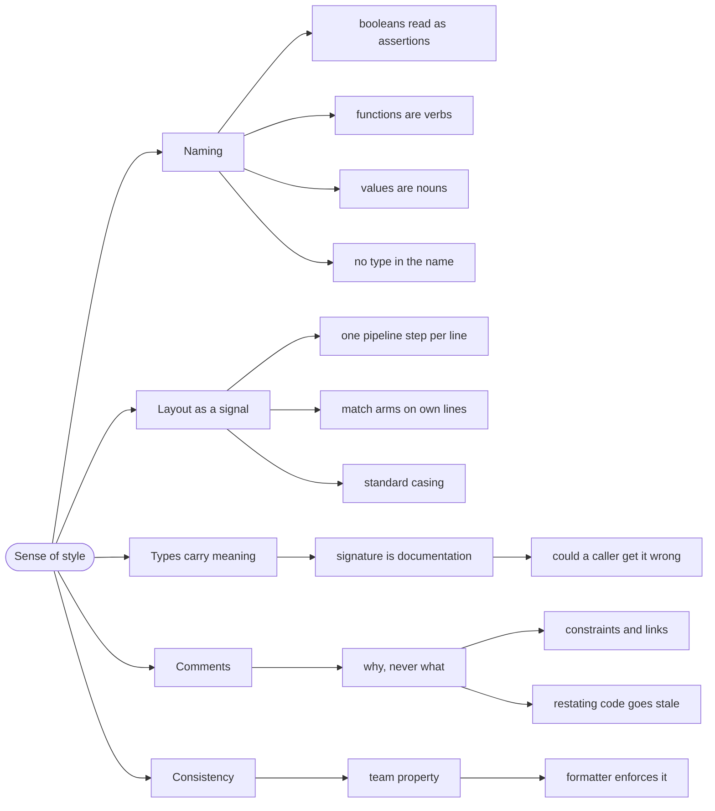

# Sense of Style — Naming, Layout, and Comments

> Source: *Stylish F# 6* (Eason) — ch 1 «The Sense of Style», ch 13
> «Layout and Naming».

F# code is read far more often than it is written, and most of the reading
happens when something is broken at 2 a.m. Style is not decoration; it is
the difference between code that explains itself and code that has to be
re-derived.

## The helper that hid the bug

A codebase has a function called `process`:

```fsharp
// ❌ what does it do? What does it return? Does it throw?
let process (data: string) (flag: bool) = ...
```

Nobody can call it without reading its body. Every caller guesses, and the
guesses are inconsistent. Now imagine a production incident and 40 call
sites of this.

Style failures are **compounding** failures: each unclear name adds a
lookup, and lookups are what you don't have time for when the system is
down.

## 1. Name things by what they mean

```fsharp
// ❌ names describe the mechanism, or nothing
let helper d = ...
let data = getData()
let flag = true

// ✅ names describe the domain
let calculateShippingCost (order: Order) = ...
let unpaidInvoices = getUnpaidInvoices ()
let registrationIsOpen = true
```

Rules that hold up in practice:

- **Booleans read as assertions** — `is`, `has`, `can`, `should`.
- **Functions are verbs** — `calculate`, `validate`, `send`.
- **Values are nouns** — `invoice`, `player`, `bracket`.
- **No abbreviations** unless they are domain-standard (`id`, `url`, `http`).
- **Don't encode the type in the name** (`playerList`) — the type already
  says that, and the name goes stale when the type changes.

DMMF's strongest naming rule is about *absence*: if you cannot find a
domain word for something, that is a signal the concept is missing from
your model, not a signal to invent a word.

## 2. Layout is a signal

F# is whitespace-sensitive, and the layout should mirror the logic:

```fsharp
// ❌ a wall — the structure is invisible
let total orders = orders |> List.filter (fun o -> o.Paid) |> List.sumBy (fun o -> o.Amount)

// ✅ one transformation per line — the pipeline reads top to bottom
let totalPaid (orders: Order list) =
    orders
    |> List.filter (fun o -> o.Paid)
    |> List.sumBy (fun o -> o.Amount)
```

Two conventions worth adopting wholesale:

- **Pipelines get one step per line.** The `|>` at the start of a line lets
  you scan the flow.
- **Match arms on their own lines**, always — even when short. Consistency
  beats compactness.

The standard is in the F# Style Guide (linked from the book): 4-space
indent, no tabs, `camelCase` for values and functions, `PascalCase` for
types and modules, `UPPER_CASE` only for mutable module-level values that
are truly constants.

## 3. Types carry the style weight

Most "unreadable" F# is really *unexpressive types*. The type is where
meaning lives:

```fsharp
// ❌ the signature says almost nothing
let create (s: string) (n: int) : string = ...

// ✅ the signature is the documentation
let createOrder (customerId: CustomerId) (quantity: int) : Result<Order, OrderError> = ...
```

Read a signature and ask: could a caller get it wrong? If yes, the type is
under-specified, not the name. This is the same argument as
[modeling-with-types](../modeling-with-types/index.md), arrived at from the
style side.

## 4. Comments: why, never what

```fsharp
// ❌ restates the code, and goes stale
// increment i by one
let i = i + 1

// ✅ explains a decision the code cannot
// Traefik on-prem never sets status.loadBalancer, so the built-in
// Ingress health check waits forever — hence the Argo CD customization.
let ingressHealthCheck = Customized
```

The rule: **if the code can say it, the comment must not.** A comment that
restates code is a second copy of the truth, and second copies drift.

What deserves a comment:

- **Why** a non-obvious approach was chosen.
- **Constraints** that aren't visible (`// must run before the cache warms`).
- **Links** to the issue or ADR that explains the decision.

What does not: what the next line does, the parameter names, or the
algorithm — those belong in the name and the type.

## 5. Consistency beats individual preference

The book's framing: style is a *team* property. A codebase where every
module is formatted differently costs the reader a context switch per file.

If you are solo, you still pay that cost — you are your own future
teammate. Pick the conventions once, write them down, and let a formatter
enforce them so the argument never recurs.

## Revise



## Cross-links

- Expressiveness that starts in the type:
  [modeling-with-types](../modeling-with-types/index.md).
- Designing the functions themselves:
  [designing-functions](../designing-functions/index.md).
- Types you will actually write: [records-and-unions](../records-and-unions/index.md).
