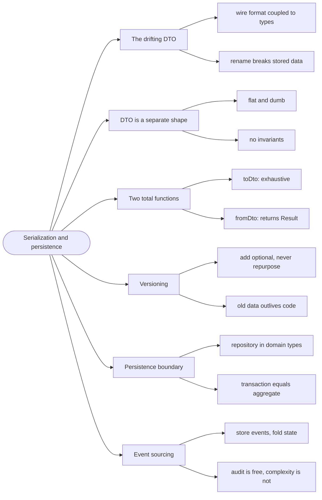

# Serialization and Persistence — The Trust Boundary

> Source: *Domain Modeling Made Functional* (Wlaschin) — ch 11
> «Serialization», ch 12 «Persistence», ch 13 «Evolving a Design and
> Keeping It Clean».

Your domain model and your storage model are **different things**, and the
boundary between them is where most real systems accumulate their worst
bugs. This page is about keeping that boundary thin, explicit, and total.

## The DTO that drifted

```fsharp
// ❌ the domain type, serialized directly
type Tournament =
    { id: string
      name: string
      phase: TournamentPhase }   // a choice type — how does JSON hold it?
```

Serializing a choice type "just works" in most F# libraries — it emits
something like `{"Case":"RegistrationOpen","Fields":[]}`. Now the wire
format is coupled to your *internal* type names. Rename a case, and you
break every client and every stored row, with no compile error anywhere.

## 1. DTOs are a separate, dumb shape

A **DTO** (data transfer object) is a plain record with no rules, whose only
job is to be the shape on the wire or in the table:

```fsharp
// ✅ DTO: flat, dumb, stable — the wire shape
type TournamentDto =
    { id: string
      name: string
      phase: string }
```

```fsharp
// ✅ domain: rich, typed, rules — the workflow shape
type Tournament =
    { Id: TournamentId
      Name: string
      Phase: TournamentPhase }
```

The DTO has no invariants, so it can represent nonsense — which is fine,
because **it is validated on the way in**. The domain type cannot represent
nonsense, which is why it is the only thing the workflow sees.

## 2. Two functions, both total

The boundary is exactly two functions, and both must handle every case:

```fsharp
// ✅ domain → wire: exhaustive, so a new phase fails the build
let private phaseToWire =
    function
    | Announced -> "announced"
    | RegistrationOpen -> "registrationOpen"
    | CheckInOpen -> "checkInOpen"
    | InProgress -> "inProgress"
    | Concluded -> "concluded"
```

```fsharp
// ✅ toDto is now total and cannot fail
let toDto (t: Tournament) : TournamentDto =
    { id = TournamentId.value t.Id
      name = t.Name
      phase = phaseToWire t.Phase }
```

```fsharp
// ✅ wire → domain: can fail, and says so
let fromDto (dto: TournamentDto) : Result<Tournament, string> =
    match dto.phase with
    | "announced" ->
        Ok { Id = TournamentId.create dto.id; Name = dto.name; Phase = Announced }
    | "registrationOpen" ->
        Ok { Id = TournamentId.create dto.id; Name = dto.name; Phase = RegistrationOpen }
    | other -> Error $"unknown phase: {other}"
```

Two properties to notice:

- **`toDto` is total.** Every domain value has a wire form, and the `match`
  is exhaustive — add a phase and `toDto` stops compiling until you decide
  its wire name. That is the compiler protecting your API contract.
- **`fromDto` returns `Result`.** Unknown input from outside is a normal
  case, not an exception.

## 3. Versioning: assume the old shape exists

A serialized value outlives the code that wrote it. Rows in a database,
messages in a queue, and cached JSON in a browser all persist across
deployments.

Three rules that survive contact with production:

- **Add optional fields, never repurpose existing ones.** Reusing a field
  name for a new meaning silently reinterprets old data.
- **Keep unknown cases representable on read.** An old client reading a new
  phase should get a clear error, not a crash.
- **Never serialize a domain type directly.** The DTO is your compatibility
  surface; the domain is free to change behind it.

## 4. Persistence: the same boundary, twice

Storage has its own shape — rows, columns, joins. The mapping is the same
two-function pattern:

```fsharp
// ✅ the repository hides storage shape; the domain never sees a row
type ITournamentRepository =
    abstract Load: TournamentId -> Async<Tournament option>
    abstract Save: Tournament -> Async<unit>
```

Two things this buys:

- **The domain layer has no database knowledge** — the onion rule from
  [domain-driven-design](../domain-driven-design/index.md).
- **Tests can substitute an in-memory implementation** with no database,
  because the interface is expressed in domain types.

Where a *transaction* is needed, the boundary is the **aggregate** (see [integrity-and-invariants](../integrity-and-invariants/index.md)): save the aggregate root and its children together, or not at all.

## 5. The event-sourcing option

Instead of storing current state, store the **events** that produced it:

```text
TournamentAnnounced { id; name; startsAt }
RegistrationOpened  { id }
PlayerRegistered    { id; playerId }
BracketGenerated    { id; seeding }
```

Current state is the **fold** of the events:

```fsharp
// ✅ state is a fold over history — replayable and auditable
let currentState events = events |> List.fold apply initialState
```

This is powerful when the history *is* the business value (audit, disputes,
replay). It is expensive when it isn't. The trade, honestly:

| | State storage | Event storage |
| --- | --- | --- |
| **Read** | direct | replay (or a projection) |
| **Audit** | extra work | free |
| **Schema change** | migrate rows | version events, upcast |
| **Complexity** | low | high |

Choose it for the audit and replay, not for the novelty.

## Revise



## Cross-links

- Where the DTO is validated: [integrity-and-invariants](../integrity-and-invariants/index.md).
- Errors on the way in: [errors-and-result](../errors-and-result/index.md).
- The layer rules: [domain-driven-design](../domain-driven-design/index.md).
- Wire formats in the browser: [commands-and-async](../commands-and-async/index.md).
