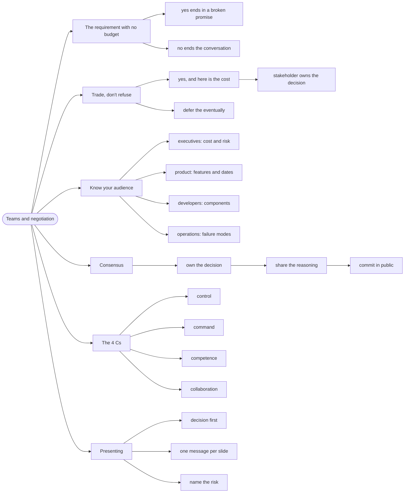

# Teams and Negotiation — Architecture Is Social

> Source: *Fundamentals of Software Architecture* (Richards & Ford) — ch 24
> «Making Teams Effective», ch 25 «Negotiation and Leadership Skills»,
> ch 26 «Architectural Intersections», ch 23 «Diagramming Architecture».

An architecture that nobody agrees to build is not an architecture. Most
technical decisions must be **negotiated** — with stakeholders who want
everything, and with developers who must live with the result.

## The requirement that had no budget

A stakeholder wants "high availability". The architect knows that means
multi-region, which means a budget and a timeline change. Saying "no" ends
the conversation. Saying "yes" produces a promise that cannot be kept.

The book's answer is not to win the argument but to **change its shape**:
negotiate on the trade-off, not on the feature.

## 1. Negotiate by trading, not refusing

The technique: never say "no" — say "**yes, and here is what it costs**".

```text
❌ "We can't do multi-region in this timeline."
✅ "We can have multi-region failover in Q4, or single-region with a
    four-hour recovery target in Q3. Which risk matters more?"
```

Two things happen. The stakeholder now owns a real decision, and the
conversation is about risk rather than about your willingness.

The book's specific move for scope: **identify what can be deferred**.
Almost every "must have" is actually a "must have eventually", and naming
the deferred part is the concession that gets the deal.

## 2. Know your audience

Different stakeholders need different views of the same decision:

| Audience | Cares about | Present |
| --- | --- | --- |
| **Executives** | cost, risk, time to market | one slide: the choice, the cost, the risk |
| **Product** | features, dates | what is deferred and what it buys |
| **Developers** | how to build it | components, contracts, constraints |
| **Operations** | failure modes | deploy, monitor, recover |

The failure mode is presenting the developer view to executives. It is not
that they can't understand it; it is that it does not answer their question.

## 3. Build consensus without design-by-committee

Consensus is not unanimity, and the book is clear that architecture by
committee produces mush. The working method:

- **Own the decision, share the reasoning.** The architect decides; the
  reasoning is public so it can be challenged on evidence.
- **Disagree in the open, commit in public.** Once decided, the team builds
  it — including the people who argued against it.
- **Make the trade-offs visible** so disagreement is about values (risk vs
  speed) rather than about facts.

This connects directly to [decisions-and-risk](../decisions-and-risk/index.md):
the ADR is the artifact that makes "share the reasoning" concrete.

## 4. The 4 Cs of architecture teams

The book's four characteristics of effective architecture teams:

| | Meaning |
| --- | --- |
| **Control** | the team owns its decisions and its code |
| **Command** | the team has authority to act without escalation |
| **Competence** | the team has the skills the domain needs |
| **Collaboration** | the team works with others rather than over them |

A team missing one of the four fails in a predictable way.

No *control* and it becomes a ticket queue; no *competence* and decisions are guesses; no *collaboration* and it builds what nobody asked for.

For a solo developer, the useful reading is that all four are yours: you have control and command by default, so the risks are *competence* (the reason for the knowledge pages) and *collaboration* (the reason for checking your model against real artifacts — see [discovering-a-domain-alone](../discovering-a-domain-alone/index.md)).

## 5. Presenting: the narrative

The book's presentation advice, condensed:

- **Start with the decision**, not the journey. "We are choosing X. Here is
  why. Here is what it costs."
- **One message per slide.** If a slide needs two sentences to explain, it
  is two slides.
- **Show the trade-off table.** Two options, three criteria, explicit
  winners and losers.
- **Name the risk out loud.** Acknowledging the cost is what makes the
  recommendation credible.

## 6. The uncomfortable truth

The book's closing point, and the one worth internalising: **architecture is
mostly about people.** The technical decisions are the easy half; getting
them accepted, funded, and built is the other half — and it is the half that
fails most often.

The practical consequence: spend the effort on the *why* and on the
*audience*, not on the diagram's colour scheme.

## Revise



## Cross-links

- The artifact that carries the reasoning:
  [decisions-and-risk](../decisions-and-risk/index.md).
- Understanding the domain you're negotiating about:
  [domain-driven-design](../domain-driven-design/index.md).
- Working alone: [discovering-a-domain-alone](../discovering-a-domain-alone/index.md).
- The laws to argue from:
  [architectural-thinking](../architectural-thinking/index.md).
