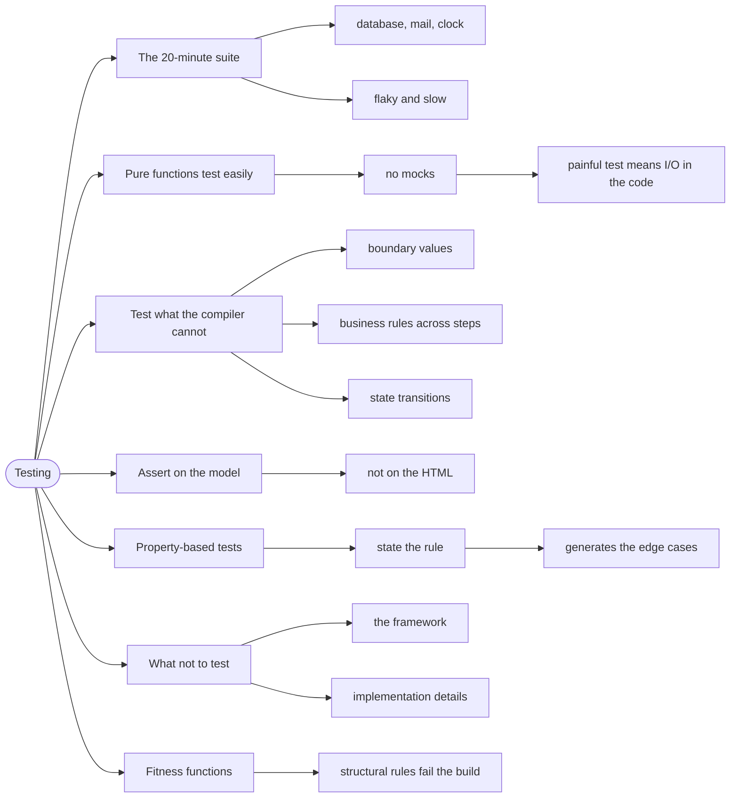

# Testing — Proving the Rules Hold

> Source: *Domain Modeling Made Functional* (Wlaschin) — ch 9
> «Implementation: Composing a Pipeline», §Testing Dependencies; ch 6
> «Integrity and Consistency in the Domain» on compile-time unit tests;
> *Fundamentals of Software Architecture* ch 24 «Making Teams Effective»,
> §Unit and Functional Testing Checklist.
>
> Note: *Stylish F# 6* has no testing chapter — ch 2 says explicitly that
> unit testing is "an important topic, but I'm not getting into that here".

A test is only cheap if it needs nothing but the function it tests. The
functional style is built for that: pure functions need no database, no
clock, no mocks — so tests are fast, deterministic, and rarely flaky.

## The test suite that took 20 minutes

```fsharp
// ❌ the test needs a database, a mail server, and today's date
[<Test>]
let ``order is placed`` () =
    setupDatabase()
    let result = placeOrder realDto    // calls the DB, the clock, and SMTP
    result.Status |> shouldEqual "placed"
```

Two hundred of these take twenty minutes, fail on Tuesdays because of a
date, and cannot run in parallel. The tests are integration tests pretending
to be unit tests, because the production code mixed logic with I/O.

## 1. Pure functions are already testable

The payoff of [workflows-as-pipelines](../workflows-as-pipelines/index.md):
`update` takes values and returns values.

```fsharp
// ✅ DMMF ch 9 — dependencies are stubs passed in, so the test is one line
[<Test>]
let ``If product doesn't exist, validation fails`` () =
    let checkAddressExists address = ...
    let checkProductCodeExists productCode = false   // fail
    let result = validateOrder checkProductCodeExists checkAddressExists ...
    // assert: check that result is a failure
```

The rule: **if a test is painful to write, the production code has an I/O
problem.** Fix the code, not the test harness.

## 2. Test the types by trying to break them

The second layer of testing comes free from the type system: if invalid
states cannot be constructed, you do not need tests for them. DMMF's point —
"compile-time unit tests".

So the tests worth writing are the ones the compiler *cannot* check:

- **Boundary values** — the smart constructor's exact limits.
- **Business rules across steps** — a valid order priced with a discount.
- **State transitions** — every `Msg` produces the expected `Model`.

```fsharp
// ✅ the smart constructor's boundaries — the compiler cannot know these
[<Test>]
let ``OrderId rejects empty`` () =
    OrderId.create "" |> shouldEqual (Error "required")

[<Test>]
let ``OrderId rejects over 50 chars`` () =
    OrderId.create (String.replicate 51 "a") |> shouldBe Error
```

## 3. Test state transitions, not the view

For an Elmish app, the model is the contract:

```fsharp
// ✅ assert on the model; ignore the command in most tests
[<Test>]
let ``Loaded replaces the loading state`` () =
    let model, _ = update (Loaded [ game1 ]) { Games = Loading }
    model.Games |> shouldEqual (Loaded [ game1 ])
```

The `view` is also a pure function, so it *can* be tested — but its output is
a large HTML tree that changes for cosmetic reasons. Model assertions are
stable; HTML assertions are brittle.

## 4. Property-based testing: state the rule, not the example

For rules that must hold for *all* inputs, a **property test** generates
hundreds of cases:

```fsharp
// ✅ the invariant, for every possible list
[<Property>]
let ``reversing twice returns the original`` (xs: int list) =
    xs |> List.rev |> List.rev = xs
```

Properties are the natural test for algebraic rules — round-trips,
idempotence, ordering. They find the edge cases you would not have thought
to write.

## 5. What not to test

- **The framework.** Do not test that `List.map` works.
- **Trivial accessors.** A record field needs no test.
- **Implementation details.** A test that breaks when you rename a private
  function is testing the wrong thing.
- **Every branch of a `match` on a choice type**, if the compiler already
  forces exhaustiveness — test the *behaviour* of the interesting branches.

The question that filters all of these: **if this test passes, what bug does
it prove is absent?** If you cannot answer, the test is documentation at
best.

## 6. The fitness-function layer

Some rules are not about behaviour but about *structure* — and those are
tested too (see [decisions-and-risk](../decisions-and-risk/index.md)):

```fsharp
// ✅ a structural rule, enforced mechanically
[<Test>]
let ``domain layer does not reference infrastructure`` () =
    let domainSource = File.ReadAllText "src/Domain.fs"
    domainSource |> shouldNotContain "Microsoft.Data.SqlClient"
```

This is how an architectural decision survives deadline pressure: it fails
the build, not a code review.

## Revise



## Cross-links

- The pure pipelines that make tests trivial:
  [workflows-as-pipelines](../workflows-as-pipelines/index.md).
- Rules enforced at construction:
  [integrity-and-invariants](../integrity-and-invariants/index.md).
- Structural checks as decisions:
  [decisions-and-risk](../decisions-and-risk/index.md).
- Testing the UI loop: [dev-workflow](../dev-workflow/index.md).
