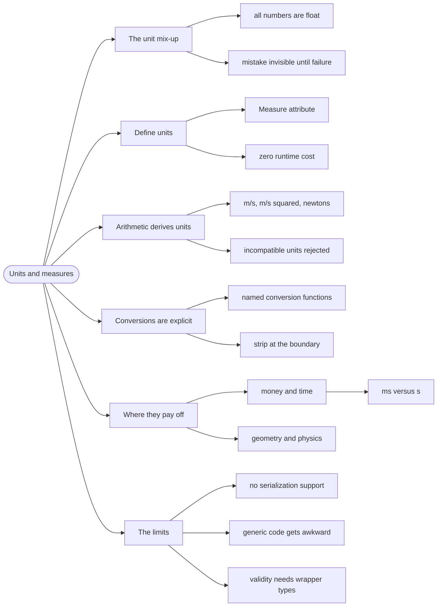

# Units and Measures — Numbers That Can't Be Confused

> Source: *Stylish F# 6* (Eason) — ch 2 (Designing Types with Your Domain),
> ch 10 (Working with Numbers).

F# lets you attach a **unit of measure** to a numeric type — `float<m>` is
metres, `float<kg>` is kilograms. The compiler then rejects arithmetic that
mixes them, which turns a whole family of silent numerical bugs into
compile errors.

## The Mars Climate Orbiter

In 1999 NASA lost a $125M spacecraft because one team computed thrust in
pound-force-seconds and another expected newton-seconds. Both numbers were
`double`. The type system had no opinion, so the mistake was invisible until
the spacecraft was.

This is not an exotic failure. Any codebase with money, distance, time, or
weight has the same shape of bug waiting:

```fsharp
// ❌ every number is the same type — nothing stops the mix-up
let burn (thrust: float) (seconds: float) = thrust * seconds
let thrustLbf = 100.0
let seconds = 10.0
burn thrustLbf seconds   // 1000.0 — of what? Wrong by a factor of 4.45
```

## 1. Define the units

```fsharp
// ✅ SF6 ch 2 — units are a compile-time annotation, zero runtime cost
[<Measure>] type m        // metre
[<Measure>] type kg       // kilogram
[<Measure>] type s        // second
[<Measure>] type N        // newton

let distance = 100.0<m>
let mass = 70.0<kg>
let time = 9.5<s>
```

A measured value has the same runtime representation as a plain `float` —
units exist only in the type checker. You pay nothing at runtime for the
safety.

## 2. The compiler does the arithmetic

```fsharp
// ✅ derived units come out of the arithmetic automatically
let speed = distance / time          // float<m/s>
let acceleration = speed / time      // float<m/s^2>
let force = mass * acceleration      // float<kg m/s^2>  (= N)
```

And mixing incompatible units is rejected:

```fsharp
// ❌ compile error: the unit of measure 'kg' does not match 'm'
let nonsense = distance + mass
```

That error is the whole value proposition: a dimensional mistake that would
have been a production incident is now a red squiggle.

## 3. Converting deliberately

Conversions must be explicit, which is exactly what you want:

```fsharp
// ✅ a named conversion, applied on purpose
let metresToFeet (x: float<m>) : float<ft> =
    x / 0.3048<m/ft>

let height = 1.83<m>
let inFeet = metresToFeet height   // 6.0<ft>
```

F# also gives you `float` (strip the unit) and the `LanguagePrimitives`
conversion functions when you truly need to cross a boundary:

```fsharp
let rawValue = float distance       // 100.0, unit discarded — do this at the edge
```

Stripping units is a **boundary operation**: do it when serializing to JSON
or calling an API that has no concept of units, and re-apply units on the
way back in.

## 4. Where units pay off most

| Domain | Units worth defining |
| --- | --- |
| **Money** | currency as a unit, or (better) a `Money` record with a currency case |
| **Time** | `s`, `ms`, `min`, `day` — the source of most off-by-1000 bugs |
| **Geometry** | `m`, `ft`, `px` |
| **Physics / engineering** | full SI set |

The time case deserves emphasis: `ms` versus `s` is the single most common
unit bug in software, and it is invisible in every language without units.

```fsharp
// ✅ impossible to pass milliseconds where seconds are expected
let timeout = 5000.0<ms>
let sleepFor (d: float<s>) = Async.Sleep(int (d * 1000.0<ms/s>))
```

## 5. The limits

Units are a compile-time tool with real edges:

- **They do not survive serialization.** JSON has no units; strip and
  re-apply at the boundary.
- **Generic code gets awkward.** A function that works for *any* unit needs
  explicit unit parameters (`float<'u>`), which is more ceremony than most
  code wants.
- **They are not a substitute for a domain type.** `float<kg>` does not stop
  you passing a negative mass. For rules, you need a single-case wrapper with
  a smart constructor (see [modeling-with-types](../modeling-with-types/index.md)).

Use units for **dimensional** safety, and wrapper types for **validity**.
They solve different problems and combine well.

## Revise



## Cross-links

- Validity rules on top of units:
  [modeling-with-types](../modeling-with-types/index.md).
- Numbers in collections: [collections](../collections/index.md).
- Signatures that state their units:
  [designing-functions](../designing-functions/index.md).
