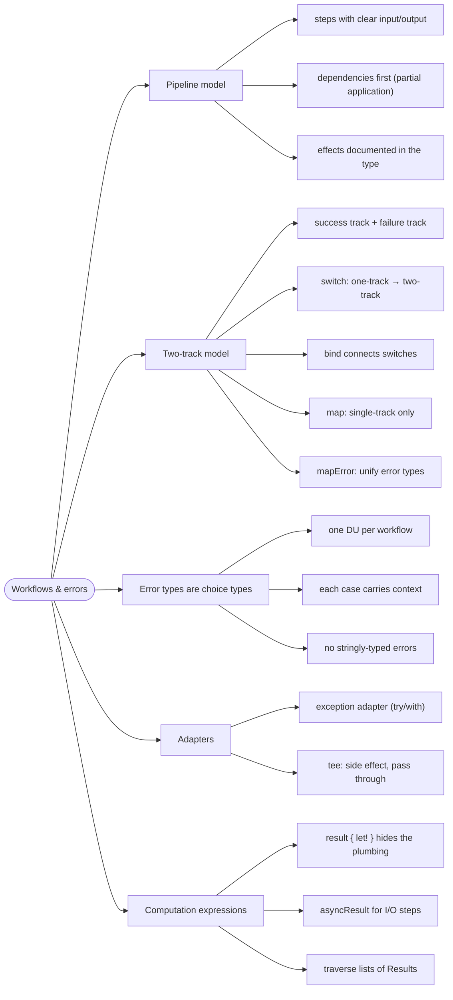

# Workflows and Error Handling — The Two-Track Model

> Source: *Domain Modeling Made Functional* (Scott Wlaschin) — ch 7
> (Modeling Workflows as Pipelines), ch 10 (Implementation: Working with
> Errors). *Stylish F# 6* ch 11 (Railway Oriented Programming) is the same
> idea told as a widget factory; *The Elmish Book* part 3 applies it to
> async UI updates.

Every business workflow is a **pipeline of functions**: validate →
calculate → store → notify. Error handling is not an afterthought — the
pipeline has two tracks, and every function must handle both.



## Workflows as pipelines

- A workflow = a function per step, each with **clear input and output
  types** (chosen in [domain-modeling-with-types](../domain-modeling-with-types/index.md)).
- Dependencies (repositories, SMTP, clock) are **parameters, injected
  first** via partial application — I/O stays at the edges.
- Effects are **documented in the type**: `Result<_,_>` for domain errors,
  `Async<_>` for I/O, `AsyncResult<_,_>` for both, plain values for pure
  logic. You can read a signature and know what can go wrong.
- The book's running example: the **place-order workflow** —
  `validateOrder → priceOrder → acknowledgeOrder`. Small helpers compose
  into steps; steps compose into the workflow (`checkAddressExists`,
  `checkProductCodeExists` feed `validatedOrder`; pricing turns
  `ValidatedOrder` into `PricedOrder`). Naming each step after the domain
  event it produces keeps code and ubiquitous language aligned.

## The two-track model

- Domain functions usually **fail**: `validate : UnvalidatedOrder ->
  Result<ValidatedOrder, ValidationError>`. That's a **switch**: one-track
  input, two-track output.
- Composing switches with `|>` breaks — the happy path and failure path
  have different shapes. Three adapters fix everything:

| Adapter | Signature (simplified) | Purpose |
| --- | --- | --- |
| `bind` | `(a -> Result<b,e>) -> Result<a,e> -> Result<b,e>` | connect switches |
| `map` | `(a -> b) -> Result<a,e> -> Result<b,e>` | run single-track fn on success track |
| `mapError` | `(e1 -> e2) -> Result<a,e1> -> Result<a,e2>` | unify error types |

```fsharp
let placeOrder =
    validate
    >> bind priceOrder
    >> bind acknowledgeOrder        // switches chain with bind
    >> mapError toWorkflowError
```

## Error types are domain types

- **One choice type per workflow** listing what can go wrong, each case
  carrying the context a caller needs:

```fsharp
type PlaceOrderError =
    | Validation of ValidationError list
    | Pricing    of PricingError
    | RemoteService of ServiceError      // acknowledge step failed
```

- ❌ `string` errors: unmatchable, drift into "something went wrong".
- Domain errors are **expected and handled**; infrastructure failures
  (network down) and panics (bugs) are separate concerns with separate
  mechanisms — don't blur them.

## Adapters for the awkward parts

- **Exception adapter**: wrap any exception-throwing API —

```fsharp
let tryGet (f: unit -> 'a) : Result<'a, exn> =
    try f () |> Ok with ex -> Error ex
```

- **`tee`**: perform a side effect on the way through (log, audit) and
  pass the value on — dead-ends become links.

## Computation expressions: hide the plumbing

```fsharp
result {
    let! validated = validate unvalidatedOrder      // unwrap or bail
    let! priced    = priceOrder validated
    return acknowledge priced
}
```

- `let!` = "unwrap the Result; on the failure track, stop here". The
  bind/map ladder becomes readable straight-line code.
- `asyncResult` layers I/O on top; `Result.traverse` handles **lists of
  Results** (validate many lines at once).

## Cross-links

- The types flowing through the pipeline: [domain-modeling-with-types](../domain-modeling-with-types/index.md).
- ROP factory analogy with the same adapters: *SF6* ch 11 (source).
- The same start/finish Result pattern in UI updates: [commands-and-async-data](../commands-and-async-data/index.md).
- Total functions / composition operators: [functions-and-composition](../functions-and-composition/index.md).
- Why pipelines beat layers: [domain-driven-design](../domain-driven-design/index.md), [architecture-styles](../architecture-styles/index.md) (pipeline style).
