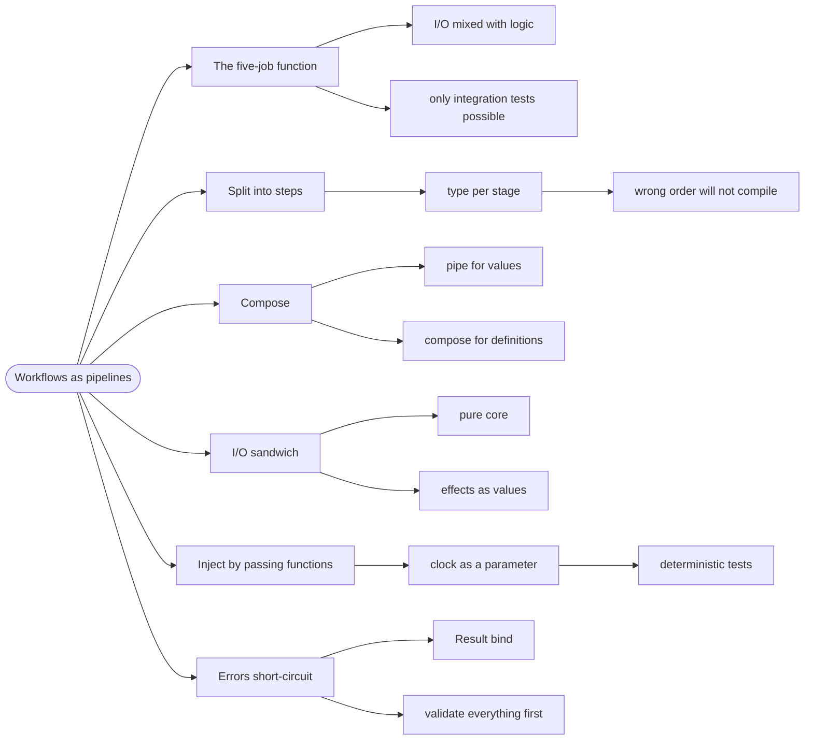

# Workflows as Pipelines — The I/O Sandwich

> Source: *Domain Modeling Made Functional* (Wlaschin) — ch 7 (Modeling
> Workflows as Pipelines), ch 8 (Understanding Functions), ch 9
> (Implementation: Composing a Pipeline).

A **workflow** is a business process expressed as a pipeline of small
functions. The pattern DMMF teaches: keep the pipeline **pure** — no
database, no clock, no randomness — and push all I/O to the two ends, like
bread around a filling.

## The function that did five things

```fsharp
// ❌ untestable, unreadable, and impossible to reuse
let placeOrder (dto: OrderDto) =
    let conn = openConnection()                  // I/O
    let validated = validate dto                 // logic
    let now = System.DateTime.Now                // clock
    insertOrder conn validated now               // I/O
    sendEmail validated.CustomerEmail            // I/O
    conn.Close()
```

You cannot test this without a database, a clock you control, and a mail
server. Every test is an integration test. The business rules are in there
somewhere, tangled with transport.

## 1. Split the pipeline into steps

The same workflow, as a chain of typed steps:

```text
UnvalidatedOrder  →  ValidatedOrder  →  PricedOrder  →  AcknowledgedOrder
     validate          price            acknowledge
```

Each arrow is a function, and each stage's output type is the next stage's
input type. The types make the pipeline self-documenting — and they make
ordering mistakes compile errors, because you cannot pass a `PricedOrder`
to `validate`.

```fsharp
// ✅ each step is a small, pure, separately testable function
let validate : UnvalidatedOrder -> Result<ValidatedOrder, ValidationError> = ...
let price    : ValidatedOrder -> PricedOrder = ...
let acknowledge : PricedOrder -> AcknowledgedOrder = ...
```

## 2. Compose with `>>` or `|>`

```fsharp
// ✅ composition — a new function, no argument named
let placeOrder =
    validate
    >> Result.map price
    >> Result.map acknowledge
```

`>>` is **composition**: `f >> g` is "do `f`, then `g`". The result is a
function you can name, test, and pass around. `|>` is the same idea applied
to a *value*: `x |> f` is `f x`.

The rule: use `|>` when you have a value in hand, `>>` when you are
*defining* the pipeline.

## 3. The I/O sandwich

Pure logic in the middle; effects at the edges:

```text
┌─────────────────────────────────────────────┐
│  I/O edge: read DTO, load state, save, send │
│  ┌───────────────────────────────────────┐  │
│  │  Pure core: validate → price → ack    │  │
│  └───────────────────────────────────────┘  │
│  I/O edge: persist result, publish event    │
└─────────────────────────────────────────────┘
```

Two rules follow, and they are what make the whole thing testable:

- **No I/O inside a step.** No DB, no `DateTime.Now`, no `Random`. Anything
  you need from the outside is **passed in** as a parameter.
- **Effects are values.** A step that needs to send an email returns a
  *description* of the email (`EmailMessage`), and the edge sends it. This
  is DMMF's approach and it is what makes the core pure.

```fsharp
// ✅ the workflow returns what should happen; the edge does it
type PlaceOrderResult =
    { Order: PricedOrder
      Acknowledgement: EmailMessage }     // a value, not a side effect
```

## 4. Dependency injection without a container

Once I/O is at the edges, "injecting dependencies" is just **passing
functions**:

```fsharp
// ✅ the clock is a parameter, not a call
let placeOrder (getTime: unit -> DateTime) (dto: UnvalidatedOrder) = ...
```

That single change makes time-dependent tests trivial: pass `fun () ->
DateTime(2026, 1, 1)` and the test is deterministic forever.

The same trick covers repositories, id generators, and loggers — each
becomes a function parameter. No interface, no container, no mock framework.

## 5. Errors short-circuit the pipeline

A pipeline with `Result` stops at the first failure:

```fsharp
// ✅ validation failure skips the rest — no nested ifs
let processOrder =
    validate
    >> Result.bind price
    >> Result.bind acknowledge
```

`Result.bind` is "continue only on success". The happy path reads
top-to-bottom, and every failure is in the type. See
[errors-and-result](../errors-and-result/index.md).

The design decision: **validate everything at the start and collect all
errors**, then run the pipeline. Users want the full list, not one at a
time.

## 6. Why this shape wins

| Property | Why it follows |
| --- | --- |
| **Testable** | pure steps, no mocks |
| **Readable** | the type chain is the process diagram |
| **Reusable** | small steps compose into other workflows |
| **Refactorable** | a step can be replaced if its types match |
| **Documented** | the types name the domain stages |

The cost: more types, and more ceremony at the edges. DMMF is explicit that
this is a trade — for any workflow with real business rules, it pays.

## Revise



## Cross-links

- Composing the steps: [functions-and-composition](../functions-and-composition/index.md).
- The error type that makes it work:
  [errors-and-result](../errors-and-result/index.md).
- Validating at the edge: [integrity-and-invariants](../integrity-and-invariants/index.md).
- The architecture this belongs to:
  [domain-driven-design](../domain-driven-design/index.md).
